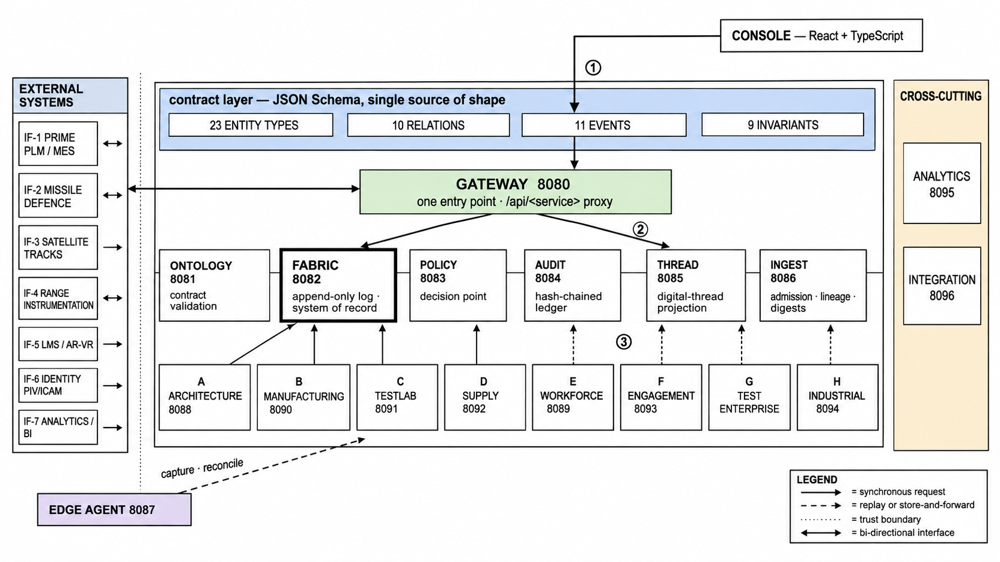

# NGSH — Next-Generation Scaled Hypersonics

**The digital lab for designing hypersonics.**

## Abstract

NGSH is a software platform for the hypersonic enterprise. It provides one
append-only record for every authoritative fact a programme produces — design
baselines, manufacturing runs, material lots, test results, suppliers, workforce
credentials and threat models — and derives every view from that record. The
digital thread, the search index, the dataset catalogue and the programme KPIs are
projections, rebuildable at any time.

The platform serves both halves of the mission on one substrate. The strike side
(design, manufacture, test, industrial scaling) and the shield side
(counter-hypersonic threat modelling, kill chains, engagement simulation) share the
same types and the same log, because they fail for the same reasons.

This document states the problem, proposes the solution, describes how the platform
works, sets out its scope and limits, and defines how a programme verifies it.

**Proprietary and confidential software of Crocell Company.** See [§15 Licence](#15-licence).

---

## 1. Executive summary

Hypersonic programmes do not usually fail on physics. They fail at the seams
between organisations and tools: the analysed design is not the built configuration,
the requirement marked verified is supported by evidence that no longer applies, and
a single-source material becomes the critical path during a shortage. These are data
problems before they are engineering problems.

NGSH addresses that class of failure directly. It is not a CAD package, a PLM
system, a manufacturing execution system or a solver. It is the connective layer
that sits across them and makes their outputs traceable, comparable and hard to
falsify.

The proposal rests on five commitments:

| Commitment | Consequence |
|---|---|
| One immutable record | History is auditable by construction, not by discipline |
| Derived views | A corrupted projection is an inconvenience, not a data loss |
| Contracts as data | Eight teams share shapes without drifting |
| Fail-closed access | The weakest service cannot weaken the programme |
| Refusal to invent | Missing evidence produces a named gap, never a plausible number |

The platform is implemented and running: **34 capabilities across 8 pillars, 7
external interfaces, 16 services, 466 tests and two live end-to-end
demonstrations.** What remains is programme-supplied: real counterpart systems,
classified data and authority to operate.

---

## 2. Problem statement

### 2.1 The seam problem

A hypersonic programme is a network of specialised organisations — primes,
material suppliers, national laboratories, test ranges, university partners and
government programme offices — each running its own tools and keeping its own
records. The gaps between them are where time and money are lost.

| Failure mode | Consequence |
|---|---|
| Design intent diverges from as-built configuration | Tests validate a vehicle that was never manufactured |
| Test evidence is filed per campaign, not per requirement | Verification status is asserted rather than demonstrated |
| Material and process history is incomplete | A defect cannot be traced to a lot, a run or a parameter |
| Supplier exposure is discovered during a shortage | Schedule slips before mitigation can begin |
| Models are used beyond their validated envelope | Decisions rest on unquantified error |
| Threat and interceptor models evolve separately | Red and blue do not measure the same threat |
| Access control is application-specific | Controlled data leaks across programme boundaries |
| Records can be edited after the fact | Audit and accreditation become an act of trust |

### 2.2 Why existing tools do not close it

Each tool in the chain is individually competent and structurally local. A PLM
system governs configuration but not test evidence. A test range governs its own
campaigns but not the requirements they satisfy. A supplier portal sees one tier.
None of them is designed to answer a cross-boundary question — *which configuration
was tested, which lot is in this part, can we build forty a year* — and each keeps a
private record that the others cannot verify.

The gap is not a missing feature. It is a missing **record**: one place where facts
from every tool and every organisation land in the same shape, under the same access
rules, with the same guarantees about immutability.

### 2.3 Why now

Three pressures make the seam problem urgent rather than theoretical. Programmes are
expected to compress design-to-test cycles, which removes the slack that used to
absorb reconciliation work. Industrial capacity is now a programme risk in its own
right, which requires evidence rather than assurance. And accreditation regimes
increasingly require demonstrable data integrity, not documented intent.

A platform that fixes the record once is cheaper than eight organisations fixing
their own records independently and then reconciling them forever.

---

## 3. Proposed solution

### 3.1 The concept

**One record. Every view derived. Every claim traceable.**

Every authoritative fact is an event: what happened, who did it, when, at what
classification, in which programme. Events are validated against a schema, appended
to a log, committed to a hash-chained ledger, and projected into the digital thread.

Nothing else is authoritative. The graph, the search index, the lakehouse catalogue
and the KPIs are functions of the log. They can be deleted and rebuilt, and the
platform proves this in its own test suite.

### 3.2 Operating principles

1. **The log is the system of record.** Read models are disposable; the log is not.
2. **Contracts are data, not code.** Shapes are JSON Schema; Python models are
   generated and drift fails the build.
3. **Evidence is immutable.** A correction supersedes; it never edits.
4. **Access fails closed.** Explicit deny wins, unmatched requests are denied,
   ambiguous classification is treated as more restricted.
5. **Derived values name their source.** Provenance, method and confidence are
   mandatory.
6. **The platform is portable.** No domain package imports a cloud SDK; placement is
   configuration, not code.

### 3.3 What the platform is, and is not

It is the connective layer, the record of evidence, and the governance around both.

It is not the weapon: no guidance, navigation, control or flight software. It is not
a modelling tool: it governs models, it does not run physics. It is not accredited,
and no configuration in the repository changes that.

---

## 4. How it works

### 4.1 Three layers

**The contract layer.** Twenty-three entity types, ten relation types, eleven event
types and nine cross-entity invariants, expressed as JSON Schema. This is the single
source of truth for shape. A contract change is reviewed before it is coded.

**The foundation.** Six services: ontology, fabric (the log), policy (the decision
point), audit (the ledger), thread (the projection) and ingest (admission, lineage
and content-addressed storage).

**The pillars.** Eight domains, each a set of pure rules in a shared library,
exposed by its own deployable service. A pillar writes facts as events and reads
them from the projection. Pillars can be deployed and licensed independently.



*Figure 1 — Layered architecture and integrated flows. Solid arrows are synchronous
requests, dashed arrows are replay or store-and-forward, and the dotted line is the
trust boundary. The numbered callouts mark the write path in §4.2.*

### 4.2 Write path

```
caller ─▶ gateway ─▶ service
                       ├─ resolve actor from the identity provider
                       ├─ ask the policy service for a decision
                       ├─ validate payload against the contract layer
                       ├─ apply domain rules (pure functions)
                       ├─ append event to the fabric
                       ├─ append ledger entry (hash chain)
                       └─ project event into the thread
```

The numbered callouts in Figure 1 trace this path from the console to the thread.

Two details are deliberate. The ledger entry and the access decision are both
written: an authorisation produces an `access.decision.recorded` event *and* a chain
entry, because a ledger nobody can query and a queryable history that can be
rewritten are both weaker than the pair. And derived reports are stored as
annotations on the entity they concern, so a surge assessment or a coverage report
rebuilds from the log like everything else.

### 4.3 Read path

```
console ─▶ gateway ─▶ thread ─▶ entities · relations · search · datasets
                                  ▲
                                  └── replay from fabric at any time
```

Reads never touch private service state. Because the projection is a pure function
of the log, destroying it is safe — and tested.

### 4.4 Access and audit

The policy service decides; services enforce. Four rules are absolute: explicit deny
wins, unmatched means denied, ambiguity fails closed, and citizenship plus clearance
are checked at the point of use.

The ledger is a hash chain. Each entry commits to its predecessor, so an edit breaks
the chain and the verifier reports where. Verification is an endpoint, not a promise.

### 4.5 Determinism

Monte Carlo draws are hash-derived, not random. Reconciliation, variant generation
and threat derivation are deterministic. The same inputs produce the same answer
years later, which is what makes a result reviewable and a rebuild a proof.

---

## 5. Scope

### 5.1 Eight pillars, 34 capabilities

| Pillar | Services | Capabilities |
|---|---|---|
| **A** — design and the thread core | architecture | A-1 Baselines · A-2 Modularity · A-3 Requirement traceability · A-4 Technology insertion · A-5 SysML and ICD exchange |
| **B** — manufacturing and materials | manufacturing, testlab | B-1 Defense MES · B-2 CMC characterisation · B-3 Test capability management · B-4 Rate and cost simulation |
| **C** — test and evaluation data | ingest, testlab | C-1 Test data lake · C-2 Anomaly detection · C-3 Twin validation loop · C-4 Campaign management |
| **D** — supply and scaling | supply | D-1 Multi-tier visibility · D-2 Foreign dependency mapping · D-3 Surge readiness twin |
| **E** — cleared workforce | workforce | E-1 Digital-twin training · E-2 Curriculum engine · E-3 Credentialing · E-4 Demand model · E-5 Industry-academia sandbox |
| **F** — counter-hypersonic engineering | engagement | F-1 Threat twins · F-2 Kill-chain simulator · F-3 Fire-control quality · F-4 Architecture workbench · F-5 Golden Dome readiness · F-6 Red/blue co-simulation |
| **G** — test enterprise | testlab, thread | G-1 Virtual test range · G-2 Campaign twin · G-3 Model validation · G-4 Fidelity registry |
| **H** — industrial surge | industrial | H-1 Surge command · H-2 Reconstitution planning · H-3 Affordability engineering |

Every capability has a tested endpoint. A unit test asserts that every path the
matrix advertises exists on the owning service's router.

### 5.2 The data model

**23 entity types** — `System`, `Variant`, `Subsystem`, `Part`, `Material`,
`ProcessPlan`, `ProcessRun`, `TestArticle`, `TestCampaign`, `TestResult`,
`Requirement`, `Interface`, `Model`, `ThreatSystem`, `ThreatObservation`,
`EngagementScenario`, `Supplier`, `PartProvenance`, `Skill`, `Credential`, `Person`,
`Facility`, `RangeSlot`.

**10 relations** — `satisfies`, `verifies`, `manufacturedBy`, `characterizedBy`,
`derivedFrom`, `threatens`, `engages`, `requiresSkill`, `supplies`, `reconstitutes`.

**11 events** — `entity.created`, `entity.updated`, `entity.relation.asserted`,
`entity.relation.retracted`, `test.campaign.planned`, `test.result.recorded`,
`process.run.completed`, `model.validated`, `ingest.batch.accepted`,
`access.decision.recorded`, `reconcile.conflict.recorded`.

**9 invariants**, enforced at write time unless noted:

| Id | Rule |
|---|---|
| C-001 | Classification may never fall below the type's floor |
| C-002 | Relations may not cross a classification boundary unless the type permits it |
| C-003 | Test results are immutable; corrections supersede |
| C-004 | A model in a safety-relevant prediction needs approval and a fidelity score |
| C-005 | A credential requires citizenship that permits the activity and a current clearance |
| C-006 | Every referenced person needs a current clearance record |
| C-007 | A critical single-source part needs a reconstitution path or is flagged as risk |
| C-008 | Engagement scenarios are unreadable below their classification |
| C-009 | Classification may not be lowered in place; a downgrade creates a new entity |

The count is kept small on purpose. Every type has to earn its place, and none of the
34 capabilities required inventing one to look complete.

### 5.3 Seven interfaces

| Id | Interface | Direction |
|---|---|---|
| IF-1 | Prime PLM and MES | bi-directional |
| IF-2 | Missile-defence systems | bi-directional |
| IF-3 | Satellite track feeds | inbound only |
| IF-4 | Range instrumentation | bi-directional |
| IF-5 | University LMS and AR/VR | outbound |
| IF-6 | Government identity (PIV/ICAM) | inbound |
| IF-7 | Analytics and BI | outbound |

Each boundary validates its payload, enforces its direction and returns a
content-addressed receipt, so retries are recognisable and duplicates detectable.
An adapter is a validated simulated counterpart; swapping in the real system changes
configuration, not the contract, the direction rule or the receipt shape.

---

## 6. Services

Every service has its own package, image, Compose entry and Helm block. A programme
can deploy Pillar B without Pillar F.

| Service | Port | Responsibility |
|---|---|---|
| gateway | 8080 | Single entry point: status, capability matrix, `/api/<service>/...` proxy |
| ontology | 8081 | The contract layer: types, relations, invariants, validation |
| fabric | 8082 | The append-only event log — system of record |
| policy | 8083 | The Policy Decision Point |
| audit | 8084 | The hash-chained ledger |
| thread | 8085 | Digital-thread projection, traversal, search, datasets |
| ingest | 8086 | Batch admission, lineage, content-addressed objects |
| edge-agent | 8087 | Degraded capture, local reads, deterministic reconciliation |
| architecture | 8088 | Baselines, interfaces, requirement traceability, SysML and ICD exchange |
| workforce | 8089 | Skills, credentials, work authorisation, workforce gap |
| manufacturing | 8090 | Travellers, process runs, genealogy, drift, production rate |
| testlab | 8091 | Campaigns, results, anomalies, twin loop, ranges, fidelity |
| supply | 8092 | Single-source exposure, reconstitution, surge |
| engagement | 8093 | Threats, scenarios, engagement batches, co-simulation |
| industrial | 8094 | Verified surge, measured reconstitution, affordability |
| analytics | 8095 | Programme KPIs from the thread |
| integration | 8096 | Interface register, direction enforcement, delivery records |

Every service exposes `/healthz`, `/readyz`, `/v1/service/info` and OpenAPI at
`/docs`.

A domain rule is a pure function in `libs/ngsh-core`; the service is transport and
persistence around it. Unit tests cover rules, HTTP tests cover transport.

---

## 7. Implementation approach

### 7.1 Delivery model

The build is ordered by dependency, not by enthusiasm.

1. **Foundation first.** Contracts, log, policy, ledger, projection. These cannot be
   retrofitted once pillars depend on them.
2. **Pillars independently.** Each pillar is deployable on its own, against the
   foundation. A programme can start with the pillar that carries its most painful
   seam.
3. **Interfaces last, and honestly.** Adapters are validated and deterministic.
   Certification of the counterpart is a programme activity, not a code activity.

### 7.2 Adoption path

| Phase | Activity | Exit condition |
|---|---|---|
| Assess | Run the stack, walk the capability sweep, map the programme's seams | A shortlist of one or two pillars that carry real pain |
| Pilot | Load one programme's real data through the contracts; connect one interface | Evidence trail for one requirement set, end to end |
| Extend | Add pillars and interfaces against the same foundation | Independent deploys, shared contract layer |
| Operate | Hand over to an accredited enclave with real identity and storage | Authority to operate |

Nothing in phases two to four requires a change to the contract layer. That is the
test of whether the boundary was drawn correctly.

### 7.3 Integration approach

External systems connect through the interface boundary, not through shared tables.
A source system publishes events or submits validated payloads; the platform returns
a receipt. This keeps the source's internal model private and makes the integration
replaceable.

### 7.4 What a programme provides

Real identity federation, counterpart endpoints and credentials, classified data,
range access, an accredited enclave, and authority to operate. None of these is a
software deliverable, and none is simulated silently.

---

## 8. Security and governance

| Concern | Handling |
|---|---|
| Access | ABAC; decision separate from enforcement; explicit deny; unmatched denied; fail closed |
| Audit | Hash chain; every decision is both a ledger entry and an event |
| Classification | Partitioned storage; cross-boundary refusal; ambiguous input treated as more restricted |
| Identity | Verified actor per request; production provider fails closed without live endpoints |
| Models | Model card, fidelity score and named approval before use; regeneration never self-approves |
| Evidence | Append-only; corrections supersede with a reference to the original |
| Edge | Degraded capture, deterministic reconciliation, human escalation on genuine conflict |
| Portability | No cloud SDK in any domain package |

The system is designed to be accreditable. It is not accredited.

---

## 9. Verification and evidence

| Gate | Command | Result |
|---|---|---|
| Lint and format | `make lint` | Clean |
| Contracts | `make contracts` | 279 checks |
| Generated models | `make codegen-check` | No drift |
| Tests | `make test` | 466 passing |
| Everything | `make verify` | All gates |
| Live sweep | `make dev` + `make demo-full` | 34/34 capabilities, 7/7 interfaces, 15 services |

`demo-full` is a completeness gate: it exits non-zero if any capability or interface
is missing.

```
Complete-build traversal finished: 34/34 capabilities, 7/7 interfaces, 15 services.
```

The end-to-end suite ingests data, projects it, traces it, takes a policy decision,
verifies the audit chain, destroys the projection, rebuilds it from the log alone,
and asserts the thread returns identical. That single test is the platform claim.

### Running it

Requires Python 3.12+ and `uv`. Docker is optional.

```bash
make setup          # install, create ./data
make verify         # all gates
make dev            # start the platform
```

In a second terminal:

```bash
make demo            # the foundation, end to end
make demo-programme  # all eight pillars in one thread traversal
make demo-full       # 34 capabilities and 7 interfaces through the gateway
make demo-edge       # the edge capture and reconciliation flow
```

| Surface | URL |
|---|---|
| Gateway | http://localhost:8080 |
| Platform status | http://localhost:8080/v1/platform/status |
| API documentation | http://localhost:8080/docs |
| Console | http://localhost:5173 |

Keep state out of the tree with
`NGSH_DSN="sqlite:////tmp/ngsh.db" NGSH_DATA_DIR=/tmp/ngsh-data make dev`.

---

## 10. Deployment

The same images run in four postures, chosen by configuration.

| Profile | Posture |
|---|---|
| `local` | Single process, SQLite, development actor |
| `il5` | Accredited cloud enclave, PostgreSQL, HA, real identity |
| `il6` | On-prem classified node, anti-affinity, no public ingress |
| `edge` | Factory floor or range annex, single replica, store-and-forward |

```bash
docker compose -f deploy/compose/docker-compose.yml up -d --build
helm lint deploy/helm/ngsh
```

No domain package knows which posture it is running in. Placement belongs to the
programme, not to an import statement.

---

## 11. Risks and mitigations

| Risk | Mitigation |
|---|---|
| Counterpart systems take longer to certify than expected | Interfaces are replaceable; a simulated adapter exercises the full path meanwhile |
| Source data is poorer than assumed | Contracts reject malformed records at admission, so gaps surface early and visibly |
| Accreditation is treated as a documentation exercise | Ledger, partitioning and fail-closed defaults are implemented, not described |
| Adoption stalls because the record is seen as another silo | One log, one contract layer, and reads through the thread; no second source of truth to reconcile |
| Model credibility is assumed rather than demonstrated | Fidelity and approval are prerequisites for use, enforced by invariant |
| A pillar is licensed and the shared layer is under-resourced | The foundation is deliberately small and boring, and is the same for every pillar |
| Classification handling is inconsistent across partners | Partitioning is enforced below the application and cross-boundary relations are refused |

---

## 12. Benefits

- **Traceability becomes a query.** Configuration, provenance, verification and cost
  are derived from one record rather than reconstructed per question.
- **Verification is demonstrable.** A requirement is verified by reviewed evidence
  attached to a baselined configuration, not by a status field.
- **Audit is evidence.** A hash chain and an immutable log turn accreditation from a
  narrative into a check.
- **Industrial risk is visible early.** Single-source exposure and surge capacity are
  computed from supplier and facility facts.
- **Model credibility is enforced.** A model without a fidelity score cannot quietly
  become the basis of a decision.
- **Comparisons are legitimate.** Red and blue resolve to the same threat node, or
  the comparison is refused.
- **Deployment fits the programme.** One platform, four postures, no cloud lock-in.

---

## 13. Commercial model

The platform is proprietary to Crocell Company and licensed per pillar. A licensed
pillar receives the contract layer, the foundation services it depends on and its own
projections. It reaches upstream data through the event feed, not through a shared
table, so licensing one pillar does not require licensing the others.

Evaluation access is granted for a defined purpose and is revocable. Production use
requires a signed agreement. The full terms, including restriction, export control,
warranty and liability provisions, are in the `LICENSE` file.

---

## 14. Next steps

1. **Run it.** `make setup && make verify && make dev`, then `make demo-full` in a
   second terminal.
2. **Pick the seam.** Identify the pillar whose failure mode is currently most
   expensive.
3. **Load real data.** One requirement set, one article, one campaign, through the
   contracts.
4. **Connect one interface.** Validate an adapter against a real counterpart.
5. **Define the accreditation path.** Enclave, identity federation, storage and
   authority to operate.

---

## 15. Licence

Proprietary and confidential software of **Crocell Company**.
Copyright © 2026 Crocell Company. All rights reserved.

No licence, express or implied, is granted except by a separate written agreement
signed by an authorised representative of Crocell. Access does not confer any right
to copy, modify, distribute, sublicense or commercially exploit the software. A
limited, revocable right to view and evaluate applies only where Crocell has granted
access for that purpose.

The software may be subject to U.S. export control law, including ITAR and the EAR.
It must not be exported, re-exported or released to any prohibited destination,
entity or person, or to any person other than a U.S. person where an authorisation is
required.

Third-party open-source components remain governed by their own licences. Full terms,
including warranty and liability, are in the `LICENSE` file.

Licensing enquiries: Crocell Company, Legal Department.

---

*Classification handling: CUI. The system described is designed for accredited
enclave operation.*
