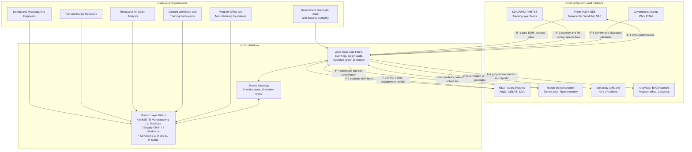

# NGSH System Context

## Purpose

This document establishes what NGSH is, for whom, and in relation to the systems it does not replace. It is the entry point for an engineer, a programme manager, a prime partner or an assessor who needs the shape of the platform before any detail. It covers the two mission sides NGSH serves, the argument for a shared ontology, the external actors and the seven external interfaces defined in PSDD §7, and the architectural invariants that constrain everything downstream. Detail on the ontology, the services, the security posture and the deployment topology lives in the sibling documents.

## Contents

1. [What NGSH is](#1-what-ngsh-is)
2. [The two mission sides](#2-the-two-mission-sides)
3. [The shared-ontology argument](#3-the-shared-ontology-argument)
4. [System context diagram](#4-system-context-diagram)
5. [External actors](#5-external-actors)
6. [External interfaces IF-1 to IF-7](#6-external-interfaces-if-1-to-if-7)
7. [Scope boundaries](#7-scope-boundaries)
8. [Architectural invariants](#8-architectural-invariants)
9. [How the context maps onto the ADRs](#9-how-the-context-maps-onto-the-adrs)
10. [References](#10-references)

## 1. What NGSH is

NGSH is a dual-mission software platform: the digital engineering, test and industrial-readiness environment for the hypersonic enterprise (PSDD §1). It is not a weapon, not a flight-control system, and not a command-and-control system. It is the environment in which a hypersonic vehicle is designed, manufactured, tested, verified and costed, and in which a counter-hypersonic kill chain is designed, simulated and evaluated.

Three properties define the platform's identity.

| Property | Statement | Consequence |
|---|---|---|
| **One ontology, two missions** | A single shared ontology links parts, processes, tests, threats and people (PSDD §4.1) | The strike side and the shield side are not two products sharing a database; they are two uses of one model |
| **Complement, never replace** | NGSH integrates with prime PLM/MES, BMC3, MDA/Aegis and SDA systems; it does not replace them (PSDD §4.2 principle 2, §3.2) | NGSH must have a credible open-API posture and a real partner posture, not a rip-and-replace posture |
| **The data fabric is the product** | The ontology, event log, policy, audit and projection layers are built before any pillar (see [`../roadmap/increments.md`](../roadmap/increments.md), Increment 0) | A pillar that arrives later plugs into a fabric that already exists, rather than building its own |

## 2. The two mission sides

### 2.1 Strike side — digital thread and manufacturing

The strike side is the model-based systems engineering, digital-thread manufacturing, CMC process intelligence and production surge readiness for hypersonic weapon systems. It is aligned to SHY, NSWC Crane 26-07, DASH-MOT and HAMTC (PSDD §1, §11).

| Concern | NGSH contribution | Pillar |
|---|---|---|
| Digital thread | One configuration baseline across payload, booster, GNC, airframe and thermal protection | A-1 |
| Family of systems | Library-based modularity; variants generated from a common core | A-2 |
| Verification | End-to-end requirement-to-test traceability with automated coverage | A-3 |
| Technology insertion | TRL/SRL mapping against production slots | A-4 |
| Defence MES | Work instructions, travellers, nonconformance and genealogy tuned to low-rate, high-complexity production | B-1 |
| Materials process intelligence | Process parameters → microstructure → test results; drift detection before scrap | B-2 |
| Test data | Ground, tunnel, sled and flight data with full configuration context | C-1, C-2 |
| Industrial base | Multi-tier visibility, foreign dependency mapping, surge readiness twin | D-1, D-2, D-3 |
| Workforce | Cleared-workforce pipeline of record | E-1..E-5 |
| Affordability | Cost traced from the earliest design decision | H-3 |

### 2.2 Shield side — kill-chain engineering

The shield side is counter-hypersonic kill-chain engineering, threat digital twins and a virtual test enterprise. It is aligned to MDA Project Maverick, GPI, HBTSS/PWSA and the Golden Dome reference architecture (PSDD §1, §11).

| Concern | NGSH contribution | Pillar |
|---|---|---|
| Threat reconstruction | Configurable HGV/HCM/boost-glide models rebuilt from intelligence, telemetry and range observation; versioned and confidence-scored | F-1 |
| Kill-chain simulation | Detect → track → custody → engage end to end, with Monte Carlo engagement statistics | F-2 |
| Data-quality scoring | Continuous measurement of custody handover quality, track purity and fire-control solution error | F-3 |
| Interim architecture | Composing sensors and offboard cueing into candidate solutions, validated virtually before flight test | F-4 |
| Reference architecture | A plug-in framework for the homeland missile-defense shield | F-5 |
| Honest balance | Red/blue co-simulation of strike and defence performance against identical threat models | F-6 |
| Virtual range | Cloud-federated ground, tunnel, sled and flight data with physics M&S | G-1 |
| Range economics | Range capacity, telemetry coverage and instrumentation availability modelled and optimised | G-2 |
| Test-coupled M&S | Every test result scores model fidelity and regenerates aero/thermal/plasma models | G-3, G-4 |

### 2.3 The shared substrate

Eight pillars do not share a runtime. They share an ontology, a data fabric and a set of contracts. The substrate is what makes the two sides one platform rather than two:

| Foundation element | Provides | ADR |
|---|---|---|
| Event log | The system of record; every fact is an append | [ADR-0001](../adr/ADR-0001-event-sourced-foundation.md) |
| Contract layer | The only cross-language and cross-partner coupling | [ADR-0002](../adr/ADR-0002-json-schema-contracts-over-shared-libraries.md) |
| Deployment abstraction | Three zones from one codebase | [ADR-0003](../adr/ADR-0003-platform-agnostic-hybrid-deployment.md) |
| Policy decision point | One rule, enforced at many points | [ADR-0004](../adr/ADR-0004-abac-with-pdp-pep-separation.md) |
| Audit ledger | Independent, tamper-evident forensic record | [ADR-0005](../adr/ADR-0005-tamper-evident-audit-ledger.md) |
| Reconciliation | Deterministic merge of disconnected edge operation | [ADR-0006](../adr/ADR-0006-edge-degraded-mode-and-reconciliation.md) |
| Partitioning | Physical confidentiality boundaries | [ADR-0007](../adr/ADR-0007-classification-partitioning.md) |
| Model governance | Provenance, fidelity, applicability and approval | [ADR-0008](../adr/ADR-0008-model-card-and-fidelity-registry.md) |

## 3. The shared-ontology argument

PSDD §4.1 states the architectural insight directly: *"The digital thread that traces a U.S. CMC part from powder to flight also traces an adversary threat from observation to engagement solution. One ontology, two mission sides."*

The argument is worth stating precisely, because it is the platform's central bet and it is frequently asserted without justification.

**The claim.** The set of concepts required to answer the strike-side question *"is this flight article flight-ready, and if not, why not?"* and the shield-side question *"if this adversary trajectory is observed, can we detect, track, custody and engage it, and how confident are we?"* are the same set of concepts: an entity with a configuration, a provenance chain, a set of tests, a set of models, and a set of people who are qualified to work on it.

| Shared concept | Strike-side instance | Shield-side instance | Ontology type |
|---|---|---|---|
| An article with a configuration and a revision | A CMC nose cap, revision C | An HGV trajectory reconstruction, version 4 | `Part` / `Variant` / `ThreatSystem` |
| An input with a lot and a certificate | A prepreg batch with a cure cycle | A sensor observation with a track quality | `Material` / `ThreatObservation` |
| A qualified recipe | An autoclave cycle for the nose cap | A tracking filter tuned for a manoeuvre regime | `ProcessPlan` / `Model` |
| An execution of that recipe | A specific cure cycle on a specific lot | A specific tracking run on a specific observation | `ProcessRun` / `Model` |
| A test with a defined method and outcome | A coupon tensile test, or a tunnel run | An engagement trial, or a hand-off rehearsal | `TestResult` |
| A credible model with a validity regime | An aero/thermal model of the vehicle | A threat kinematic model | `Model` with `FidelityScore` |
| A declared requirement and its verification | "TPS survives 45 minutes at 1,800 K" | "Custody handed over within 30 s of detection" | `Requirement` |
| A qualified person | An autoclave operator with a current credential | A range safety officer | `Person` / `Credential` / `Skill` |

**Why this is not a coincidence of vocabulary.** Two structural facts make the shared ontology load-bearing rather than merely convenient:

1. **Traceability is the same mechanism.** The strike side needs "which lot of powder is in this flight article, and which test proves it". The shield side needs "which observation produced this threat model, and which simulation exercises it". Both are answered by the same relation set — `satisfies`, `verifies`, `characterizedBy`, `derivedFrom` — over the same node types. Building two ontologies means building two traceability engines, two lineage engines and two audit models, and reconciling them at every exchange.
2. **Trust is the same mechanism.** Both sides need to know how much to believe a record: where it came from, who approved it, how current it is, and what it was validated against. That is `Provenance` plus `FidelityScore` plus the approval trail, and it is a platform-wide concern. PSDD §8 makes it an explicit non-functional requirement: *"Every model version, test result, and access decision reconstructable."*

**Where the ontology must not be flattened.** One ontology does not mean one vocabulary of business meaning. The shared types carry shared *structure* (identity, configuration, provenance, classification, traceability) while domain-specific attributes live in `attributes`. A `TestResult` is the same node whether it holds a wind-tunnel run or a flight campaign outcome, but the *meaning* of `outcome` in a given context is a domain decision. The platform provides the structure; the pillars own the semantics. This is why the ontology is defined in JSON Schema with `attributes` free-form and a registry of type metadata, rather than as a monolithic domain model.

The full type inventory, the relation set, the constraint catalogue and worked trace paths are in [`02-ontology-model.md`](02-ontology-model.md).

## 4. System context diagram

**Reading the diagram.** NGSH is drawn as a platform that *absorbs* data from external systems and *publishes* to them, with the ontology and the fabric as the mediating layer. The seven external interfaces (IF-1 to IF-7) are the only sanctioned points of contact. Everything else — the graph, the lakehouse, the vector index, the time-series store — is internal.

## 5. External actors

| Actor | Relationship to NGSH | Primary interfaces | What they need | What constrains us |
|---|---|---|---|---|
| **Design and manufacturing engineers** (structures, aero, GNC, materials, process) | Primary authors of strike-side data | Console, APIs; IF-1 for PLM/MES | Configuration control, traceability, defect and nonconformance workflows, cost visibility | Their time is the scarcest input in the programme; any workflow that adds a step will be worked around |
| **Test and range operators** | Produce the evidence the platform exists to make valuable | IF-4 instrumentation, edge console | Simple capture, works offline, no re-keying, confidence the data will be accepted | Operate in poor connectivity and under time pressure; the degraded-mode design ([ADR-0006](../adr/ADR-0006-edge-degraded-mode-and-reconciliation.md)) is built around their working conditions |
| **Threat and kill-chain analysts** (shield side) | Produce threat reconstructions and engagement analyses | Console, APIs; IF-2, IF-3 | Versioned threat models, confidence intervals, reproducible Monte Carlo, defensible assumptions | Work with the most classified content in the platform; their data is what forces P-R and P-S partitions ([ADR-0007](../adr/ADR-0007-classification-partitioning.md)) |
| **Cleared workforce and training participants** (Pillar E) | Consume curriculum; hold credentials | IF-5 to academic LMS and AR/VR clients; credential APIs | Portable, deployable courseware; credentials that are recognised at a real work site | Cannot hold classified content in an academic environment; everything they receive passes the sanitized-extract guard |
| **Program office executives and manufacturing leadership** | Consume metrics; make surge and affordability decisions | IF-7 BI; console | Verified surge rate, cost-per-effect trajectory, time-to-reconstitute, cleared-skills gap by region and trade | They will ask for a number; the platform must be able to state the number's provenance and its uncertainty, or the number is worthless |
| **Manufacturing and supply-chain partners, including primes** | Provide and consume part, BOM and process data | IF-1 | A clean integration that does not require replacing their PLM/MES | They are competitors for data authority as well as partners; PSDD §13 identifies "prime data-sharing resistance" as a programme risk |
| **MDA, SDA and DoD sponsors** | Consume scenarios, readiness assessments and kill-chain evidence | IF-2, IF-3, IF-7 | Defensible, reproducible analysis | Explicit non-replacement posture for BMC3 is a condition of their engagement (PSDD §3.2, §7, §13) |
| **Government oversight, audit and security authority** | Verify compliance and manage accreditation | Audit ledger read; verification reports; IF-6 | Reconstructable access trails, verifiable anchors, evidence of separation of duties | The audit ledger ([ADR-0005](../adr/ADR-0005-tamper-evident-audit-ledger.md)) exists for this audience specifically |
| **Academic and industry sandbox partners** | Replicate manufacturing scenarios in sanitized environments | IF-5 only | Realistic, unclassified, deployable environments | One-way data flow is non-negotiable; the guard pipeline is the control |
| **Regulators and export-control authorities** | Determine ITAR/EAR and workforce handling | Audit and lineage evidence | Evidence of partitioning, citizenship gating and programme protection artefacts | The platform's own development must meet CMMC L2+ with SBOM (PSDD §10) |

## 6. External interfaces IF-1 to IF-7

| ID | Interface | Direction | Purpose (PSDD §7) | Contract mechanism | Classification expectation |
|---|---|---|---|---|---|
| **IF-1** | Prime PLM/MES APIs | Bi-directional | Sync part, BOM and process data (Teamcenter / Windchill / SAP-class) | `entity.created` / `entity.updated` for `Part`, `Material`, `ProcessPlan`; `entity.relation.asserted` for `manufacturedBy`, `supplies` | CUI, with ITAR/EAR flags on `Part.exportControlled` and `Supplier.exportControlled` |
| **IF-2** | MDA / Aegis systems | In (data), Out (scenarios) | Threat tracks, engagement results in; scenario definitions out for BMC3 test | `entity.created` for `ThreatSystem`, `ThreatObservation`, `EngagementScenario`; `entity.relation.asserted` for `engages`, `threatens` | RESTRICTED floor per the registry — the P-R partition |
| **IF-3** | SDA PWSA / HBTSS data feeds | In | Tracking-layer custody and fire-control data quality ingestion | `entity.created` / `entity.updated` for `EngagementScenario` and related `Model`; quality metrics into the time-series store | RESTRICTED; fire-control solution error data is among the most sensitive content in the platform |
| **IF-4** | Range instrumentation | Bi-directional | Test article manifests, telemetry and schedules | `ingest.batch.accepted` with `format` covering CSV/NDJSON/JSON/PARQUET/HDF5/NETCDF/BINARY; `test.campaign.planned` out for slot and instrumentation coordination | CUI at the range; may be higher — the ingest path classifies before placement |
| **IF-5** | University LMS / AR-VR clients | Out | Curriculum packages and training environments | `entity.created` for `Skill`, `Credential`, `Course` objects; sanitized extract manifests; delivered as P-U artifacts only | UNCLASSIFIED by construction; anything classified never leaves through this interface |
| **IF-6** | Government identity (PIV / ICAM) | In | Authentication and clearance verification | OIDC/OAuth 2.0 profile; attributes populate `Actor.clearance`, `Actor.citizenship`, `Actor.programs` | The identity attributes themselves are CUI and are subject to strict retention (the `Person` and `Credential` types are the two `pii: true` types in the registry) |
| **IF-7** | Analytics / BI | Out | Program-office dashboards and Congressional reporting metrics | Read-only, PEP-governed API and export gateway; aggregated views only | The output is classified no higher than the highest input it aggregates — a computed aggregate inherits its inputs' ceiling |

**Interface posture.** The contracts in `contracts/` are the integration surface. A partner integrating with NGSH implements the JSON Schema contract and consumes the event feed; no NGSH runtime library is required, which is what makes academic and prime integration tractable ([ADR-0002](../adr/ADR-0002-json-schema-contracts-over-shared-libraries.md)).

## 7. Scope boundaries

PSDD §3.2 excludes three things explicitly. They are the boundary of the platform and are worth restating because scope creep against them is the most common way a dual-mission platform loses focus.

| Out of scope (PSDD §3.2) | What NGSH does instead | Why this matters for the architecture |
|---|---|---|
| BMC3 / C2 software that replaces fielded systems | NGSH **tests and integrates with** BMC3. Scenario definitions flow out through IF-2 for BMC3 test | It is why IF-2 is a scenario interface and not a weapon interface, and why the console must never present a tactical picture |
| Weapon GNC or flight software | NGSH holds the *interface contracts* to GNC (`Interface` entities, `satisfies` edges) and the test evidence about them | It is why `Interface` is a first-class ontology type with an ICD version, and why `System.systemType` includes `GNC` as a *described* system rather than an implemented one |
| Hardware manufacturing | Manufacturing is a partner domain; NGSH holds the process data, the genealogy and the qualification evidence | It is why `Facility`, `Supplier` and `PartProvenance` exist as first-class types and why the MES (B-1) is process-intelligence rather than a machine-control system |

Three further boundaries are architectural rather than contractual:

| Boundary | Rule |
|---|---|
| NGSH does not adjudicate physical truth | Two sites disagreeing about a test result is escalated to a human ([ADR-0006](../adr/ADR-0006-edge-degraded-mode-and-reconciliation.md)); the platform never silently picks one |
| NGSH does not replace the authoritative system of record for a partner | NGSH is the integration and verification layer. Where a prime's PLM holds the authoritative part record, NGSH holds the trace and the evidence, and says which is authoritative |
| NGSH does not train models on data it is not cleared to hold | Model artefacts inherit the classification of their evidence set, and the training pipeline runs inside the partition where that evidence lives ([ADR-0007](../adr/ADR-0007-classification-partitioning.md), [ADR-0008](../adr/ADR-0008-model-card-and-fidelity-registry.md)) |

## 8. Architectural invariants

These invariants hold in every deployment profile, in every zone, at every increment. They are the statements that future features must not violate, and they are the acceptance criteria a new service or pillar is reviewed against.

| # | Invariant | Enforced by |
|---|---|---|
| I-1 | All state change enters through the event log. No service writes directly to a projection. | [ADR-0001](../adr/ADR-0001-event-sourced-foundation.md) — enforced by the fabric append path and the architectural dependency test |
| I-2 | Domain code contains no cloud SDK, no managed-service client and no environment sniffing. Behaviour varies only through a declared capability set. | [ADR-0003](../adr/ADR-0003-platform-agnostic-hybrid-deployment.md) — enforced by the CI dependency-boundary check |
| I-3 | Cross-language coupling is JSON Schema only. Generated codecs are the only permitted representation of a contract type. | [ADR-0002](../adr/ADR-0002-json-schema-contracts-over-shared-libraries.md) — enforced by the codegen staleness check |
| I-4 | Authorization is deny-by-default, decided by one PDP, enforced at every PEP, and every ALLOW carries obligations that are discharged. | [ADR-0004](../adr/ADR-0004-abac-with-pdp-pep-separation.md) — enforced at the PEP and by the storage-layer partitioning |
| I-5 | Storage is physically partitioned by classification level. A record's partition never changes. Downgrade is a new entity, never an in-place edit. | [ADR-0007](../adr/ADR-0007-classification-partitioning.md) — enforced by the append-path routing and the per-partition credentials |
| I-6 | The audit trail is written by a component that does not write business data, is hash-chained, and is anchored outside the NGSH boundary. | [ADR-0005](../adr/ADR-0005-tamper-evident-audit-ledger.md) — enforced by credential separation and the verification job |
| I-7 | Disconnected operation is a designed capability. Reconciliation is deterministic. Immutable evidence is escalated, never silently resolved. | [ADR-0006](../adr/ADR-0006-edge-degraded-mode-and-reconciliation.md) — enforced by the reconciliation rules and the CI fault-injection harness |
| I-8 | Every model carries provenance, a fidelity score with an applicability envelope, and an approval state. Out-of-envelope use is refused. | [ADR-0008](../adr/ADR-0008-model-card-and-fidelity-registry.md) — enforced by the model service and constraint C-004 |
| I-9 | Every pillar is independently deployable and licenseable. A pillar consumes contracts and events, never another pillar's store. | PSDD §8 Modularity — enforced by the subscription model in `contracts/events/catalog.json` |
| I-10 | Classification is resolved at ingestion, before placement, and defaults to the most restrictive partition when uncertain. | [ADR-0007](../adr/ADR-0007-classification-partitioning.md) — enforced by the ingest PEP |

## 9. How the context maps onto the ADRs

| Concern in this document | Where it is specified in detail |
|---|---|
| The 23 entity types and 10 relation types | [`02-ontology-model.md`](02-ontology-model.md) |
| Constraints C-001 to C-008 | [`02-ontology-model.md`](02-ontology-model.md) |
| The six foundation services and the ten event types | [`03-foundation-services.md`](03-foundation-services.md) |
| Zero trust, PDP/PEP topology, partitioning, accreditation boundaries | [`04-security-architecture.md`](04-security-architecture.md) |
| The three zones, the four deployment profiles, degraded mode | [`05-deployment-architecture.md`](05-deployment-architecture.md) |
| Increment sequencing and the foundation-first decision | [`../roadmap/increments.md`](../roadmap/increments.md) |
| Work-package breakdown and pod assignments | [`../roadmap/work-packages.md`](../roadmap/work-packages.md) |
| Pod model and reference organisations | [`../staffing.md`](../staffing.md) |
| Risks, including prime data-sharing resistance and the 2027 validation event | [`../risk-register.md`](../risk-register.md) |

## 10. References

**PSDD:** §1 (executive summary — dual-mission platform), §2.1 (problems P1–P7), §2.2 (mission need statement), §3.1 (in scope), §3.2 (out of scope), §4.1 (concept — two layers, one ontology, one data fabric), §4.2 (design principles), §5 (pillars A–H), §6.1 (core ontology), §6.2 (data stores), §6.3 (data governance), §7 (interface design IF-1..IF-7), §8 (non-functional requirements), §10 (security and compliance architecture), §11 (phasing), §12 (KPIs), §13 (risks), §14 (teaming strategy).

**Contracts:**
- `contracts/ontology/registry.json` — the entity/relation registry and constraints C-001..C-008.
- `contracts/ontology/entities.schema.json` — the 23 entity types.
- `contracts/ontology/relations.schema.json` — the 10 relation types.
- `contracts/events/catalog.json` — the ten event types and the `subscriptionGroups` that implement invariant I-9.
- `contracts/events/event-envelope.schema.json` — the envelope every record carries.

**ADRs:** all eight in [`../adr/`](../adr/README.md).
