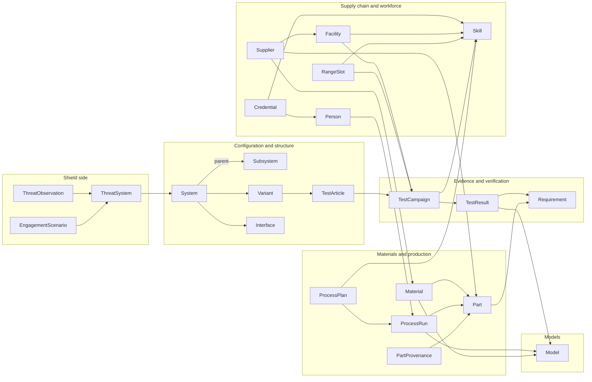

# NGSH Shared Ontology Model

## Purpose

This document specifies the NGSH shared ontology: the 23 entity types and 10 relation types defined in `contracts/ontology/registry.json` and `contracts/ontology/entities.schema.json`, the eight cross-cutting constraints C-001 to C-008, the change-control path for introducing a new type, and three worked trace paths that show the ontology serving both mission sides. It is the reference for engineers who will extend the ontology, for partners who will integrate against it, and for assessors who will review how data lineage and classification are constrained.

## Contents

1. [Design rules](#1-design-rules)
2. [Entity types](#2-entity-types)
3. [Relation types](#3-relation-types)
4. [Constraint catalogue C-001 to C-008](#4-constraint-catalogue-c-001-to-c-008)
5. [Entity and relation diagram](#5-entity-and-relation-diagram)
6. [How one ontology serves both mission sides](#6-how-one-ontology-serves-both-mission-sides)
7. [Introducing a new entity or relation type](#7-introducing-a-new-entity-or-relation-type)
8. [Worked trace path 1 — CMC nozzle qualification](#8-worked-trace-path-1--cmc-nozzle-qualification)
9. [Worked trace path 2 — requirement to test verification](#9-worked-trace-path-2--requirement-to-test-verification)
10. [Worked trace path 3 — threat observation to engagement scenario](#10-worked-trace-path-3--threat-observation-to-engagement-scenario)
11. [Cross-cutting traversal rules](#11-cross-cutting-traversal-rules)
12. [References](#12-references)

## 1. Design rules

Five rules govern the shape of the ontology. They are stated here because every subsequent table is a consequence of them, and because any proposed new type must be checked against them.

| # | Rule | Consequence |
|---|---|---|
| DR-1 | **Shared header, domain body.** Every entity carries the same `EntityHeader` — id, type, tenant, program, version, classification, timestamps, actors, provenance, labels, annotations, `deleted` — and a type-specific `attributes` object. | Governance, classification, tenancy and lineage operate uniformly across all eight pillars. A new type gets all of it for free. |
| DR-2 | **Identity is typed and prefixed.** `EntityId` matches `^[A-Za-z0-9][A-Za-z0-9_.:-]{0,127}$` with the form `<TYPE_PREFIX>:<ULID or domain key>`. Each type has a registered `idPrefix`. | A reader can determine an entity's type from its identifier without a lookup. The registry is the authority for prefixes. |
| DR-3 | **Relations are first-class and classified.** A relation is an entity with its own id, classification, provenance, confidence, weight and a retraction lifecycle (`assertedAt`, `retractedAt`, `retractionReason`). | An assertion can be withdrawn without erasing history, and a relation can itself carry classification independent of its endpoints — which is what makes C-002 expressible. |
| DR-4 | **Immutability is a property of the type, not of the caller.** `TestResult` is immutable (C-003). Correction is a new entity with `supersedesRef`. | The digital thread's evidence base cannot be rewritten, because the platform itself refuses to allow it. |
| DR-5 | **Cross-pillar sharing is explicit.** Each type and relation declares its owning pillars. A type used by one pillar is that pillar's to evolve; a type used by several is changed only through the shared change-control path. | The ontology stays coherent without becoming a single team's private schema. |

## 2. Entity types

All 23 entity types, with their registered `idPrefix`, purpose, owning pillars and `classificationFloor`. The `pillars` column and the floor are taken verbatim from `contracts/ontology/registry.json`; the purpose column summarises the `$def` in `contracts/ontology/entities.schema.json`.

| # | Type | Prefix | Purpose | Owning pillars | Classification floor | PII |
|---|---|---|---|---|---|---|
| 1 | `System` | `SYS` | Any engineered system of interest, at any level of the digital thread. Carries `systemType` (HYPERSONIC_WEAPON, BOOSTER, PAYLOAD, GNC, AIRFRAME, TPS, SENSOR, EFFECTOR, C2, GROUND_SYSTEM, ENTERPRISE_SERVICE), `lifecycleState`, `parentSystemId`, `interfaceIds`, `costEstimate`, `platform`. | A, F, G, FOUNDATION | CUI | No |
| 2 | `Variant` | `VAR` | A configuration-specific instance of a `System`; the unit of family-of-systems generation (A-2). Carries `variantId`, `configurationVersion`, `distinguishingCharacteristics`, `familyId`. | A | CUI | No |
| 3 | `Subsystem` | `SUB` | Decomposition node beneath a `System`. Carries `parentSystemId`, `subsystemType`, `interfaceIds`, `maturity` (TRL_1..TRL_9). | A | CUI | No |
| 4 | `Part` | `PART` | A discrete hardware article. Carries `partNumber`, `partType` (CMC_NOSECAP, PREPREG, BILLET, STRUCTURAL, AVIONICS, PROPULSION, TPS, FASTENER, CONSUMABLE, OTHER), `revision`, `criticality`, `materialIds`, `isSingleSource`, `exportControlled`, `unitCost`, `processPlanIds`, `leadTimeDays`. | A, B, D, H | CUI | No |
| 5 | `Material` | `MAT` | CMC lot, prepreg batch or billet — the join point between strike-side materials and shield-side supply-chain risk. Carries `materialType`, `lotNumber`, `batchId`, `supplierId`, `processPlanIds`, `characterizationIds`, `certifications`, `microstructureSummary`, `receivedAt`. | B, D | CUI | No |
| 6 | `ProcessPlan` | `PP` | Qualified recipe for producing a `Part` from `Material`. Carries `processType` (FILM_LAMINATION, AUTOCLAVE, PYROLYSIS, HIP, MACHINING, COATING, BRAZE, NDT, ASSEMBLY, OTHER), `revision`, `operations[]` with `specLimits`, `requiredSkillIds` and `equipmentTags`, `qualificationStatus`, `qualifiedFacilityIds`. | B | CUI | No |
| 7 | `ProcessRun` | `PR` | A single execution of a `ProcessPlan` against a `Material` lot. Carries `processPlanId`, `materialId`, `partId`, `facilityId`, `measuredParameters`, `measuredSeries[]`, `operatorId`, `disposition` (ACCEPTED, REWORK, SCRAP, PENDING), `nonconformanceId`, `driftFlags[]`. | B | CUI | No |
| 8 | `TestArticle` | `TA` | As-built configuration subject to test. Carries `serialNumber`, `variantId`, `partIds[]`, `buildConfigurationId`, `asBuiltStatus` (AS_BUILT, AS_DESIGNED, DEVIATED), `deviations[]`. | B, C, G | CUI | No |
| 9 | `TestCampaign` | `TC` | A planned, coordinated body of tests against one or more articles. Carries `campaignType` (GROUND, WIND_TUNNEL, SLED, FLIGHT, ENGINE, MATERIAL_COUPOON, STRUCTURAL, QUALIFICATION), `status`, `objectives[]`, `requirementIds[]`, `testArticleIds[]`, `rangeSlotIds[]`, `instrumentationManifest[]`, `dataSetUris[]`. | C, G | CUI | No |
| 10 | `TestResult` | `TR` | Outcome of a test, with full configuration context. Carries `testMethod`, `outcome` (PASS, FAIL, MARGINAL, INCONCLUSIVE, NOT_RUN), `measurements[]`, `limits`, `configurationSnapshot`, `dataSetUris[]`, `modelVersionIds[]`, `baselineId`, `anomalyFlags[]`, `reviewedBy`. **Immutable once written (C-003).** | C, G, A | CUI | No |
| 11 | `Requirement` | `REQ` | A baselined engineering requirement; the root of the verification chain. Carries `statement`, `reqType`, `parentId`, `verificationMethod` (TEST, ANALYSIS, INSPECTION, DEMONSTRATION, CERTIFICATION, TOLERANCE), `status`, `verificationStatus`, `allocatedToIds[]`, `acceptanceCriteria`, `text`, `costDrivers[]`. | A, E, F | CUI | No |
| 12 | `Interface` | `IFC` | Controlled interface between two systems, versioned by ICD. Carries `name`, `fromSystemId`, `toSystemId`, `icdVersion`, `dataItems[]`, `characteristics` (rate, latency, timing, envelope). | A, F | CUI | No |
| 13 | `Model` | `MDL` | A simulation or ML model with provenance and a fidelity score (G-4). Carries `modelType` (AERODYNAMIC, THERMAL, STRUCTURAL, TRAJECTORY, GNC, THREAT_KINEMATIC, DETECTION, TRACKING, ENGAGEMENT, PRODUCTION_SURGE, SURROGATE_ML, OTHER), `modelVersion`, `parentModelId`, `fidelity` (`FidelityScore`), `codeRef`, `inputSchemaRef`, `outputSchemaRef`, `modelCard`, `runtime`, `approvedForUse`. | B, C, F, G, H | CUI | No |
| 14 | `ThreatSystem` | `THR` | An adversarial system reconstructed from observations; versioned and confidence-scored. Carries `designation`, `threatClass` (HGV, HGV_MANEUVERABLE, HCM, BOOST_GLIDE, BOOSTED_GLIDE, CRUISE_MISSILE, UNKNOWN), `kinematicProfile`, `characteristics[]`, `confidence`, `observationIds[]`, `modelVersionIds[]`. | F | RESTRICTED | No |
| 15 | `ThreatObservation` | `TOBS` | A single sensor observation of a threat system. Carries `observationTime`, `sensorIds[]`, `measurements[]`, `trackQuality`, `source`, `rawUri`, `sensorType` (SPACE_IR, SPACE_EO, GROUND_RADAR, AIRBORNE_IR, AEW, GROUND_EO, OTHER). | F | RESTRICTED | No |
| 16 | `EngagementScenario` | `ESC` | A composed detect-to-engage scenario for simulation and analysis. Carries `name`, `threatSystemIds[]`, `defensiveArchitecture`, `sensorChain[]`, `effectorChain[]`, `timeline`, `monteCarloConfig` (runs, seed, confidenceLevel), `resultsSummary`. | F | RESTRICTED | No |
| 17 | `Supplier` | `SUP` | An external or internal supply node, scored for risk and dependency. Carries `tier`, `riskScore`, `capabilities[]`, `certifications[]`, `leadTimeDays`, `dependencies[]`, `facilityIds[]`, `domesticContent`, `exportControlled`. | D, H | CUI | No |
| 18 | `PartProvenance` | `PROV` | Chain-of-custody record for a `Part` across facilities and transfers. Carries `partId`, `chainOfCustody[]` (fromNodeId, toNodeId, transferredAt, quantity, transferType, custodian), `materialIds[]`, `processRunIds[]`. | D, B | CUI | No |
| 19 | `Skill` | `SKL` | A defined occupational or technical skill. Carries `name`, `code` (SDO/O*NET-style where available), `category` (MANUFACTURING, QUALITY, TEST, ENGINEERING, ANALYSIS, OPERATIONS, SUPERVISION), `level` (1–5), `qualificationCriteria[]`, `clearanceRequired`. | E, B | UNCLASSIFIED | No |
| 20 | `Credential` | `CRD` | Evidence that a `Person` holds a `Skill`, with expiry and authority. Carries `personId`, `skillId`, `issuedAt`, `expiresAt`, `issuingAuthority`, `status` (ACTIVE, EXPIRED, SUSPENDED, REVOKED), `evidenceRefs[]`, `workAuthorizationIds[]`. | E | CUI | **Yes** |
| 21 | `Person` | `PER` | A cleared individual. Carries `employeeId`, `name`, `citizenship` (US, ALLIED, FOREIGN, UNKNOWN), `clearanceLevel` (NONE, SECRET, TOP SECRET, SCI-CLEARED), `clearanceExpiry`, `skillIds[]`, `role`, `organization`, `region`. | E | CUI | **Yes** |
| 22 | `Facility` | `FAC` | A manufacturing, test, range or training site with surge capability. Carries `facilityType` (MANUFACTURING, TEST, RANGE, LABORATORY, WAREHOUSE, TRAINING, OTHER), `capabilities[]`, `accreditations[]`, `securityLevel`, `surgeCapacity` (baseline/surge units per year, `timeToSurgeDays`), `resourceIds[]`, `constrainedBySkillIds[]`. | B, D, E, G, H | CUI | No |
| 23 | `RangeSlot` | `RS` | A bookable window of range capacity with instrumentation coverage. Carries `facilityId`, `start`, `end`, `campaignId`, `instrumentation[]`, `telemetryCoverage`, `status` (HELD, REQUESTED, CONFIRMED, CANCELLED, USED). | C, G | CUI | No |

**Notes on the type set.**

| Observation | Consequence |
|---|---|
| `Skill` is the only type with an `UNCLASSIFIED` floor | A skill taxonomy is a workforce-planning artefact, not sensitive. It is safe to publish to an academic partner. `Credential` and `Person`, which reference it, are CUI and PII-bearing |
| The three shield-side types (`ThreatSystem`, `ThreatObservation`, `EngagementScenario`) have a `RESTRICTED` floor | They cannot be written to the CUI partition. This is the constraint that forces the P-R partition to exist ([ADR-0007](../adr/ADR-0007-classification-partitioning.md)) |
| `Credential` and `Person` are the only `pii: true` types | PII retention, subject-access and redaction obligations attach to exactly two types, which is a tractable scope |
| `Person` is registered to Pillar E only, but C-006 requires it for `ProcessRun.operatorId` | A `ProcessRun` in Pillar B references a `Person` owned by Pillar E. This is an accepted cross-pillar dependency; it is called out here because it is a registry observation rather than a modelling error. `Person` is treated as a shared type for change-control purposes |
| `Interface` uses the `IFC` prefix, so that it does not collide with PSDD §7's `IF-1`..`IF-7` external interface references | **Resolved.** The entity id prefix was `IF` and has been changed to `IFC`. Two different things no longer share a prefix, and tooling can parse an id unambiguously. The regression test is `tests/integration/test_contract_reconciliation.py` |
| `Variant` and `Subsystem` are Pillar A only | The digital-thread decomposition vocabulary is owned by Pillar A. Other pillars reference it but do not extend it |

## 3. Relation types

All 10 relation types, with their allowed endpoint types, cardinality and the four registry flags that govern them.

| # | Type | From → To | Cardinality | May cross classification | Provenance required | Supports rollup | Purpose |
|---|---|---|---|---|---|---|---|
| 1 | `satisfies` | `Part`, `Variant`, `Subsystem`, `Model`, `System` → `Requirement` | Many-to-many | No | Yes | Yes | A design element discharges a requirement |
| 2 | `verifies` | `TestResult`, `TestCampaign` → `Requirement` | Many-to-many | No | Yes | Yes | Test evidence verifies a requirement (A-3) |
| 3 | `manufacturedBy` | `Part`, `Material` → `Facility`, `Supplier` | Many-to-many | No | Yes | No | Article is produced at a facility or supplied by a supplier |
| 4 | `characterizedBy` | `Material`, `ProcessRun`, `Part` → `Model`, `TestResult` | Many-to-many | No | Yes | Yes | Physics or ML characterisation of a material, run or part |
| 5 | `derivedFrom` | `Model`, `ThreatSystem`, `TestResult` → `Model`, `TestResult`, `ThreatObservation` | Many-to-many | **Yes** | Yes | Yes | Derivation lineage between models, results and reconstructions |
| 6 | `threatens` | `ThreatSystem` → `System`, `Facility`, `Part` | Many-to-many | No | Yes | No | Adversarial system poses a threat to a defended asset |
| 7 | `engages` | `EngagementScenario` → `ThreatSystem` | Many-to-many | No | Yes | No | Scenario exercises an engagement against a threat system |
| 8 | `requiresSkill` | `ProcessPlan`, `TestCampaign`, `Facility`, `RangeSlot` → `Skill` | Many-to-many | **Yes** | No | No | Activity demands a skill; drives workforce gap analysis (E-4) |
| 9 | `supplies` | `Supplier` → `Part`, `Facility`, `Material` | Many-to-many | No | Yes | No | Supplier provides a part, material or facility capability |
| 10 | `reconstitutes` | `Facility`, `Supplier`, `Part` → `Part`, `Facility`, `Supplier` | Many-to-many | No | No | No | Recovery path that restores a lost critical node (H-2) |

**Notes on the relation set.**

| Observation | Consequence |
|---|---|
| Only `derivedFrom` and `requiresSkill` may cross a classification boundary | C-002 forbids every other relation from bridging partitions. A `verifies` edge whose endpoints sit in different partitions must be represented as a non-dereferenceable pointer. This is the single most operationally consequential fact in the relation table |
| `satisfies` and `verifies` are the only relations with `supportsRollup: true` | Rollup — aggregating verification status up a requirement tree — is defined only where the semantics support it. Rollup on `characterizedBy` or `threatens` has no well-defined meaning |
| `requiresSkill` is the only relation that does not require provenance | A skill requirement is a structural statement, not a claim about the world |
| `reconstitutes` also does not require provenance | It is a planned recovery path, not an observation |
| `manufacturedBy`, `threatens`, `engages`, `supplies` and `reconstitutes` do not support rollup | They are edge facts, not aggregation inputs |
| `reconstitutes` is self-referential in both directions (`Facility`, `Supplier`, `Part` → `Part`, `Facility`, `Supplier`) | It expresses both "node A can be reconstituted by node B" and "node B is reconstituted by node A", which the graph must disambiguate by the edge's `weight` and `attributes` (recovery lead time, cost) |
| There is no relation from `Person` to `Credential` | The link is by attribute: `Credential.personId` and `Person.skillIds[]`. The direction is deliberate — the credential is the evidence, and the person is the holder |

## 4. Constraint catalogue C-001 to C-008

| ID | Scope | Severity | Rule | Enforcement point | ADR |
|---|---|---|---|---|---|
| **C-001** | write | ERROR | An entity's classification may never be lower than the `classificationFloor` of its type. | Ontology-service / fabric append path, against `registry.json` | [ADR-0007](../adr/ADR-0007-classification-partitioning.md) |
| **C-002** | write | ERROR | A relation may not cross a classification boundary unless the relation type has `mayCrossClassification=true`. | Ontology-service at relation assertion, against the registry's relation flags | [ADR-0007](../adr/ADR-0007-classification-partitioning.md) |
| **C-003** | write | ERROR | A `TestResult` is immutable once written; corrections are new events with a `supersedesRef`, never in-place edits. | Fabric append path — `entity.updated` is rejected for `TestResult` | [ADR-0001](../adr/ADR-0001-event-sourced-foundation.md) |
| **C-004** | use | ERROR | A `Model` used in a safety-relevant prediction must have `approvedForUse=true` and a non-null fidelity score. | Model service, at invocation | [ADR-0008](../adr/ADR-0008-model-card-and-fidelity-registry.md) |
| **C-005** | write | ERROR | A `Credential`'s `personId` must resolve to a `Person` whose citizenship permits the credentialed activity, and whose clearance is current at issue time. | Ontology-service / policy-service at credential issuance | [ADR-0004](../adr/ADR-0004-abac-with-pdp-pep-separation.md) |
| **C-006** | write | ERROR | Every `Person` referenced by a `Credential` or `ProcessRun.operatorId` must have a non-expired clearance record at the time of reference. | Ontology-service at write, against the clearance attribute store | [ADR-0004](../adr/ADR-0004-abac-with-pdp-pep-separation.md) |
| **C-007** | post | WARNING | A `Part` with `criticality=CRITICAL` and `isSingleSource=true` must have at least one `reconstitutes` edge or be flagged as a program risk. | Post-commit evaluation over the graph projection; escalates to Pillar D/H | [ADR-0008](../adr/ADR-0008-model-card-and-fidelity-registry.md) relates; primary driver is D-2/H-2 |
| **C-008** | read | ERROR | An `EngagementScenario` referencing a `ThreatSystem` must not be readable by an actor whose clearance is below the scenario's classification. | Policy PEP on the thread-service and the fabric subscription path | [ADR-0004](../adr/ADR-0004-abac-with-pdp-pep-separation.md) |

**Notes on the constraint catalogue.**

| Observation | Consequence |
|---|---|
| The scope field (`write`, `use`, `post`, `read`) says *where* the constraint bites, and that determines which service owns it | `write` → the fabric append path; `use` → the model service; `post` → an asynchronous evaluation over the projection; `read` → the PEP |
| C-001, C-002 and C-003 are enforced at exactly one place — the append path | A single enforcement point is what makes the constraints cheap to audit ([ADR-0001](../adr/ADR-0001-event-sourced-foundation.md)) |
| C-005 and C-006 are *temporal* constraints | They depend on the state at the moment of reference, not the current state. They therefore cannot be fully validated by a schema validator, only by the append path with access to the clearance store |
| C-007 is a WARNING at `post` scope | It is a governance obligation to flag a risk, not a correctness rule. Blocking the write would prevent the platform from recording the very single-source dependency it needs to flag. The escalation target is Pillar D's risk register |
| C-008 is a read-scope constraint on the shield side | It exists because `EngagementScenario` and `ThreatSystem` both have a `RESTRICTED` floor, and because the shield side's content is the most sensitive in the platform |
| C-001 and C-007 together are the mechanism behind "critical single-source part" tracking | C-001 ensures a critical part cannot be filed below its floor; C-007 ensures it acquires a reconstitution path or a risk flag |

**C-009, now implemented.** The registry has no rule preventing an entity's classification from being *lowered* in place, as distinct from being below its type floor. [ADR-0007](../adr/ADR-0007-classification-partitioning.md) specifies this as constraint **C-009**: *"An entity's classification may not be lowered in place; a downgrade creates a new entity in a lower partition with `derivedFromClassified=true` and a `parentRefs` link to the original."*

C-009 is declared in `contracts/ontology/registry.json` and enforced in two places: the ontology service's validation endpoint, which rejects an update that lowers an entity's classification unless the incoming copy carries `derivedFromClassified` and a `parentRefs` link to the original; and the reconciliation engine's classification gate, which refuses any merge that would produce a downgrade. The regression tests are in `tests/integration/test_contract_reconciliation.py`.

## 5. Entity and relation diagram



*The diagram shows a representative subset of relations for orientation. The authoritative definition of every edge is the relation table in §3 and `contracts/ontology/registry.json`.*

## 6. How one ontology serves both mission sides

The shared-ontology argument is made in [`01-system-context.md` §3](01-system-context.md#3-the-shared-ontology-argument). This section states it in terms of specific nodes.

### 6.1 One `Part` node, two lifecycles

A CMC nose cap is a `Part` with `partType: CMC_NOSECAP`. Its lifecycle in the strike side:

```
Material (lot) ──[manufacturedBy]──▶ Facility
      │                                    │
      └─[derivedFrom / characterizedBy]     │
                          ProcessPlan ──[manufacturedBy]──▶ Facility
                                 │
                            ProcessRun ──▶ Part ──[satisfies]──▶ Requirement
                                 │              │
                                 │              └─▶ TestArticle ──▶ TestCampaign ──▶ TestResult ──[verifies]──▶ Requirement
                                 │                                                                    │
                                 └────────────────────[characterizedBy]──────────────────────────────────┘
```

The *same node types* drive a threat reconstruction on the shield side:

```
ThreatObservation ──[derivedFrom]──▶ ThreatSystem ──[threatens]──▶ System / Facility / Part
        │                                  │
        │                             [engages]
        │                                  │
        └────[derivedFrom]──▶ Model (THREAT_KINEMATIC) ◀──[derivedFrom]── EngagementScenario
                                    │
                            [characterizedBy]
                                    │
                            TestResult (simulation trial)
```

The connection between the two sides is not a similarity of vocabulary. It is that `Part`, `Material`, `ProcessPlan`, `ProcessRun`, `TestArticle`, `TestCampaign`, `TestResult`, `Model`, `Requirement`, `Facility` and `Skill` are *the same types with the same semantics and the same constraint set* on both sides. A CMC autoclave cycle and an engagement Monte Carlo are different facts, but the question "what evidence supports this claim, who produced it, how current is it, and how confident am I?" is answered by the same mechanism: `Provenance`, `FidelityScore`, `reviewedBy` and the `verifies`/`characterizedBy`/`derivedFrom` edges.

### 6.2 One `TestResult` node, two kinds of outcome

`TestResult` holds the outcome of a test with full configuration context. The `configurationSnapshot` attribute is the generic mechanism that lets one type carry both:

| Context | `configurationSnapshot` content | `testMethod` | `outcome` |
|---|---|---|---|
| Wind tunnel | Tunnel facility id, model article geometry revision, wind tunnel calibration state, Mach / Re / alpha condition, instrumentation manifest | `WIND_TUNNEL_RUN` | PASS / FAIL / MARGINAL / INCONCLUSIVE |
| Flight | Vehicle variant, lot numbers of every CMC article, software build id, instrumentation and calibration state, flight conditions | `FLIGHT_DEMO` | PASS / FAIL / MARGINAL |
| Material coupon | Coupon geometry, prepreg lot, cure cycle id, test machine calibration, environment | `COUPON_MECHANICAL` | PASS / FAIL / INCONCLUSIVE |
| Engagement simulation | Threat model version, sensor chain, effector chain, Monte Carlo seed, run count, confidence level | `MONTE_CARLO_ENGAGEMENT` | PASS / FAIL / MARGINAL |

`TestResult` is the platform's central evidence event: `test.result.recorded` feeds requirements verification (Pillar A), CMC process learning (Pillar B), the test data lake (Pillar C) and model validation (Pillar G), as the payload schema's own description states.

### 6.3 Where the two sides actually meet

| Junction | Mechanism | Why it matters |
|---|---|---|
| The same `TestArticle` type | `TestArticle` carries `variantId`, `partIds[]`, `buildConfigurationId`, `asBuiltStatus` | A flight article and a threat reconstruction are both "as-built configuration under test", which is what allows a red/blue co-simulation (F-6) to compare strike and defence performance against *identical* threat models rather than similar ones |
| The same `Model` type and the same `FidelityScore` | `Model.modelType` includes both `AERODYNAMIC` and `THREAT_KINEMATIC` | A physics model and a threat model are held to the same evidentiary standard: provenance, applicability envelope, approval |
| The same `Requirement` type | `Requirement.reqType` and `verificationMethod` cover both "the TPS survives 45 minutes at 1,800 K" and "custody is handed over within 30 s of detection" | Verification status is computed by one engine, not two |
| The same `Skill` and `Credential` types | `Skill.category` includes MANUFACTURING, QUALITY, TEST, ENGINEERING, ANALYSIS, OPERATIONS, SUPERVISION | The workforce that builds the vehicle and the workforce that runs the range are the same population in the same credentialing system (E-3, E-4) |
| `derivedFrom` as the only broadly cross-classification relation | Model lineage crosses partitions | A model validated on CUI flight data can underpin a RESTRICTED engagement scenario, and the lineage survives the partition boundary |
| `Facility.surgeCapacity` and `Facility.constrainedBySkillIds` | One facility type serves manufacturing, test, range and training | The surge question (H-1) is the same question as the workforce question (E-4) applied to the same facilities |

### 6.4 Where the ontology must not be flattened

| Boundary | Rule |
|---|---|
| Business semantics stay with the pillar | The shared types provide structure. Whether a `TestResult.outcome` of `MARGINAL` means "within limits but with trend" in CMC qualification or "within the Pk threshold with degraded geometry" in an engagement trial is a domain decision, owned by the pillar |
| Domain-specific attributes live in `attributes`, not in new types | A CMC-specific attribute belongs on `Material.attributes`, not in a `CmcLot` type. The registry's 23 types are the platform's shared vocabulary; a proliferation of single-pillar types destroys the sharing that justifies the model |
| A type used by two or more pillars changes only through the shared path | See §7 |
| Shared attributes are promoted, not duplicated | If an attribute appears in three or more types or has cross-pillar meaning, it is promoted to a `$def` in `common.schema.json` rather than repeated |

## 7. Introducing a new entity or relation type

Adding a type is a change to the platform's contract surface and is governed. The path is deliberately slow.

### 7.1 Steps

| Step | Action | Gate |
|---|---|---|
| 1 | **Raise a change request.** State the type, the business question it answers, the pillars that need it, and — critically — why an existing type plus an attribute cannot express it | Reviewer rejects if an existing type suffices. Type proliferation is the primary failure mode of shared ontologies |
| 2 | **Classify and partition.** Determine the `classificationFloor`, the `pii` flag, and the owning pillars. Determine whether the type requires a new storage partition to exist before it can be written ([ADR-0007](../adr/ADR-0007-classification-partitioning.md), HW-7) | A `classificationFloor` above `CUI` requires that the P-R or P-S partition be accredited and provisioned. This is a schedule dependency, not a detail |
| 3 | **Define the attributes.** Write the `$def` in `contracts/ontology/entities.schema.json`, with required fields, enums, and the validation rules. Reuse `Measurement`, `CostEstimate`, `Attachment`, `Reference` and `FidelityScore` where they apply | Required fields must be justified. An attribute that no consumer reads should not exist |
| 4 | **Determine the relations.** For each new edge, specify `fromTypes`, `toTypes`, `cardinality`, `mayCrossClassification`, `requiresProvenance` and `supportsRollup` | `mayCrossClassification: true` requires an explicit justification, because it is the flag that relaxes C-002 |
| 5 | **Determine the constraints.** Which of C-001..C-008 apply, whether a new constraint is needed, and what the enforcement point is | A new constraint must specify scope (`write`, `use`, `post`, `read`) and severity |
| 6 | **Assign the `idPrefix`.** A short, unique, mnemonic prefix. It is permanent | Prefix collisions are rejected. A prefix is not reused after retirement |
| 7 | **Version the registry.** `ontologyVersion` minor bump for an addition. The compatibility rules in [ADR-0002](../adr/ADR-0002-json-schema-contracts-over-shared-libraries.md) apply | A change that removes a type, changes a floor, or changes `mayCrossClassification` is a **major** bump |
| 8 | **Regenerate codecs.** `tools/codegen` regenerates for Go, Python and TypeScript. The CI staleness check must pass | Hand-edited generated code is rejected |
| 9 | **Run the conformance fixtures.** Generated fixtures for the new type must pass against every consuming service | A service that cannot handle the new type is not allowed to subscribe to the affected event type |
| 10 | **Extend the event contracts.** If the new type is created or mutated through the platform, the corresponding event payload schema is extended. `entity.created` and `entity.updated` carry the entity body generically; a type-specific event is added only if the type has semantics the generic events cannot express | Every new event type is a `catalogVersion` minor bump |
| 11 | **Extend the guard and the partition routing.** If the type has a `classificationFloor` above `CUI`, extend the routing in the append path and the guard's transformation profile | An unextended guard is a partition leak |
| 12 | **Publish.** Update `contracts/ontology/registry.json`, the schema files, the generated code, and this document | A registry change without a documentation change is rejected at review |

### 7.2 Adding a *relation* type

A relation type is a lighter change — no `$def`, no `idPrefix` (the relation carries its own `id` in the `EntityId` namespace), but the same classification discipline applies. Steps 1, 2, 4, 5, 7, 8, 9 and 10 apply. A new relation type also requires a check that no existing relation already expresses the same assertion, because two relations expressing the same fact with different semantics is the second-worst outcome of a shared ontology.

### 7.3 Adding an *attribute* to an existing type

| Aspect | Rule |
|---|---|
| Permitted | Adding an optional attribute, within the existing `ontologyVersion` major |
| Requires | That no consumer relies on the absence of the attribute; that the attribute is not semantically meaningful to a different type |
| Bump | `ontologyVersion` minor |
| Promotion rule | If the attribute is meaningful to two or more pillars, or appears in three or more types, it is promoted to a `$def` in `common.schema.json` instead of being added ad hoc |
| Closed enums | Adding a value to an existing enum requires a major bump of the affected `eventVersion` under the [ADR-0002](../adr/ADR-0002-json-schema-contracts-over-shared-libraries.md) compatibility rules |

## 8. Worked trace path 1 — CMC nozzle qualification

**Question:** *Is CMC nose cap `PART:NSN-4472` qualified for flight, and on what evidence?*

This path is the strike side's core value proposition: it converts a physical qualification argument into a graph traversal.

| Step | Node | Type | Key attributes | Edges traversed |
|---|---|---|---|---|
| 1 | Powder prepreg lot | `Material` | `materialType: CMC_PREG`, `lotNumber`, `certifications[]`, `microstructureSummary`, `supplierId` | — |
| 2 | Curing recipe | `ProcessPlan` | `processType: FILM_LAMINATION`, `revision`, `operations[]` with `specLimits` (pressure, temperature ramp, dwell), `requiredSkillIds[]`, `qualificationStatus: QUALIFIED`, `qualifiedFacilityIds[]` | `derivedFrom` from the material's characterisation; `requiresSkill` → `Skill` |
| 3 | The cure cycle | `ProcessRun` | `processPlanId`, `materialId`, `partId`, `facilityId`, `measuredParameters` (actual cycle vs `specLimits`), `measuredSeries[]`, `operatorId`, `disposition: ACCEPTED`, `driftFlags[]` | `manufacturedBy` → `Facility` |
| 4 | The nozzle | `Part` | `partNumber: NSN-4472`, `partType: CMC_NOSECAP`, `revision: C`, `criticality: CRITICAL`, `materialIds[]`, `processPlanIds[]`, `isSingleSource`, `exportControlled`, `unitCost`, `leadTimeDays` | `manufacturedBy` → `Facility`; `satisfies` → `Requirement` |
| 5 | The flight article | `TestArticle` | `serialNumber`, `variantId`, `partIds[]`, `buildConfigurationId`, `asBuiltStatus: AS_BUILT` | — |
| 6 | The qualification campaign | `TestCampaign` | `campaignType: MATERIAL_COUPOON`, `objectives[]`, `requirementIds[]`, `testArticleIds[]`, `rangeSlotIds[]`, `instrumentationManifest[]` | `requiresSkill` → `Skill`; `rangeSlotIds` → `RangeSlot` |
| 7 | The coupon tensile result | `TestResult` | `testMethod`, `outcome: PASS`, `measurements[]` (tensile strength with `uncertainty` at k=2), `limits`, `configurationSnapshot` (prepreg lot, cure cycle id, machine calibration), `modelVersionIds[]`, `reviewedBy` | `verifies` → `Requirement`; `characterizedBy` → `Model`; **immutable (C-003)** |
| 8 | The process characterisation | `Model` | `modelType: SURROGATE_ML` (or `STRUCTURAL`), `fidelity` with `applicabilityEnvelope` (cure cycle bounds, lot family), `modelCard`, `approvedForUse: true`, `codeRef` | `characterizedBy` from `Material` / `ProcessRun`; `derivedFrom` → earlier `TestResult`s |
| 9 | The flight result | `TestResult` | `outcome: PASS`, `configurationSnapshot` naming lot numbers of every CMC article and the software build | `verifies` → `Requirement`; `modelVersionIds` → `Model` |

**The answer, assembled.** `PART:NSN-4472` is qualified because: its material lot is characterised (step 1 → 8); its cure cycle was executed within `specLimits` and accepted (steps 2–3); the resulting article carries the required `revision` and is `AS_BUILT` in the configuration that flew (steps 4–5); the coupon evidence verifies the material requirement (step 7); and the flight evidence verifies the system requirement with full configuration context (step 9). Any of steps 1, 3, 5 or 7 failing changes the answer, which is why the trace is a graph and not a document.

**Constraints exercised.** C-003 (the coupon result is immutable; a bad test is corrected by a superseding result, not an edit). C-001 (a `Part` cannot be filed below `CUI`). C-007 (a `CRITICAL` single-source part needs a `reconstitutes` edge or a risk flag — see §8.1).

### 8.1 The supply-chain branch

Because `criticality: CRITICAL` and `isSingleSource: true` on the same `Part`, C-007 fires at post-commit scope. The `Part` must acquire either a `reconstitutes` edge (from a `Facility` or `Supplier` that could rebuild it) or an explicit programme risk flag. The `reconstitutes` edge is also what feeds `H-2` reconstitution playbooks and the `timeToReconstitute` KPI (PSDD §12). A `PartProvenance` record carries the `chainOfCustody` — receipts, processing, transfers, consignments and scrapping — which is what makes single-sourcing a detectable condition rather than an anecdote.

## 9. Worked trace path 2 — requirement to test verification

**Question:** *Which requirements are verified, by which evidence, and what is the status of the ones that are not?*

| Step | Node | Type | Key attributes | Edges traversed |
|---|---|---|---|---|
| 1 | The requirement | `Requirement` | `statement`, `reqType: PERFORMANCE`, `parentId`, `verificationMethod: TEST`, `status: BASELINED`, `verificationStatus: NOT_STARTED`, `allocatedToIds[]`, `acceptanceCriteria`, `costDrivers[]` | `parentId` → parent requirement |
| 2 | The allocated design | `Part` / `Variant` / `Subsystem` / `System` / `Model` | — | `satisfies` → `Requirement` |
| 3 | The verifying evidence | `TestResult` | `outcome`, `measurements[]` vs `limits`, `reviewedBy` | `verifies` → `Requirement`; `characterizedBy` → `Model` |
| 4 | The campaign | `TestCampaign` | `requirementIds[]`, `testArticleIds[]`, `rangeSlotIds[]` | `verifies` → `Requirement` (campaign-level verification) |
| 5 | The article under test | `TestArticle` | `buildConfigurationId`, `asBuiltStatus` | — |
| 6 | The article's build | `Part` | `revision`, `materialIds[]` | `manufacturedBy` → `Facility` |
| 7 | The validation model | `Model` | `fidelity` with `evidenceRefs[]` naming the `TestResult`s in step 3 | `characterizedBy` from `TestResult`; `derivedFrom` → parent `Model` versions |

**Rollup.** `satisfies` and `verifies` are the only relations with `supportsRollup: true`, which is what makes the requirement tree aggregatable. Rollup runs over the requirement hierarchy using `parentId`: a child is `COMPLETE` when every allocated child is `COMPLETE` and at least one `verifies` edge carries a `TestResult` with `outcome: PASS` and a `reviewedBy` present. `MARGINAL` and `INCONCLUSIVE` do not satisfy a requirement; they raise a review item.

**Cost coupling.** `Requirement.costDrivers[]` links the requirement to the cost trace (H-3). `System.costEstimate` and `Part.unitCost` (`CostEstimate` with `basis`: QUOTE, ACTUAL, ANALOG, PARAMETRIC, LEARNED_CURVE) carry the estimate. This is the mechanism behind PSDD §4.2 principle 5, "cost-as-a-requirement".

**Constraints exercised.** C-004, because a `Model` used to verify a performance requirement must be approved and have a fidelity score. A verification computed from an out-of-envelope model is not a verification.

## 10. Worked trace path 3 — threat observation to engagement scenario

**Question:** *How confident are we in this engagement scenario, and what is the evidence behind the threat model it uses?*

| Step | Node | Type | Key attributes | Edges traversed |
|---|---|---|---|---|
| 1 | A sensor observation | `ThreatObservation` | `observationTime`, `sensorIds[]`, `measurements[]`, `trackQuality`, `source`, `rawUri`, `sensorType: SPACE_IR` | — |
| 2 | The reconstructed threat | `ThreatSystem` | `designation`, `threatClass: HGV_MANEUVERABLE`, `kinematicProfile` (Mach, altitude, range, acceleration envelope), `confidence`, `observationIds[]`, `modelVersionIds[]` | `derivedFrom` → `ThreatObservation`; `derivedFrom` → `Model` |
| 3 | The kinematic model | `Model` | `modelType: THREAT_KINEMATIC`, `fidelity` with `applicabilityEnvelope` (Mach, altitude, manoeuvre envelope) and `evidenceRefs[]` → step 1 | `derivedFrom` → `ThreatObservation` |
| 4 | The defended assets | `System`, `Facility`, `Part` | `systemType: SENSOR`, `EFFECTOR`, `GROUND_SYSTEM` | `threatens` → from `ThreatSystem` |
| 5 | The scenario | `EngagementScenario` | `name`, `threatSystemIds[]`, `defensiveArchitecture` (e.g. `HBTSS-cued-Aegis-GPI`), `sensorChain[]`, `effectorChain[]`, `timeline`, `monteCarloConfig` (runs, seed, confidenceLevel), `resultsSummary` (detection-to-custody time, Pk, single-shot Pk) | `engages` → `ThreatSystem`; `derivedFrom` → `ThreatObservation` and `Model` |
| 6 | The simulation trial | `TestResult` | `testMethod: MONTE_CARLO_ENGAGEMENT`, `outcome`, `measurements[]` with `uncertainty`, `modelVersionIds[]`, `configurationSnapshot` (threat model version, sensor chain, effector chain, seed, run count) | `verifies` → `Requirement` (e.g. "custody handed over within 30 s"); `characterizedBy` → `Model` |
| 7 | The requirement | `Requirement` | `statement`, `verificationMethod: ANALYSIS`, `verificationStatus` | `verifies` ← `TestResult`; `satisfies` ← `System` |
| 8 | The firing solution quality | `Model` | `modelType: ENGAGEMENT` or `TRACKING`, `fidelity` | `characterizedBy` ← `TestResult`; `derivedFrom` ← `ThreatObservation` |

**The answer, assembled.** The scenario is as good as the threat reconstruction beneath it, and the reconstruction is as good as the observations and the model that fuses them. The traversal `EngagementScenario` → `ThreatSystem` → `ThreatObservation` → raw data is the shield side's answer to "why should I believe this number", and it mirrors the strike side's `TestResult` → `Part` → `Material` → lot → certificate.

**Constraints exercised.** C-002: the `derivedFrom` edges may cross a classification boundary; the `engages` and `threatens` edges may not. So a scenario in P-R can point at a `ThreatObservation` in P-R freely, but a scenario cannot `verifies` a `Requirement` held in P-C without a non-dereferenceable pointer across the boundary. C-008: the scenario must not be readable by an actor below its classification — this is the read-scope enforcement that protects the shield side's most sensitive content. C-004: the `Model` at step 3 and step 8 must be approved with a fidelity score for the scenario's outputs to count as verification evidence.

### 10.1 The red/blue junction (F-6)

The shield-side path above and the strike-side path in §8 converge when a red/blue co-simulation compares strike performance against defence performance using *identical* threat models. In ontology terms:

- The strike-side performance of a vehicle is a `TestResult` whose `configurationSnapshot` names the vehicle `Variant` and its `Part` set.
- The defence-side performance is a `TestResult` whose `configurationSnapshot` names the `EngagementScenario` and the `ThreatSystem`.
- The threat model is the *same* `ThreatSystem` node in both, with the same `modelVersionIds`.

That identity is only possible because both sides live in one ontology with one `Model` type, one `FidelityScore` and one evidence chain. This is the concrete form of PSDD §4.1's "one ontology, two mission sides".

## 11. Cross-cutting traversal rules

A traversal across the ontology is subject to constraints that are not specific to any one relation. These are implemented in the thread service and enforced by the PEP.

| # | Rule | Basis |
|---|---|---|
| T-1 | A traversal may not cross a classification boundary on a relation whose type has `mayCrossClassification: false`. The relation is represented as a pointer that the reader may not dereference | C-002 |
| T-2 | A traversal into a record whose classification exceeds the actor's clearance is refused, and the refusal must not leak the existence of the record — including through counts, path lengths, timing or error text | [ADR-0004](../adr/ADR-0004-abac-with-pdp-pep-separation.md) HW-3 |
| T-3 | A traversal that would cross into a partition the calling service holds no credential for is impossible; there is no interface that spans partitions | [ADR-0007](../adr/ADR-0007-classification-partitioning.md) P-5 |
| T-4 | A traversal through a `deleted` entity is permitted for historical and audit purposes, and the `deleted` flag is surfaced in the result. Deleted entities are not removed from the log | [ADR-0001](../adr/ADR-0001-event-sourced-foundation.md) N-3 |
| T-5 | A traversal through a superseded `TestResult` returns the superseding result and marks the superseded one, rather than returning both as if both were current | C-003 |
| T-6 | A traversal through a retracted relation returns the retraction as a tombstone; the history of what was once asserted is retained | `entity.relation.retracted` |
| T-7 | A traversal that reaches a `Model` must surface the model's current `approvedForUse`, `fidelity.overall` and `applicabilityEnvelope`, because a trace that includes an unapproved or out-of-envelope model has a materially different evidential weight | [ADR-0008](../adr/ADR-0008-model-card-and-fidelity-registry.md) |
| T-8 | Every node and edge in a traversal result carries its `provenance`, so that the lineage behind a conclusion is visible without a second traversal | `Provenance.parentRefs` |
| T-9 | A traversal is tenant-scoped. A cross-tenant traversal is refused; tenancy is not a filter that can be bypassed by a wider query | `EntityHeader.tenant` |
| T-10 | A traversal must be reproducible. The same traversal against the same log state returns the same result, and the state the traversal saw is identified by the log high-water mark | [ADR-0001](../adr/ADR-0001-event-sourced-foundation.md) DR-1.9 |

## 12. References

**PSDD:** §4.1 (concept — one shared ontology, two mission sides), §4.2 (design principles 1 and 5), §5.1–§5.8 (Pillars A–H and their capability ids), §6.1 (core ontology — the 23 entity types and 10 relation types), §6.2 (data stores), §6.3 (data governance — classification, lineage, append-only ledger), §8 (Modularity, Auditability, AI/ML), §9 (AI/ML governance), §12 (KPIs), §13 (risks).

**Contracts:**
- `contracts/ontology/registry.json` — the authoritative source for all 23 entity types (`type`, `idPrefix`, `schemaDef`, `description`, `pillars`, `classificationFloor`, `pii`), all 10 relation types (`fromTypes`, `toTypes`, `cardinality`, `mayCrossClassification`, `requiresProvenance`, `supportsRollup`) and constraints C-001..C-008, plus `ontologyVersion: 1.0.0`.
- `contracts/ontology/entities.schema.json` — the `oneOf` discrimination over `type` and the 23 attribute `$def`s.
- `contracts/ontology/relations.schema.json` — the relation body, its closed `type` enum, and the retraction lifecycle.
- `contracts/ontology/common.schema.json` — `EntityId`, `Classification`, `Actor`, `Provenance`, `EntityHeader`, `Measurement`, `Attachment`, `Reference`, `FidelityScore`, `CostEstimate`.
- `contracts/events/entity.created.schema.json`, `entity.updated.schema.json`, `entity.relation.asserted.schema.json`, `entity.relation.retracted.schema.json` — the events that carry ontology mutations.
- `contracts/events/test.result.recorded.schema.json`, `test.campaign.planned.schema.json`, `process.run.completed.schema.json`, `model.validated.schema.json` — the events that carry the domain evidence the ontology describes.

**ADRs:** [ADR-0001](../adr/ADR-0001-event-sourced-foundation.md), [ADR-0002](../adr/ADR-0002-json-schema-contracts-over-shared-libraries.md), [ADR-0004](../adr/ADR-0004-abac-with-pdp-pep-separation.md), [ADR-0006](../adr/ADR-0006-edge-degraded-mode-and-reconciliation.md), [ADR-0007](../adr/ADR-0007-classification-partitioning.md), [ADR-0008](../adr/ADR-0008-model-card-and-fidelity-registry.md).

**Sibling documents:** [`01-system-context.md`](01-system-context.md), [`03-foundation-services.md`](03-foundation-services.md), [`04-security-architecture.md`](04-security-architecture.md).
