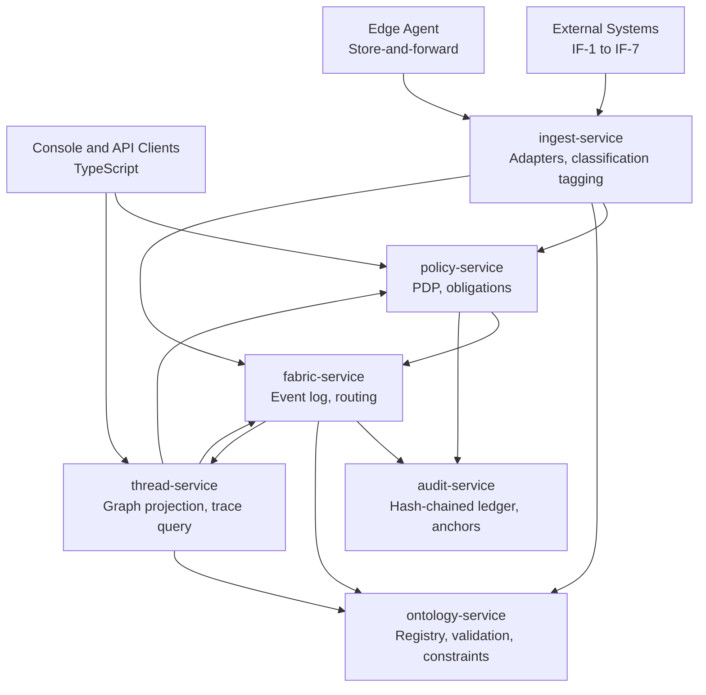
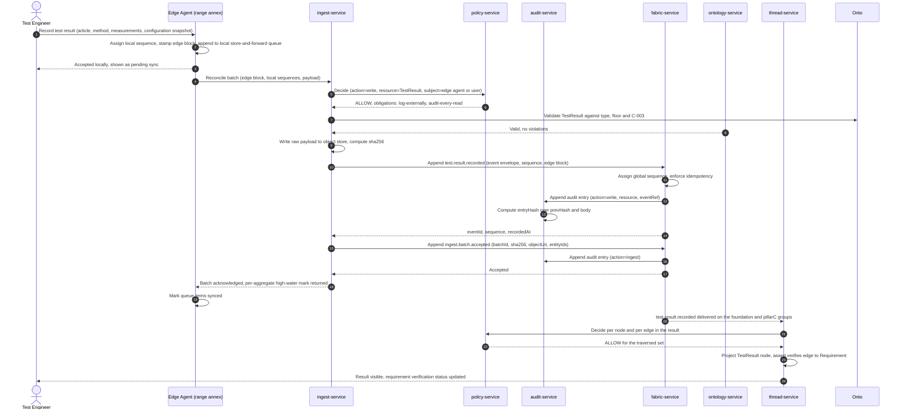

# NGSH Foundation Services

## Purpose

This document specifies the six foundation services that exist before any pillar: the ontology, fabric, policy, audit, thread and ingest services. For each it states the responsibility, the API surface, the backing store, the scaling model, the failure modes, and the events it consumes and produces. It also traces a single end-to-end operation — *record a test result* — across all six, because that operation touches every one of them and is the clearest demonstration that the foundation is a foundation and not a layer of utilities.

## Contents

1. [Architecture of the foundation](#1-architecture-of-the-foundation)
2. [Service dependency diagram](#2-service-dependency-diagram)
3. [The event catalogue](#3-the-event-catalogue)
4. [ontology-service](#4-ontology-service)
5. [fabric-service](#5-fabric-service)
6. [policy-service](#6-policy-service)
7. [audit-service](#7-audit-service)
8. [thread-service](#8-thread-service)
9. [ingest-service](#9-ingest-service)
10. [End-to-end sequence — record a test result](#10-end-to-end-sequence--record-a-test-result)
11. [Cross-cutting concerns](#11-cross-cutting-concerns)
12. [Foundation exit criteria](#12-foundation-exit-criteria)
13. [References](#13-references)

## 1. Architecture of the foundation

The foundation is the substrate that every pillar stands on. Six services, one shared pattern.

| Service | Role | Kind |
|---|---|---|
| `ontology-service` | Owns the registry. Validates every entity and relation against it, and owns constraint enforcement for C-001, C-002, C-003, C-005, C-006 | Validation and semantics |
| `fabric-service` | Owns the event log. The only write path. Routes events to subscribers | State and transport |
| `policy-service` | The PDP. Decides every access, with obligations | Decision |
| `audit-service` | Owns the tamper-evident ledger. Independent write authority | Forensic record |
| `thread-service` | Owns the graph projection and the trace query API | Read model |
| `ingest-service` | Bulk ingestion, adapters, normalisation, classification tagging, edge reconciliation | Ingress |

**The pattern every service follows.**

| Concern | How it is handled |
|---|---|
| State | Read-only for all services except `fabric-service` (which owns the log) and `audit-service` (which owns the ledger). Every other service's state is a projection |
| Write path | All state change enters through `fabric-service`. A service that needs to change state appends an event; it does not write to another service's store |
| Reads | Served from the service's own projection. A projection is rebuilt by replaying the log |
| Authorization | Every request passes a PEP. The decision is made by `policy-service` and every decision is an `access.decision.recorded` event and a ledger entry |
| Classification | Every service instance holds credentials for exactly the partitions it is accredited for ([ADR-0007](../adr/ADR-0007-classification-partitioning.md)) |
| Failure posture | A service degrades by capability, never by partial write. A failed dependency produces `CapabilityUnavailable`, never a partial mutation ([ADR-0003](../adr/ADR-0003-platform-agnostic-hybrid-deployment.md)) |

**Foundational versus pillar-owned.** The `catalog.json` `owner` field distinguishes them. Events with `owner: FOUNDATION` — `entity.created`, `entity.updated`, `entity.relation.asserted`, `entity.relation.retracted`, `ingest.batch.accepted`, `access.decision.recorded`, `reconcile.conflict.recorded` — are produced by the foundation. Events with a pillar owner — `test.campaign.planned` (C, G), `test.result.recorded` (C), `process.run.completed` (B), `model.validated` (G, B, F) — are produced by pillar services, but they flow through the foundation's fabric and are projected by it.

## 2. Service dependency diagram

**Reading the diagram.** Solid edges are request paths. `fabric-service` sits at the centre: `ingest-service` and `policy-service` append to it, and `thread-service` reads from it. `audit-service` is deliberately at the edge of the graph: it is written by `fabric-service` and `policy-service`, and it writes to nothing. That is the separation of duties that [ADR-0005](../adr/ADR-0005-tamper-evident-audit-ledger.md) requires — the audit ledger has no path back into the system it audits.

`ontology-service` is consulted by `fabric-service` at append time for constraint validation, and by `thread-service` for semantic queries over the registry.

## 3. The event catalogue

All ten event types from `contracts/events/catalog.json`, with the producer, the schema, and the subscription groups from the catalog.

| # | Event type | Version | Owner | Schema | Produced by | Subscribed by |
|---|---|---|---|---|---|---|
| 1 | `entity.created` | 1 | FOUNDATION | `contracts/events/entity.created.schema.json` | `ingest-service`, `ontology-service`, pillar services via the command path | `foundation` (`entity.*`), `pillarA`, `pillarD`, `pillarE`, `pillarF`, `pillarG`, `pillarH` |
| 2 | `entity.updated` | 1 | FOUNDATION | `contracts/events/entity.updated.schema.json` | `ingest-service`, `ontology-service`, pillar services | `foundation`, `pillarA`, `pillarD`, `pillarE`, `pillarF`, `pillarG`, `pillarH` |
| 3 | `entity.relation.asserted` | 1 | FOUNDATION | `contracts/events/entity.relation.asserted.schema.json` | `ontology-service`, pillar services | `foundation`, `pillarA`, `pillarD`, `pillarE`, `pillarF`, `pillarG`, `pillarH` |
| 4 | `entity.relation.retracted` | 1 | FOUNDATION | `contracts/events/entity.relation.retracted.schema.json` | `ontology-service`, pillar services | `foundation`, `pillarA`, `pillarD`, `pillarE`, `pillarF`, `pillarG`, `pillarH` |
| 5 | `test.campaign.planned` | 1 | C, G | `contracts/events/test.campaign.planned.schema.json` | Pillar C campaign service; Pillar G campaign digital twin | `pillarC` (`test.*`), `pillarG` (`test.*`) |
| 6 | `test.result.recorded` | 1 | C | `contracts/events/test.result.recorded.schema.json` | Pillar C test-data service | `pillarA`, `pillarB`, `pillarC` |
| 7 | `process.run.completed` | 1 | B | `contracts/events/process.run.completed.schema.json` | Pillar B MES service | `pillarB`, `pillarD` |
| 8 | `model.validated` | 1 | G, B, F | `contracts/events/model.validated.schema.json` | Pillar G validation service; Pillar B characterisation; Pillar F threat-model validation | `pillarB`, `pillarC`, `pillarF`, `pillarG`, `pillarH` |
| 9 | `ingest.batch.accepted` | 1 | FOUNDATION | `contracts/events/ingest.batch.accepted.schema.json` | `ingest-service` | `foundation` (`ingest.*`), `pillarC` |
| 10 | `access.decision.recorded` | 1 | FOUNDATION | `contracts/events/access.decision.recorded.schema.json` | `policy-service` | `foundation` (`access.*`) |
| 11 | `reconcile.conflict.recorded` | 1 | FOUNDATION | `contracts/events/reconcile.conflict.recorded.schema.json` | `fabric-service` (edge reconciliation) | `foundation` (`reconcile.*`) |

**Subscription-group semantics.** The `subscriptionGroups` in `catalog.json` are the mechanism that implements PSDD §8 Modularity — "all pillars independently deployable and licenseable". A pillar subscribes to a prefix group and receives only the event types it declared. It never reaches into another pillar's store, and unsubscribing from a group removes the pillar's dependency on that producer entirely.

**The `entity.*` dependency.** Six of the ten event types are `entity.*`, and seven of the eight pillars subscribe to them. This is the digital thread's breadth: a change to a `Part` is relevant to the MBSE pillar, the supply-chain pillar and the surge pillar simultaneously. It is also the reason the foundation's throughput target is a platform-level requirement rather than a per-pillar one.

## 4. ontology-service

### Responsibility

Owns the entity and relation registry (`contracts/ontology/registry.json`). It is the authority on what a type means, what its `classificationFloor` is, which relations may connect which types, and what constraints apply. It validates every entity and relation before the fact enters the log, and it serves semantic queries over the registry to the thread service and the console.

It is **not** the query service for entity data. That is `thread-service`. The distinction matters: `ontology-service` is about *type semantics* and is small, hot and cached; `thread-service` is about *instances* and is large, sharded and indexed.

### API surface

| Method | Path | Purpose |
|---|---|---|
| `GET` | `/v1/registry` | The full registry: entity types, relation types, constraints |
| `GET` | `/v1/registry/entities/{type}` | One entity type's metadata: prefix, floor, pii, pillars, attribute schema reference |
| `GET` | `/v1/registry/relations/{type}` | One relation type's metadata: from/to types, cardinality, flags |
| `GET` | `/v1/registry/constraints` | The constraint catalogue C-001..C-008 with scope and severity |
| `POST` | `/v1/validate/entity` | Validate an entity body against its type, the floor and the applicable constraints. Returns violations, not a verdict |
| `POST` | `/v1/validate/relation` | Validate a relation against the allowed endpoint types and C-002 |
| `POST` | `/v1/resolve/prefix/{prefix}` | Map an id prefix to an entity type |
| `POST` | `/v1/resolve/classification` | Compute the effective partition and ceiling for a classification level |
| `GET` | `/v1/version` | `ontologyVersion` and the schema digests the service loaded |
| `GET` | `/healthz`, `/readyz` | Liveness and readiness, including registry-load state |

### Backing store

| Store | Content | Notes |
|---|---|---|
| In-memory registry snapshot | The parsed registry | Loaded at start, refreshed on `ontologyVersion` change. The registry is small enough to hold entirely in memory — it is a document, not a dataset |
| Version-controlled file | `contracts/ontology/registry.json` | The source of truth, held in the repository and mounted read-only |
| Event log (read projection) | `entity.created` / `entity.updated` events | Used for constraint evaluations that depend on instance state — C-007's post-scope check |

### Scaling model

The service is stateless and horizontally scalable. The registry snapshot is loaded once per instance; the registry is under 100 KB, so memory cost is negligible. Constraint evaluation that needs instance state (C-005, C-006, C-007) is served from a local, bounded cache of the referenced entities, refreshed by subscription to `entity.*` events. Validation is CPU-bound and cheap; the instance count tracks request rate, not data volume.

### Failure modes

| Failure | Effect | Mitigation |
|---|---|---|
| Registry file unreadable or unparseable at start | The service refuses to start. The platform does not run with an unknown registry | The image ships a valid registry; the start-up check parses it fully before serving |
| Registry version newer than the service understands | Validation returns `INDETERMINATE` and the append path rejects the write rather than accepting an unvalidated fact | The compatibility rules in [ADR-0002](../adr/ADR-0002-json-schema-contracts-over-shared-libraries.md) make this rare; the failure is loud, not silent |
| Cache stale for C-005/C-006 | A credential could be accepted against a lapsed clearance | The cache is short-lived and the validation result carries the clearance state it was evaluated against. A stale entry is a *wider* window of risk, so the TTL is deliberately short and the clearance store is queried directly for high-consequence writes |
| Constraint evaluation times out | The write is rejected with a retryable error. A fact is never admitted unvalidated | Fail closed |

### Events

| Direction | Events |
|---|---|
| Consumes | `entity.created`, `entity.updated`, `entity.relation.asserted`, `entity.relation.retracted` (to maintain the instance-state cache for C-005, C-006, C-007) |
| Produces | `entity.created`, `entity.updated`, `entity.relation.asserted`, `entity.relation.retracted` (for entities it creates on the command path); `access.decision.recorded` (via `policy-service`) |

## 5. fabric-service

### Responsibility

Owns the event log, which is the system of record ([ADR-0001](../adr/ADR-0001-event-sourced-foundation.md)). It is the only component that can write authoritative state. It validates envelopes against `contracts/events/event-envelope.schema.json`, assigns and enforces the per-aggregate `sequence`, enforces idempotency, routes events to subscribers, and records the append in the audit ledger.

### API surface

| Method | Path | Purpose |
|---|---|---|
| `POST` | `/v1/events` | Append one event. Returns the assigned `sequence`, `eventId` and `recordedAt`. This is the only state-changing endpoint in the platform |
| `POST` | `/v1/events/batch` | Append a batch atomically under one `transactionId`. Used by `ingest-service` and by edge reconciliation |
| `GET` | `/v1/events/{eventId}` | Fetch one event by id |
| `GET` | `/v1/events?aggregateType=&aggregateId=&fromSeq=` | Fetch the event history of one aggregate, ordered by `sequence` |
| `GET` | `/v1/stream?groups={subscriptionGroup}&from={eventId}` | Subscribe. Long-lived, ordered, at-least-once, resumable from a given `eventId` |
| `GET` | `/v1/highwater?aggregateType=&aggregateId=` | The current global `sequence` for an aggregate. The read-your-writes anchor |
| `POST` | `/v1/replay` | Replay the log into a scratch projection. Used by tests, by the recovery procedure and by the audit cross-check |
| `GET` | `/v1/topics` | The available subscription groups and the events in each |
| `GET` | `/healthz`, `/readyz`, `/metrics` | Health and Prometheus metrics |

### Backing store

| Store | Content | Notes |
|---|---|---|
| Append-only event log | Every event envelope, partitioned by classification | The system of record. Written sequentially, never updated, never deleted within the retention window |
| Sequence allocator | The current global `sequence` per aggregate | In the append path, transactionally coupled to the log write |
| Idempotency index | `(tenant, eventType, idempotencyKey)` → `eventId` | Bounded, time-windowed, persisted |
| Subscription offsets | Consumer position per group | Enables resumable, at-least-once delivery |
| Object store (bulk bodies) | Superseded payload bodies archived at retention boundary | Archive only; the manifest preserves the superseding chain |

### Scaling model

The log is append-ordered per partition, with partitions keyed by aggregate identity so that an aggregate's events land on one partition and its `sequence` is allocated without cross-partition contention. Consumers scale independently of producers: each subscription group has its own offset and its own consumer instances. The append path scales horizontally by partition count; the hot path is the sequence allocation plus the durable write.

The critical property is that the log is the only write path, so the write throughput of the platform is the throughput of this service. The ingest target of ≥ 10 GB/s burst from PSDD §8 is a *bytes* target — the raw bytes go to the object store and the time-series store; the fabric carries the envelope, which is orders of magnitude smaller.

### Failure modes

| Failure | Effect | Mitigation |
|---|---|---|
| Log write fails after the sequence was allocated | A gap in the aggregate's sequence | The sequence is allocated and the log write are one transactional unit. A partial allocation is rolled back |
| Duplicate append | A second fact | Idempotency: `eventId` and `(tenant, eventType, idempotencyKey)`. The duplicate is acknowledged as a duplicate and does not advance the sequence |
| Out-of-order append for an aggregate | A gap | The fabric accepts the event and records it as out of order; the projection applies it when the gap fills, or flags it. The envelope's `sequence` is the authority, not arrival order |
| Subscriber falls behind | Stale projections | Offsets are durable; the consumer resumes. Lag is an SLO with alerting |
| Storage partition unavailable | Appends to that partition fail | Fail closed. Writes are not redirected to another partition — a record's partition is determined by its classification, and moving it would violate [ADR-0007](../adr/ADR-0007-classification-partitioning.md) |
| Fabric is unreachable from an edge node | Edge writes queue locally | This is the degraded mode of [ADR-0006](../adr/ADR-0006-edge-degraded-mode-and-reconciliation.md), not an outage |

### Events

| Direction | Events |
|---|---|
| Consumes | Nothing. The fabric is the terminus of the write path |
| Produces | Every event type. `entity.created`, `entity.updated`, `entity.relation.asserted`, `entity.relation.retracted`, `test.campaign.planned`, `test.result.recorded`, `process.run.completed`, `model.validated`, `ingest.batch.accepted`, `reconcile.conflict.recorded` — and, on behalf of `policy-service`, `access.decision.recorded` |

## 6. policy-service

### Responsibility

The Policy Decision Point ([ADR-0004](../adr/ADR-0004-abac-with-pdp-pep-separation.md)). It evaluates the policy bundle against subject, resource and environment attributes and returns `ALLOW`, `DENY` or `INDETERMINATE`, with a `policyId`, `policyVersion`, a human-readable `reason` and a list of `obligations`. It owns the policy bundle and its versioning, and it emits the `access.decision.recorded` event.

The fabric additionally owns **edge reconciliation**. `POST /v1/edge/reconcile` applies the conflict rule of [ADR-0006](../adr/ADR-0006-edge-degraded-mode-and-reconciliation.md) to a batch submitted by an edge annex, allocating the global sequence on acceptance and recording every conflict it cannot decide as a `reconcile.conflict.recorded` event.

### API surface

| Method | Path | Purpose |
|---|---|---|
| `POST` | `/v1/decide` | The decision request: subject attributes, resource attributes, environment, action. Returns the decision and obligations |
| `POST` | `/v1/decide/batch` | Many decisions in one round trip, for bulk ingestion and bulk reads |
| `GET` | `/v1/policy` | The active policy bundle, with its version and digest |
| `GET` | `/v1/policy/versions` | The bundle version history, retained for the audit trail |
| `POST` | `/v1/policy/evaluate` | Dry-run a bundle revision against a test corpus, reporting the decisions that would change |
| `GET` | `/v1/obligations` | The obligation catalogue and the PEPs that discharge each one |
| `GET` | `/v1/decisions?actor=&resource=&from=&to=` | The decision history, for audit and for the policy author |
| `GET` | `/healthz`, `/readyz` | Health, including the freshness of the clearance attribute cache |

### Backing store

| Store | Content | Notes |
|---|---|---|
| Policy bundle store | Versioned, signed policy documents | Versioned content, not configuration files. `policyVersion` appears on every decision |
| Clearance attribute cache | ICAM-sourced clearance and citizenship attributes, with TTL | Cached because the PDP is on the request path; the TTL is short because a stale clearance is a security defect, not a performance defect |
| Decision cache | `(subject, resource, action, env) → decision` with a conservative TTL | Invalidated on bundle version change and on clearance revocation events |
| Event log (write) | `access.decision.recorded` | Every decision is an event |
| Audit ledger (write) | Every decision, plus every obligation discharge | The independent record ([ADR-0005](../adr/ADR-0005-tamper-evident-audit-ledger.md)) |

### Scaling model

Stateless for evaluation; the policy bundle is held in memory and refreshed on version change. The decision cache absorbs the repeat-decision load, which dominates a graph traversal that evaluates thousands of resources. Batch decisions amortise the round trip for ingestion and bulk read. The service is deployed **in every zone**, including the IL6 annex and the edge appliance, where it runs against a locally synchronised, signed bundle — this is what keeps enforcement independent of cross-zone reachability.

### Failure modes

| Failure | Effect | Mitigation |
|---|---|---|
| Attribute source unreachable (clearance store) | `INDETERMINATE` | Treated as `DENY` by every PEP, and distinguished in the record because it is a system condition rather than a user condition |
| Policy bundle malformed at load | The service refuses to start and does not serve decisions | Fail closed, loudly |
| Decision cache stale after a clearance revocation | A revoked clearance might still be honoured | Revocation events invalidate the cache; the TTL bounds the exposure. The residual is accepted and documented in [`../risk-register.md`](../risk-register.md) (R-10) |
| PDP unreachable from a PEP | The PEP applies its local policy subset or denies | PEPs hold the last-known bundle and a conservative local ruleset. Deny is always available |
| Obligation cannot be discharged | The decision is refused | Obligations are mandatory; an undischargeable obligation is a DENY, not an ALLOW with a warning |

### Events

| Direction | Events |
|---|---|
| Consumes | `entity.created`, `entity.updated` (to know a resource's current classification for the decision), and clearance revocation events |
| Produces | `access.decision.recorded` — for every decision, ALLOW, DENY and INDETERMINATE alike |

## 7. audit-service

### Responsibility

Owns the tamper-evident audit ledger ([ADR-0005](../adr/ADR-0005-tamper-evident-audit-ledger.md)). It writes hash-chained entries with independent write authority, publishes anchors outside the NGSH boundary, and serves the verification tooling and the signed verification reports. It is the only service with the ledger write credential, and it writes to no other service.

### API surface

| Method | Path | Purpose |
|---|---|---|
| `POST` | `/v1/entries` | Append an audit entry. The only write endpoint |
| `GET` | `/v1/entries?from=&to=&action=&actor=&resource=` | Read entries. Derived index, explicitly not authoritative |
| `GET` | `/v1/head` | The current head hash and `entrySeq` |
| `GET` | `/v1/anchors` | The anchor chain |
| `POST` | `/v1/anchors` | Request an anchor (security-office role only) |
| `POST` | `/v1/verify` | Run verification over a range. Returns findings by class and a signed report |
| `GET` | `/v1/reports/{id}` | A previously produced verification report |
| `POST` | `/v1/seal` | Seal a range against archival or modification |
| `GET` | `/healthz`, `/readyz`, `/metrics` | Health, including anchor lag and the unattested window |

### Backing store

| Store | Content | Notes |
|---|---|---|
| Hash-chained ledger | Every entry, with `prevHash` and `entryHash` | Append-only, never updated. The canonicalisation function is versioned and frozen within a `ledgerFormatVersion` |
| Anchor chain | The slower chain over the fast chain | Published outside the NGSH boundary, under separate administrative control |
| Derived search index | A queryable projection of the ledger | Explicitly not authoritative; marked as such in every verification report |
| Sealed archive | Sealed ranges moved to cold storage | The archive manifest records the head hash and range boundary |

### Scaling model

The ledger is a single global sequence, so it is a single-writer system by design. Throughput is bounded by the durable append rate, which is far lower than the business log's because the ledger records *actions*, not facts — one entry per decision, not per field read. The bulk operations that touch many records produce one entry with a content-addressed manifest, not one entry per record.

Partitioning by classification applies to the ledger store as well, so the ledger's write path is partitioned. The hash chain must remain globally ordered, so the chain spans partitions with the partition boundary as a chain segment — the chain continues across partitions, and each partition holds a contiguous segment of `entrySeq`.

### Failure modes

| Failure | Effect | Mitigation |
|---|---|---|
| Ledger write fails | The audited action cannot be recorded | The action is refused. Every PEP treats a ledger-write failure as a DENY. Losing the audit record is worse than losing the action |
| Anchor destination unreachable | Unattested window grows | Alertable security event, recorded in the ledger itself as an `anchor-failure` action. The window is reported, not hidden |
| Chain verification fails | Tampering suspected | The failure is escalated to the security office and the affected range is sealed. Verification runs continuously, not only before an assessment |
| Ledger partition unavailable | Audit writes for that partition fail | Fail closed for the affected classification |
| Ledger grows unbounded | Storage pressure | Retention and archival via `audit.archive`, with a manifest that preserves the head hash |

### Events

| Direction | Events |
|---|---|
| Consumes | `access.decision.recorded` — for cross-checking coverage and for the obligation `log-externally`. The ledger does not derive its entries from the event log; it is written independently |
| Produces | No domain events. The ledger is a terminal store |

## 8. thread-service

### Responsibility

Owns the property-graph projection of the ontology and serves the trace and query API. It is the read model for the digital thread: multi-hop traversals, requirement rollup, verification status, coverage analysis, threat reconstruction lineage, and the query surfaces behind the console.

### API surface

| Method | Path | Purpose |
|---|---|---|
| `GET` | `/v1/entities/{type}/{id}` | One entity, with its relations |
| `POST` | `/v1/query` | A structured query over the projection: filters, traversal paths, aggregations |
| `POST` | `/v1/trace` | A trace between two nodes. The digital-thread traversal, with the constraint rules of [`02-ontology-model.md` §11](02-ontology-model.md#11-cross-cutting-traversal-rules) applied |
| `POST` | `/v1/rollup` | Requirement rollup: verification status aggregated over a requirement tree |
| `GET` | `/v1/requirements/{id}/coverage` | Verification coverage for one requirement |
| `GET` | `/v1/campaigns/{id}/trace` | Campaign-to-evidence-to-requirement trace |
| `GET` | `/v1/threats/{id}/lineage` | Threat reconstruction lineage, through `derivedFrom` to observations |
| `GET` | `/v1/models/{id}/fidelity` | Model fidelity, envelope and approval state |
| `POST` | `/v1/projects/rebuild` | Rebuild a projection from the log. An operator action, audited |
| `GET` | `/v1/health`, `/v1/lag` | Health and projection lag against the log tail |

### Backing store

| Store | Content | Notes |
|---|---|---|
| Property graph | The projection of the ontology: nodes, edges, properties | Partitioned by classification. One instance per partition |
| Vector index | Embeddings for requirements, test results and threat records, for semantic search and retrieval-augmented analysis | A projection, rebuilt from the log |
| Query cache | Bounded cache of expensive traversals | Keyed by the log high-water mark so a cached result is never stale |
| Log subscription | The consumer offset for the `foundation` group and per-pillar groups | The source of every projection update |

### Scaling model

Read-heavy and sharded by partition and by aggregate hash. Traversal depth and fan-out are the scaling drivers, so the service caps fan-out and depth per request and rejects rather than degrading silently. The projection is updated by consuming the log, so projection instances scale independently of the append path. A dedicated "rebuild" pool handles full replays without disturbing the serving pool.

### Failure modes

| Failure | Effect | Mitigation |
|---|---|---|
| Projection lag exceeds the SLO (5 s steady, 60 s degraded) | Stale reads | Alerting. The log remains authoritative; the console shows the lag and the high-water mark so a reader can judge freshness |
| Projection corrupt or lost | Reads fail | The projection is rebuilt from the log. No data loss, only time ([ADR-0001](../adr/ADR-0001-event-sourced-foundation.md)) |
| Traversal reaches a record above the actor's clearance | — | The PEP filters during traversal, not after. The refusal does not leak existence through counts, path lengths or timing |
| Traversal crosses a partition the instance has no credential for | The crossing is impossible | The relation is represented as a non-dereferenceable pointer |
| Vector index unavailable | Semantic search is unavailable; structured query is unaffected | The vector index is an accelerator, never a source of truth |
| Query fan-out explosion | Resource exhaustion | Depth and fan-out caps; the query is rejected with an actionable message, and the caller narrows it |

### Events

| Direction | Events |
|---|---|
| Consumes | `entity.created`, `entity.updated`, `entity.relation.asserted`, `entity.relation.retracted`, `test.result.recorded`, `test.campaign.planned`, `model.validated` — the `foundation`, `pillarA`, `pillarC` and `pillarG` subscription groups |
| Produces | No domain events. The thread service is a read model |

## 9. ingest-service

### Responsibility

Owns ingress. It accepts data from external systems (IF-1 to IF-4), from the edge agent, and from bulk file drops; it validates against the contracts; it tags classification before anything is placed; it normalises into the ontology; it writes raw bytes to the object store with a digest; and it appends the corresponding events to the fabric.

### API surface

| Method | Path | Purpose |
|---|---|---|
| `POST` | `/v1/ingest/{adapter}` | Ingest a payload through a named adapter (`plm`, `mes`, `range`, `pwsa`, `generic`) |
| `POST` | `/v1/ingest/{adapter}/batch` | Ingest a file or a stream in batches. The 10 GB/s burst path |
| `POST` | `/v1/ingest/{adapter}/validate` | Dry-run: validate and classify without writing. Returns the normalised entity set and the proposed events |
| `GET` | `/v1/adapters` | The available adapters, their formats, and their expected schemas |
| `GET` | `/v1/batches/{batchId}` | Batch status: records accepted and rejected, bytes, digest, object URI |
| `POST` | `/v1/reconcile` | Accept an edge reconciliation batch, apply the merge rule, return the per-aggregate resolution |
| `GET` | `/v1/classification/estimate` | Estimate the classification of an incoming payload without ingesting it |
| `GET` | `/healthz`, `/readyz`, `/metrics` | Health and throughput metrics |

### Backing store

| Store | Content | Notes |
|---|---|---|
| Object store (per partition) | Raw accepted payloads, content-addressed, with `sha256` | The bytes. The log carries the pointer and the digest |
| Time-series store (per partition) | High-rate sensor channels extracted from a batch | Referenced from `process.run.completed.sensorChannels[]` |
| Ingestion buffer | Bounded working set for a batch in flight | Discarded on completion |
| Idempotency store | `(tenant, eventType, idempotencyKey)` and batch digests | Bounded, time-windowed |
| Event log (write) | The normalised entity events and `ingest.batch.accepted` | The authoritative record of what was ingested |

### Scaling model

The ingest path is the platform's throughput path. It is sharded by source and by partition, so one tenant's burst does not starve another. Ingestion is embarrassingly parallel across files within a batch; within a file, records are streamed. Normalisation is CPU-bound and scales with worker count; the durable write of raw bytes is I/O-bound and scales with object-store concurrency.

The ≥ 10 GB/s burst target (PSDD §8) is an aggregate over the sharded pool, and the per-partition ceiling is lower, because a partition's write path is narrower.

### Failure modes

| Failure | Effect | Mitigation |
|---|---|---|
| Source file is malformed | The batch is rejected at the file level with a diagnostic | The batch is the unit of acceptance; `ingest.batch.accepted.recordsRejected` reports the count and the reason codes are attached to the rejected records |
| Classification cannot be determined | **Default to the most restrictive partition**, never the least | This is invariant I-10 in [`01-system-context.md`](01-system-context.md#8-architectural-invariants). A human or a validated classifier must lower it |
| Object store write succeeds but the log append fails | Bytes on disk with no record | The batch is recorded as failed; the object is marked unreferenced and garbage-collected after a grace period. The digest is retained so the operation can be replayed |
| Log append succeeds but the object write fails | A record pointing at missing bytes | The digest mismatch is detected by the periodic integrity sweep, which quarantines the record |
| Duplicate batch | Duplicate facts | `ingest.batch.accepted.sha256` plus `idempotencyKey` deduplicate at the batch level |
| Edge reconciliation batch contains an undecidable conflict | — | The batch is acknowledged; the conflict is quarantined and surfaced. One conflict never blocks a batch ([ADR-0006](../adr/ADR-0006-edge-degraded-mode-and-reconciliation.md)) |
| Ingest exceeds the partition's write budget | Back-pressure | The source is throttled with a clear signal. Data is never silently dropped |

### Events

| Direction | Events |
|---|---|
| Consumes | None directly. It reads source systems and edge queues |
| Produces | `entity.created`, `entity.updated`, `entity.relation.asserted`, `entity.relation.retracted` (for the entities it normalises), and `ingest.batch.accepted` (one per accepted batch, carrying `batchId`, `source`, `format`, `recordsAccepted`, `recordsRejected`, `bytesAccepted`, `sha256`, `objectUri`, `entityIds[]` and the `edge` block for edge-captured batches) |

## 10. End-to-end sequence — record a test result

The scenario: a test engineer at a range annex records the outcome of a wind-tunnel run. The article was built at a factory; the run happened at a range with intermittent connectivity; the result must appear in the digital thread, verify a requirement, and update a model.

**What the diagram shows.**

| # | Observation |
|---|---|
| 1 | The write does not go directly to the graph. It goes to the log, and the graph is updated by subscription. The engineer sees the result after the projection catches up, not at append time |
| 2 | The authorization decision happens **before** the append, and it is a PDP decision with obligations, not a boolean check |
| 3 | The ontology validation is a separate call to a separate service. It is the enforcement point for C-001, C-002 and C-003, and it is *not* the same component as the one that writes |
| 4 | The audit entry is written by `fabric-service` directly to `audit-service`, in parallel with the append. The audit ledger is not derived from the event log after the fact; it is written as the action happens |
| 5 | `ingest.batch.accepted` is appended as a separate event, so that ingestion volume, digest and lineage are accounted for independently of the entities a batch produced |
| 6 | The edge path is the same path. The edge's `edge` block carries `nodeId`, `capturedAt`, `reconciledAt` and `clockSkewMs` through to the log, and the merge rule decides whether the incoming event fast-forwards or conflicts |
| 7 | The thread service asks the PDP for a decision **per node and per edge** in the traversed result, not once for the query. A traversal that reaches an unclassifiable record is refused at the node, not at the query |
| 8 | The requirement verification status is a projection consequence. Nothing wrote to the requirement; the `verifies` edge and the result outcome produced it |

## 11. Cross-cutting concerns

| Concern | How it is handled across the six services |
|---|---|
| **Tenancy** | `tenant` is on every entity and every envelope. Every query, append and decision is tenant-scoped. A cross-tenant operation is refused, not filtered |
| **Classification** | Decided at ingest, enforced by the registry floor, realised by physical partition, checked on every read by the PEP, and immutable for the life of the record ([ADR-0007](../adr/ADR-0007-classification-partitioning.md)) |
| **Observability** | Every service emits OpenTelemetry traces and metrics. The correlation id on the envelope ties a client request to the append, the decision, the audit entry and the projection update |
| **Idempotency** | `eventId` (ULID) is the platform-wide idempotency key; `(tenant, eventType, idempotencyKey)` is the caller-scoped one; `ingest.batch.accepted.sha256` is the batch-scoped one |
| **Determinism** | The log's replay order is `(aggregateType, aggregateId, sequence)` then `eventId`. Every projection is a pure function of the log, so a rebuild is byte-identical to the live state |
| **Degradation** | Every dependency failure produces `CapabilityUnavailable` with a defined user-facing behaviour. Nothing partially writes. Every service declares the capabilities it provides, so a deployment can be configured to avoid relying on the ones it lacks ([ADR-0003](../adr/ADR-0003-platform-agnostic-hybrid-deployment.md)) |
| **Contract coupling** | No service shares source code with another service. The only coupling is the JSON Schema contract layer and its generated codecs ([ADR-0002](../adr/ADR-0002-json-schema-contracts-over-shared-libraries.md)) |
| **Audit coverage** | Every state change, every decision, every export, every configuration change and every reconciliation outcome has both an event (where one exists) and a ledger entry (where it matters) |

## 12. Foundation exit criteria

Increment 0 is complete when all of the following are true. These are the testable criteria from [`../roadmap/increments.md`](../roadmap/increments.md).

| # | Criterion | How it is measured |
|---|---|---|
| FE-1 | All 23 entity types and 10 relation types are registered, validated and queryable | The conformance fixture suite passes for every type and every relation type |
| FE-2 | All eight constraints C-001..C-008 have an implemented enforcement point and a negative test | Each constraint has a seeded-violation test that fails the write, read or post-commit check as specified |
| FE-3 | All ten event types are appendable, subscribable and replayable | A replay of a synthetic log containing all ten event types reproduces an identical projection in every service |
| FE-4 | A full projection rebuild completes within the replay budget | ≥ 500,000 events/s single-node apply; ≤ 2 h for 10^9 events |
| FE-5 | Every request path produces an `access.decision.recorded` event and a ledger entry | 100% coverage asserted by the ledger-to-event cross-check, which must report zero unexplained mismatches |
| FE-6 | Classification partitioning is physical and negative isolation is tested | A test suite attempts cross-partition reads and writes across every service and every API and asserts that all attempts fail |
| FE-7 | The edge agent operates disconnected for 72 hours and reconciles deterministically | Fault-injection harness: disconnect, write, duplicate, reorder, reconnect, reconcile; the final state is identical across 100 randomised orderings |
| FE-8 | A model with `approvedForUse: false` cannot be used, and an out-of-envelope request is refused | Negative tests for both, with the refusal reason asserted |
| FE-9 | The audit ledger verifies clean and detects a seeded tamper | Verification passes on an untampered ledger and reports the expected finding class on a seeded one |
| FE-10 | The platform runs on all four deployment profiles from one build | The same image digest runs in DP-L, DP-5, DP-6 and DP-E, and the conformance suite passes against each |

## 13. References

**PSDD:** §4.1 (concept — foundation layer, shared ontology), §4.2 (design principles), §5 (pillars and the capabilities that consume the foundation), §6.1 (ontology), §6.2 (data stores), §6.3 (data governance), §7 (IF-1..IF-7), §8 (Availability, Performance, Scalability, Modularity, Auditability, AI/ML), §9 (AI/ML), §10 (security and compliance), §11 (phasing), §13 (risks).

**Contracts:**
- `contracts/events/catalog.json` — the ten event types, their owners, their schemas, and the `subscriptionGroups`.
- `contracts/events/event-envelope.schema.json` — the envelope every service writes and reads.
- `contracts/events/entity.created.schema.json`, `entity.updated.schema.json`, `entity.relation.asserted.schema.json`, `entity.relation.retracted.schema.json` — the ontology mutation events.
- `contracts/events/test.campaign.planned.schema.json`, `test.result.recorded.schema.json`, `process.run.completed.schema.json`, `model.validated.schema.json` — the pillar-owned evidence events.
- `contracts/events/ingest.batch.accepted.schema.json` — the ingest record with `sha256`, `objectUri` and the `edge` block.
- `contracts/events/access.decision.recorded.schema.json` — the decision record with `policyId`, `policyVersion`, `obligations` and `reason`.
- `contracts/ontology/registry.json` — the entity/relation registry and constraints C-001..C-008.
- `contracts/ontology/common.schema.json`, `entities.schema.json`, `relations.schema.json` — the shapes the services validate against.

**Repository:** `services/ontology-service`, `services/fabric-service`, `services/policy-service`, `services/audit-service`, `services/thread-service`, `services/ingest-service`, `apps/edge-agent`, `apps/web`, `libs/ngsh-core`, `tools/codegen`.

**ADRs:** [ADR-0001](../adr/ADR-0001-event-sourced-foundation.md), [ADR-0002](../adr/ADR-0002-json-schema-contracts-over-shared-libraries.md), [ADR-0003](../adr/ADR-0003-platform-agnostic-hybrid-deployment.md), [ADR-0004](../adr/ADR-0004-abac-with-pdp-pep-separation.md), [ADR-0005](../adr/ADR-0005-tamper-evident-audit-ledger.md), [ADR-0006](../adr/ADR-0006-edge-degraded-mode-and-reconciliation.md), [ADR-0007](../adr/ADR-0007-classification-partitioning.md), [ADR-0008](../adr/ADR-0008-model-card-and-fidelity-registry.md).

**Sibling documents:** [`01-system-context.md`](01-system-context.md), [`02-ontology-model.md`](02-ontology-model.md), [`04-security-architecture.md`](04-security-architecture.md), [`05-deployment-architecture.md`](05-deployment-architecture.md), [`../roadmap/increments.md`](../roadmap/increments.md), [`../roadmap/work-packages.md`](../roadmap/work-packages.md).
