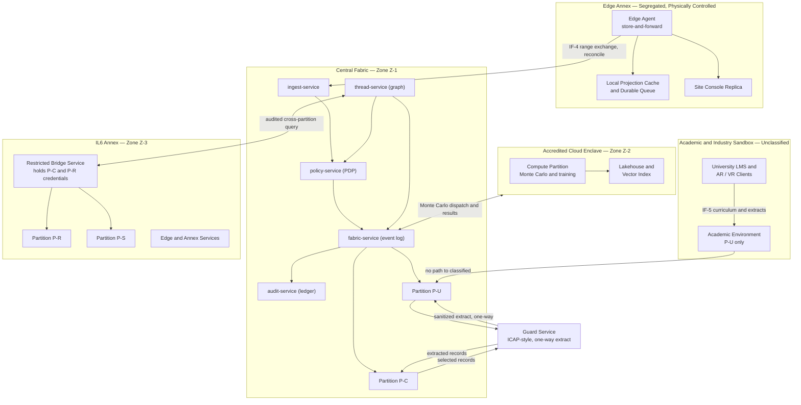

# NGSH Security Architecture

## Purpose

This document specifies the security architecture of the NGSH platform: the zero-trust posture, the attribute model and the PDP/PEP topology, the physical classification partitioning, the identity and clearance-verification model, the audit trail, the key-management posture, the SBOM and CMMC L2+ obligations, and the accreditation boundaries between the central fabric, the cloud enclave and the edge annex. It is the document that an assessor reads and that an engineer consults before adding a service or a data path.

## Contents

1. [Security objectives](#1-security-objectives)
2. [Zero-trust posture](#2-zero-trust-posture)
3. [Attribute model](#3-attribute-model)
4. [PDP / PEP topology](#4-pdp--pep-topology)
5. [Classification partitioning](#5-classification-partitioning)
6. [Identity and clearance verification](#6-identity-and-clearance-verification)
7. [Audit trail](#7-audit-trail)
8. [Key management posture](#8-key-management-posture)
9. [Trust boundary diagram](#9-trust-boundary-diagram)
10. [Accreditation boundaries](#10-accreditation-boundaries)
11. [SBOM and CMMC L2+ obligations](#11-sbom-and-cmmc-l2-obligations)
12. [Security control matrix](#12-security-control-matrix)
13. [Known gaps](#13-known-gaps)
14. [References](#14-references)

## 1. Security objectives

The security architecture is derived from five objectives, each traceable to a PSDD requirement.

| # | Objective | Source |
|---|---|---|
| O-1 | No actor reaches a resource they are not entitled to reach, and the decision that let them is reconstructable | PSDD §6.3, §8 (Auditability) |
| O-2 | Classified content never reaches a store, a network or a partner that is not accredited for it | PSDD §6.3, §10 |
| O-3 | The audit trail is evidence, not self-report: independently written, tamper-evident, and anchored outside the platform | PSDD §8 (Auditability), §10 |
| O-4 | A safety-relevant prediction is made by an approved model within its validated regime, by a human who knows they are accountable | PSDD §8 (AI/ML), §9 |
| O-5 | The platform's own supply chain is inspectable: every component known, every vulnerability tracked, every artefact attested | PSDD §10 |

## 2. Zero-trust posture

PSDD §8 requires zero trust. In this platform the term is given a specific, testable meaning rather than being used as a label.

| # | Posture element | Concrete mechanism | How it is tested |
|---|---|---|---|
| Z-1 | No implicit trust zone in the storage tier | Physical partition by classification; a credential never spans a partition ([ADR-0007](../adr/ADR-0007-classification-partitioning.md)) | Negative isolation test suite: cross-partition reads and writes must fail |
| Z-2 | No implicit trust zone in the service tier | Every request is authorized by a remote PDP. No service holds embedded authorization rules | A policy change takes effect without a service redeploy |
| Z-3 | No implicit trust in the network | Zone boundaries have no transitive reachability. The IL6 annex does not reach the IL5 enclave and vice versa | Network policy is asserted in the deployment manifests and checked by a policy test in CI |
| Z-4 | No implicit trust in the client | The console is a PEP, not a trust anchor. Field-level masking is applied server-side as well | A direct API call with an under-privileged token returns masked data, not the raw record |
| Z-5 | No implicit trust in the edge | The edge agent holds no fabric write credential. It proposes events; every proposal is validated as any other writer's | A forged edge submission is rejected by the same validation as a forged fabric submission |
| Z-6 | No implicit trust in the stored record | Every record carries `classification`, `provenance` and `actor`, and a record's classification is set at ingestion and never lowered in place | Tamper with a stored record; the projection detects the divergence from the log |
| Z-7 | No implicit trust in the operator | Break-glass administration requires dual authorisation and is itself audited | Exercise the break-glass procedure; confirm two identities are required and both are in the ledger |
| Z-8 | Continuous verification | Every access decision is an event and a ledger entry; the chain is verified continuously and reports are published | The verification job runs on a schedule and publishes a signed report |
| Z-9 | Explicit degradation | A missing dependency produces `CapabilityUnavailable`, never a permissive default | The degraded-mode conformance suite asserts that no code path silently proceeds |

**The principle in one line.** Trust is never inferred from network location, from the presence of a credential, or from the fact that a request already succeeded once. Every access is decided from attributes, every decision is recorded, and every record is independently attested.

## 3. Attribute model

The attribute model is specified in full in [ADR-0004](../adr/ADR-0004-abac-with-pdp-pep-separation.md). This section records the values and their sources.

### Subject attributes

| Attribute | Values | Source of truth | Cache policy |
|---|---|---|---|
| `actor.subjectId` | Entity id, `PER:` namespace | ICAM / PIV identity | Cached at the PDP; authoritative at the identity provider |
| `actor.kind` | `user`, `service`, `device`, `edge-agent`, `anonymous` | Service identity registry | Not cached; a local lookup |
| `actor.clearance` | `NONE`, `SECRET`, `TOP SECRET`, `SCI-CLEARED` | ICAM attribute store | Short TTL (default 300 s). A clearance change invalidates the cache |
| `actor.citizenship` | `US`, `ALLIED`, `FOREIGN`, `UNKNOWN` | ICAM attribute store | Same TTL. `UNKNOWN` is treated as the most restrictive value for export-controlled resources |
| `actor.programs[]` | Program tags (e.g. `NGSH-SHY`, `NGSH-MAVERICK`) | Programme membership register | Cached; invalidated on membership change |
| `actor.needToKnow[]` | Fine-grained need-to-know tags | Derived from programme membership plus explicit grants | Cached; invalidated on grant change |
| `actor.org` | Organisation | Directory | Cached |
| `actor.clearanceExpiry` | Timestamp | ICAM | Checked at decision time against `env.time`. A lapsed clearance denies regardless of the cached level |

### Resource attributes

| Attribute | Values | Source |
|---|---|---|
| `resource.type` | The 23 entity types | Ontology registry |
| `resource.id` | Typed entity id | Ontology |
| `resource.classification.level` | `UNCLASSIFIED`, `CUI`, `CUI//REL`, `CUI//FOUO`, `RESTRICTED`, `SECRET`, `TOP SECRET` | `EntityHeader.classification` |
| `resource.classification.caveats[]` | `NOFORN`, `PROPIN`, `CNSSI 5016.1`, … | `EntityHeader.classification.caveats` |
| `resource.classification.origins[]` | Original classification authorities | `EntityHeader.classification.origins` |
| `resource.derivedFromClassified` | Boolean | `EntityHeader.classification.derivedFromClassified` |
| `resource.program` | Programme of record | `EntityHeader.program` |
| `resource.tenant` | Tenancy key | `EntityHeader.tenant` |
| `resource.pii` | Boolean | Ontology registry `pii` flag — true only for `Credential` and `Person` |
| `resource.floor` | Minimum classification for the type | Ontology registry `classificationFloor` |

### Environment attributes

| Attribute | Values | Source |
|---|---|---|
| `env.zone` | `Z-0` local, `Z-1` central fabric, `Z-2` cloud enclave, `Z-3` segregated annex or edge | Deployment configuration |
| `env.network` | Reachability set | Deployment configuration |
| `env.devicePosture` | `managed`, `compliant`, `encrypted-at-rest`, `unmanaged` | Device management / attestation |
| `env.time` | Current instant | Fabric clock; the reference for all temporal checks |
| `env.locality` | Whether the request originates inside a physically controlled annex | Edge node identity |

### Combination rules

| # | Rule |
|---|---|
| 1 | Deny by default. An absent rule is a DENY |
| 2 | Explicit deny overrides any allow |
| 3 | `INDETERMINATE` is treated as DENY by every PEP, but is distinguished in the record because it indicates a system condition rather than a user condition |
| 4 | The conjunction is conjunctive. Clearance alone is never sufficient: citizenship, programme and classification must all be satisfied |
| 5 | Citizenship gates export-controlled content independently of clearance. `FOREIGN` and `UNKNOWN` never receive export-controlled resources at any clearance |
| 6 | Classification comparison uses the ordering declared in `Classification.level`. Caveats travel with the record and are enforced as additional restrictions |
| 7 | The entity type's `classificationFloor` is a write-time rule (C-001) and is also exposed as a resource attribute so that read rules can reference it |
| 8 | Relation boundaries are enforced on read (C-002, C-008): a traversal may not cross a boundary that the relation type does not permit |

## 4. PDP / PEP topology

| Role | Component | Enforcement point | Notes |
|---|---|---|---|
| **PDP** | `policy-service` | Evaluates subject, resource and environment against the versioned policy bundle | Deployed in every zone, including the IL6 annex and the edge appliance |
| **PEP — fabric** | `fabric-service` | Append path and subscription path | Every append and every event read is decided |
| **PEP — graph** | `thread-service` | Every traversal, applied to the result set, not only the query | A node the actor may not read is neither returned nor counted nor timed |
| **PEP — ingest** | `ingest-service` | Batch-level and record-level classification decision | Classification is resolved here, before placement |
| **PEP — bytes** | Object-store gateway | On the URI, independent of the referring record | The referrer cannot downgrade what it points at |
| **PEP — console** | `apps/web` | Field-level masking, export control, watermark | Never the only PEP |
| **PEP — edge** | `apps/edge-agent` | Local evaluation against a signed, synchronised bundle | When the PDP is unreachable, the edge applies the most restrictive local rules |

### Obligations

| Obligation | Enforcement | Where it is discharged |
|---|---|---|
| `log-externally` | The access is written to the audit ledger, not only to the event log | Audit PEP |
| `audit-every-read` | A read produces an `access.decision.recorded` event even though reads are not otherwise events | Fabric PEP |
| `watermark` | The rendered output carries a visible, attributable marking | Console PEP, export gateway |
| `no-export` | The content may be read but not exported, downloaded, copied or printed | Console PEP, export gateway, DLP at the object-store gateway |
| `redact-attributes` | Named attributes are masked before the content reaches the caller | Thread PEP, console PEP |
| `notify` | A second party is notified | Policy service post-decision hook |
| `require-recent-mfa` | Access requires an MFA assertion within a specified window | Identity integration, PDP context |
| `log-attribute-access` | Attribute-level reads are recorded, not only entity-level reads | Thread PEP |

An obligation that cannot be discharged causes the decision to be a DENY. Obligations are not advisory.

### Decision record

Every decision is written twice: as an `access.decision.recorded` event and as a ledger entry. The event carries `decision`, `action`, `resource` (with `type`, `id`, `classification`), `policyId`, `policyVersion`, `obligations[]`, `reason` and `context`. The ledger entry carries the same content plus the enforcement point and the session. The `policyVersion` is what makes "which rule applied at 14:32 on the 3rd" answerable.

## 5. Classification partitioning

The partitioning design is specified in full in [ADR-0007](../adr/ADR-0007-classification-partitioning.md). This section records the enforcement-relevant summary.

| Partition | Levels | Physical realisation | Accreditation |
|---|---|---|---|
| **P-U** | UNCLASSIFIED, including all sanitized extracts | Dedicated store instances and namespaces | Z-1, Z-2, Z-3 (edge), and the academic sandbox |
| **P-C** | CUI, CUI//REL, CUI//FOUO | Separate store instances | Z-1, Z-2 |
| **P-R** | RESTRICTED | Separate store instances | Z-3 (IL6 annex) |
| **P-S** | SECRET, TOP SECRET | Separate store instances | Z-3 (IL6 annex) |
| **P-L** | Site-local, scoped to the site's accreditation | Per-site instances | Edge site |

### What `RESTRICTED` means

PSDD §6.3 and §10 speak of "CUI" and of "classified" but never enumerate the
levels, so the contract layer's `RESTRICTED` level has no PSDD counterpart to
check against. This is the reading the programme has adopted:

**`RESTRICTED` is the IL6-annex level.** It is the level at which classified
threat and fire-control data is held — the data PSDD §10 places in the "on-prem
IL6 annex (classified threat data, fire-control data)" — and it sits between
`CUI` and `SECRET` in the ordering because it marks the *accreditation
boundary* rather than a national security classification level. It is the
level the three threat types carry a floor at, because `ThreatSystem`,
`ThreatObservation` and `EngagementScenario` are the entities that exist to
carry that analysis.

The practical consequence is the partition boundary: everything at `CUI` or
below lives in the accredited cloud enclave (P-U, P-C), and everything at
`RESTRICTED` or above lives in the segregated on-prem annex (P-R, P-S). If
the programme office prefers the threat types to be floored at `SECRET`
instead, the change is one line in `contracts/ontology/registry.json` and the
partition table above; the enforcement mechanism does not change.

### Downgrade prevention

| Layer | Control |
|---|---|
| Floor | C-001 — an entity's classification may never be below its type's `classificationFloor`. Enforced at append |
| Placement | A record is physically written only into the partition matching its classification; the write credential for a partition cannot write elsewhere |
| Monotonicity | **C-009** — a classification is never lowered in place. Lowering creates a **new entity** in a lower partition with `derivedFromClassified: true` and a `parentRefs` link to the original; the original stays put. Enforced by the ontology service on updates and by the reconciliation engine's classification gate on edge merges |
| Boundary | C-002 — a relation may not cross a classification boundary unless its type is `mayCrossClassification: true`. Only `derivedFrom` and `requiresSkill` are |
| Read | C-008 — an `EngagementScenario` is not readable below its classification |

The monotonicity rule is **not yet in the registry**. It is proposed as constraint C-009 and is tracked in [`../roadmap/work-packages.md`](../roadmap/work-packages.md) under WP-0.1.

### Sanitized extracts

One-way, guarded, reviewed and anchored. The guard service is the only egress path from a classified partition to P-U; there is no route around it. The extract is a new classified record with its own id and manifest, not a copy of the original.

| Stage | Control |
|---|---|
| Request | Against a named, versioned view — not raw data |
| Selection | Only records at or below the extract's ceiling are eligible |
| Transformation | Field removal, generalisation, unit conversion, date shifting, identifier re-mapping, `parentRefs` replacement |
| Review | A named human approves; the approval is in the ledger before release |
| Release | Content-addressed write to P-U with a manifest listing source ids, rules applied, guard version and reviewer |
| Anchoring | The manifest is anchored in the ledger |
| No return path | The academic environment receives only the P-U artefact |

## 6. Identity and clearance verification

IF-6 is the government identity interface (PSDD §7). The model is deliberately narrow, because identity is the one place where a mistake is unrecoverable.

| Aspect | Design |
|---|---|
| Authentication | PIV/CAC for human access at IL5 and above, through a portable OIDC/OAuth 2.0 profile so that no cloud broker is embedded in the domain path ([ADR-0003](../adr/ADR-0003-platform-agnostic-hybrid-deployment.md) HW-2) |
| Workforce identity | `Person` entities carry `employeeId`, `citizenship`, `clearanceLevel`, `clearanceExpiry`, `region`. They are one of only two `pii: true` types |
| Credential evidence | `Credential` carries `personId`, `skillId`, `issuedAt`, `expiresAt`, `issuingAuthority`, `status`, `evidenceRefs[]`, `workAuthorizationIds[]` — the second `pii: true` type |
| Verification | The clearance attribute comes from the identity provider. It is never self-asserted by the client, and never asserted by the platform |
| Service identity | Workload identities are issued by the platform's own registry, with the same `Actor.kind: service` shape, so that a service action and a human action are recorded in the same way |
| Edge identity | `Actor.kind: edge-agent`, with a per-node identity. The edge holds no fabric write credential; it proposes |
| Continuous verification | The clearance attribute is cached with a short TTL and invalidated by revocation events. A lapsed clearance denies even at a high level (C-005, C-006) |
| Temporal correctness | C-005 requires the clearance to be current **at issue time**; C-006 requires it to be current **at the time of reference**. Both are evaluated against `env.time` at the write, not against the current state at read |
| Retention | `Person` and `Credential` records are subject to strict retention. They are the two types where deletion, correction and subject-access obligations bite hardest |
| Separation | Authentication, authorisation and identity management are distinct functions: the identity provider authenticates, the PDP authorises, the platform manages identities |

## 7. Audit trail

Two records, deliberately separate.

| Aspect | Business event log | Audit ledger |
|---|---|---|
| Purpose | Record what is true | Record what was done to the system |
| Write authority | Services, through the fabric | The audit service only |
| Structure | Per-aggregate monotonic `sequence` | Global `entrySeq`, hash-chained with `prevHash` |
| Integrity | Storage-layer controls and replay verification | Cryptographic chain plus external anchoring |
| Retention | Business-driven; superseded bodies may be archived | Policy-driven; entries are never rewritten |
| Consumer | Projections, pillars, analysts | Auditors, investigators, assessors |

**Anchor chain.** Every 15 minutes, and on demand, the head hash is published outside the NGSH trust boundary under separate administrative control. A failure to anchor is an alertable security event, recorded in the ledger as an `anchor-failure` action, and it opens a measurable unattested window that is reported.

**Verification.** The continuous verification job recomputes the chain, detects gaps, checks each anchor, cross-checks the ledger against the `access.decision.recorded` event stream for coverage, and publishes a signed daily report. Verification failures escalate; they are not retried silently. A verification tool that has never been shown to fail on a seeded tampering case is not evidence, so seeded-tamper tests are a release gate.

**What the trail proves and does not prove.** The ledger proves that a recorded action occurred in the recorded order, that the record has not been altered or removed within the anchored range, and that the decision was produced by the recorded policy version. It does not prove that an action never occurred before the ledger existed, that the actor was a human, that the underlying physical fact was true, or that the pre-action system state was correct. A fraudulent measurement that was faithfully recorded is faithfully recorded.

## 8. Key management posture

There is no cloud KMS in this architecture, because there is no cloud KMS reachable from an IL6 annex or an edge appliance ([ADR-0003](../adr/ADR-0003-platform-agnostic-hybrid-deployment.md) HW-3). Each zone operates its own key management.

| Key class | Purpose | Custody | Rotation |
|---|---|---|---|
| **Partition data keys** | Encryption at rest for each classification partition | HSM-backed, per zone. The partition key never leaves its zone | Annual, or on compromise |
| **Transport keys** | TLS in transit, including into the IL6 enclave | Zone key store | 90 days |
| **Event log signing key** | Signs the anchor material | HSM in the zone that owns the log | Annual, with a key-ceremony record |
| **Edge node keys** | Encrypt the local store-and-forward queue and authenticate the node to the fabric | Node-local, with a recovery escrow held by the site's security officer | On node replacement; re-keyable remotely |
| **Policy bundle signing key** | Signs the policy bundle so an edge can verify it offline | Security-office custody | 180 days |
| **Service workload keys** | mTLS between services | Zone key store, rotated by the platform | 90 days |
| **Identity keys** | Token signing, session keys | The identity provider's custody; the platform holds no signing key for government identity | Managed by the provider |
| **Backup keys** | Encrypt sealed archives and ledger archives | Separate from the primary key store, under separate administration | Annual |

| Posture rule | Detail |
|---|---|
| No long-lived secret in configuration | Secrets are issued at runtime from the zone key store; no secret is in an image, a repository or a deployment manifest |
| No shared key across zones | A key in Z-1 cannot decrypt Z-3 data. Crossing zones requires the guard's transformation, not a key |
| Least-privilege decryption | A service holds the key for the partitions it is accredited for, not for the partitions it can read about |
| HSM required at SECRET and above | P-S and P-R keys are HSM-backed. Software key stores are permitted only for P-U and P-C |
| Key escrow and recovery | Every zone documents a key-recovery procedure, exercised annually. An unrecoverable key is a data-loss event |
| Quantum readiness | The hash algorithm for the audit chain is SHA-256. A migration plan for a longer hash exists, and the `ledgerFormatVersion` mechanism exists to carry it. Harvest-now-decrypt-later exposure is managed by the re-keying capability for data keys, and the ledger chain is the acknowledged residual |

## 9. Trust boundary diagram

**Boundary summary.**

| Boundary | Between | Controls at the boundary |
|---|---|---|
| **TB-1** | Edge annex and central fabric | Partition-scoped credentials; a signed policy bundle for offline enforcement; store-and-forward with deterministic reconciliation; every edge write is validated as any other write |
| **TB-2** | Central fabric and cloud enclave | The enclave is a compute partition, not a data owner. It receives work and returns results; it holds no partition credentials for P-R or P-S. Classification restricts what work can be dispatched there |
| **TB-3** | Central fabric and IL6 annex | No transitive reachability. The annex holds P-R and P-S. The only bridge is the restricted bridge service, which is audited on every query |
| **TB-4** | Classified and unclassified | The guard service. One-way, reviewed, anchored. No other route exists |
| **TB-5** | NGSH and academic partners | P-U only. The academic environment has no credential, no route and no network path into a classified partition |
| **TB-6** | The platform and the identity provider | OIDC/OAuth 2.0 over a controlled path. The platform holds no government identity signing key |

## 10. Accreditation boundaries

| Boundary | Scope | Contents | Evidence |
|---|---|---|---|
| **AB-1** | **IL5 accreditation** (central fabric, Z-1) | Fabric, ontology, policy, audit, thread, ingest, console; P-U and P-C partitions; multi-tenant | CMMC L2+ artefacts, SBOM, ATO package, SSP |
| **AB-2** | **IL5 accreditation** (cloud enclave, Z-2) | Elastic compute for Monte Carlo and training; lakehouse; vector index | Same as AB-1 plus the provider's ATO and the enclave's boundary definition |
| **AB-3** | **IL6 accreditation** (segregated annex, Z-3) | P-R and P-S partitions; the restricted bridge; the annex's own policy and audit instances | Physical security documentation, TEMPEST/EMSEC posture as applicable, personnel clearances, the annex's own SSP |
| **AB-4** | **Edge site accreditation** (per site) | Edge agent, local queue, local projection, site console replica | Site physical security, operator clearance, local accreditation letter. Each site is separately accredited |
| **AB-5** | **Academic partner** (Pillar E-5) | P-U only; sanitized extracts and curriculum packages | One-way extract manifests anchored in the ledger; no credential issued |

**Rules that cross the boundaries.**

| # | Rule |
|---|---|
| 1 | A credential never crosses an accreditation boundary. An AB-1 credential cannot read AB-3 data, and the storage partition makes that a physical impossibility, not a policy |
| 2 | Data crosses a boundary only through a named, logged interface: IF-1 to IF-7, the guard's extract pipeline, or the edge reconciliation path |
| 3 | The audit ledger is anchored in each zone, and an anchor from a higher zone is published to a destination under separate administrative control |
| 4 | The platform's own development environment is AB-5-like: unclassified, synthetic data only. No production or classified data enters a developer workstation |
| 5 | The same artefact — the same image digest — is promoted across profiles. Only the configuration and the capability declaration change. A separate build per zone is not permitted |
| 6 | Personnel: a developer with access to AB-3 content is a cleared, trained and authorised individual. The `Person` and `Credential` entities record the authorisation, and C-005/C-006 enforce its currency |

## 11. SBOM and CMMC L2+ obligations

PSDD §10 requires that NGSH itself be developed under CMMC L2+ with an SBOM for all components. The platform's own development posture is therefore part of the security architecture.

| # | Obligation | Implementation |
|---|---|---|
| 1 | SBOM for all components, per build | CycloneDX or SPDX generated in CI from the resolved dependency graph of every service, the edge agent, the console and the shared library. One SBOM per build artefact, published with the artefact, retained for the life of the version |
| 2 | Component provenance | Every artefact carries an image digest and a build provenance attestation linking it to the source commit, the contract digests and the codegen version. Promotion across profiles moves the digest, not a rebuild |
| 3 | No vendor SDK in the domain layer | Enforced by the CI dependency-boundary check ([ADR-0003](../adr/ADR-0003-platform-agnostic-hybrid-deployment.md) P-1). Each cloud SDK in an adapter is a separately scanable SBOM entry with its own assessment |
| 4 | Vulnerability management | Continuous dependency scanning plus a full SCA scan at each release. Findings are triaged against the exploitability of the deployment profile — a P-U-only component is assessed differently from one in the IL6 annex |
| 5 | Language and runtime currency | The language runtimes and base images are on a supported release with a defined patch SLA: critical within 72 hours, high within 15 days |
| 6 | License and export review | Automated license scanning, plus an export review for any dependency with a foreign origin, because ITAR/EAR obligations apply to the supply chain as well as the product |
| 7 | Generated code provenance | Generated code is derived from the reviewed contract layer and is reproducible from it ([ADR-0002](../adr/ADR-0002-json-schema-contracts-over-shared-libraries.md) GEN-1, GEN-9). It is covered by the SBOM as a build artefact with a stronger provenance story than a hand-written dependency |
| 8 | Reproducible build | The build is reproducible from source and contract. A third party can rebuild the artefact and obtain the same digest, which is what makes the SBOM meaningful rather than declarative |
| 9 | Signing | Artefacts are signed with the platform's signing key; the verification step runs before deployment in any profile |
| 10 | Assessment evidence | The SBOM, the provenance attestations, the dependency review records and the penetration-test reports are the CMMC SA family evidence package |

### CMMC L2 control families and where each is satisfied

| Family | Representative controls | Mechanism |
|---|---|---|
| **AC** — Access control | AC-2, AC-3, AC-4, AC-5, AC-6, AC-12 | The PDP/PEP model; the attribute conjunction; physical partition boundaries; PIV/ICAM |
| **AU** — Audit and accountability | AU-2, AU-3, AU-6, AU-9, AU-10 | The two-ledger model; the hash chain and anchors; the independent write authority |
| **CA** — Configuration management | CA-2, CA-3, CA-7 | The contract layer as the controlled interface baseline; the ingest PEP and object-store gateway; the SBOM and provenance chain |
| **CM** — Configuration management (baseline) | CM-6, CM-7, CM-8 | Change control over contracts and configuration items; artefact signing and digest promotion; configuration baselines per deployment profile |
| **IA** — Information and workforce management | IA-2, IA-5, IA-8 | PIV/ICAM; service identity registry; separation of duties in the credential store |
| **IR** — Incident response | IR-4, IR-6 | The audit ledger and the verification job are the primary detection and evidence sources; the anchor chain supports incident forensics |
| **MA** — Maintenance | MA-4 | Patch SLA; the dependency-boundary check; the release gate that includes the seeded-tamper and negative isolation tests |
| **MP** — Media protection | MP-6 | Per-partition encryption; media sanitisation on archive and disposal; the `deleted` soft-delete policy with its retention rule |
| **PE** — Physical and environmental protection | PE-2, PE-3 | Zone physical security; the site accreditation model for edge annexes |
| **PS** — Personnel security | PS-2, PS-6 | Clearance and citizenship recorded in `Person` and `Credential`; C-005 and C-006 enforce currency |
| **SC** — System and communications protection | SC-7, SC-12, SC-28 | Zone topology with no transitive reachability; no cloud control plane in the domain path; per-partition encryption at rest |

## 12. Security control matrix

| Threat | Control | Layer | Evidence produced |
|---|---|---|---|
| A developer reads classified content they are not cleared for | PEP decision on every access; physical partition prevents the query path | Application + storage | `access.decision.recorded` and a ledger entry per access |
| A service is compromised and exfiltrates a partition | Partition-scoped credentials limit the blast radius to one classification level | Storage | Ledger entries; the compromised service's access pattern is visible |
| A classification downgrade hides in the application code | Downgrade is structurally impossible — a downgrade creates a new entity and the original stays in its partition | Storage + application | The new entity's `derivedFromClassified` and the ledger entry for the downgrade operation |
| An insider with the ledger credential rewrites history | The chain hash breaks, and the anchor destination is under separate administrative control | Application + external | Verification report with a tamper finding; the anchor mismatch |
| An edge node forges measurements | The edge proposes, it does not assert; every proposal is validated as any other write; the conflict is escalated | Application | The `reconcile.conflict.recorded` event and the ledger conflict entry |
| Two sites silently disagree about a test result | C-003 prevents in-place resolution; the conflict is escalated to a human | Application | The quarantine record and the escalation task |
| A model is used outside its validated regime | The model service refuses, with the exceeded dimension named | Application | The refusal in the ledger; the model's `applicableEnvelope` state |
| An unsafe model is approved by its author | Separation of duties in the approval workflow (ADR-0008 DR-3) | Application | The approval ledger entry with the approver identity |
| Classified content reaches an academic partner | The guard is the only egress route; the extract is a separately classified record with a manifest | Application + storage | The extract manifest and its anchor |
| A dependency is compromised in the supply chain | SBOM per build, provenance attestation, reproducible build, signing, SCA scanning | Build | The SBOM, the attestation and the scan record |
| An unauthorised export occurs | The `no-export` obligation, the export gateway, and the DLP at the object-store gateway | Application + network | The export action in the ledger, with the obligation it carried |
| Clock tampering corrupts ordering at the edge | `occurredAt` versus `recordedAt`; skew measured and recorded; `clock-untrusted` disables time-based tiebreaks | Application | `edge.clockSkewMs` on every reconciled batch |

## 13. Known gaps

These are acknowledged and tracked, not undisclosed.

| # | Gap | Status | Tracking |
|---|---|---|---|
| SG-1 | The registry has no monotonicity constraint preventing an in-place classification downgrade. C-001 constrains the floor only | Proposed as C-009 | WP-0.1 in [`../roadmap/work-packages.md`](../roadmap/work-packages.md) |
| SG-2 | The envelope's `edge` block lacks `localSequence` and `branchedFromSeq`, so reconciliation cannot always distinguish a fast-forward from a duplicate | Proposed addition | WP-0.1; [ADR-0006](../adr/ADR-0006-edge-degraded-mode-and-reconciliation.md) |
| SG-3 | There is no `reconcile.conflict.recorded` event type; conflicts exist only as ledger entries and quarantine records | Proposed addition to the catalog | WP-0.1 |
| SG-4 | The audit ledger has no contract artefact. The entry schema does not exist in `contracts/` | To be created | WP-0.6 |
| SG-5 | The `classification` attribute in `Attachment` carries no partition reference, so a reader must consult deployment configuration to know where a byte lives | Proposed addition | WP-0.1 |
| SG-6 | The identity integration is specified against a portable OIDC profile, but no concrete profile has been selected | Design | WP-0.10 |
| SG-7 | The key-management design assumes a locally operable HSM in each zone. No zone has been confirmed to have one | Dependency | WP-0.11; a programme dependency, tracked in [`../risk-register.md`](../risk-register.md) R-17 |
| SG-8 | Cross-partition trace analysis requires the restricted bridge service, which is a single high-value asset across two accreditation boundaries | Design accepted | [ADR-0007](../adr/ADR-0007-classification-partitioning.md) HW-1; tracked as R-16 |

## 14. References

**PSDD:** §4.2 (principles 3 and 6 — edge deployment and security by design), §6.1 (ontology), §6.3 (data governance — ABAC, CUI tagging, ITAR/EAR partitions, sanitized extracts, audit trail, lineage), §7 (IF-1..IF-7, especially IF-5 and IF-6), §8 (Security, Availability, Scalability, AI/ML, Auditability), §9 (AI/ML governance and human approval), §10 (Security & Compliance Architecture — deployment pattern, cross-domain guards, program protection, supply chain and SBOM), §13 (risks).

**Contracts:**
- `contracts/ontology/common.schema.json` — `Classification` with `level`, `caveats`, `origins`, `derivedFromClassified`; `Actor` with `clearance`, `citizenship`, `programs`, `needToKnow`, `org`; `EntityHeader.classification`; `Provenance`; `Attachment.classification`.
- `contracts/ontology/registry.json` — `classificationFloor` and `pii` per type; `mayCrossClassification` per relation; C-001, C-002, C-005, C-006, C-008.
- `contracts/ontology/entities.schema.json` — `Part.exportControlled`, `Supplier.exportControlled`, `Person.citizenship`, `Person.clearanceLevel`, `Person.clearanceExpiry`, `Credential.status`, `Credential.expiresAt`, `Facility.securityLevel`.
- `contracts/events/access.decision.recorded.schema.json` — the decision, the policy reference, the obligations and the reason.
- `contracts/events/event-envelope.schema.json` — `actor` and `classification` on every envelope; the `edge` block.

**ADRs:** [ADR-0001](../adr/ADR-0001-event-sourced-foundation.md), [ADR-0002](../adr/ADR-0002-json-schema-contracts-over-shared-libraries.md), [ADR-0003](../adr/ADR-0003-platform-agnostic-hybrid-deployment.md), [ADR-0004](../adr/ADR-0004-abac-with-pdp-pep-separation.md), [ADR-0005](../adr/ADR-0005-tamper-evident-audit-ledger.md), [ADR-0006](../adr/ADR-0006-edge-degraded-mode-and-reconciliation.md), [ADR-0007](../adr/ADR-0007-classification-partitioning.md), [ADR-0008](../adr/ADR-0008-model-card-and-fidelity-registry.md).

**Sibling documents:** [`01-system-context.md`](01-system-context.md), [`02-ontology-model.md`](02-ontology-model.md), [`03-foundation-services.md`](03-foundation-services.md), [`05-deployment-architecture.md`](05-deployment-architecture.md), [`../risk-register.md`](../risk-register.md).
