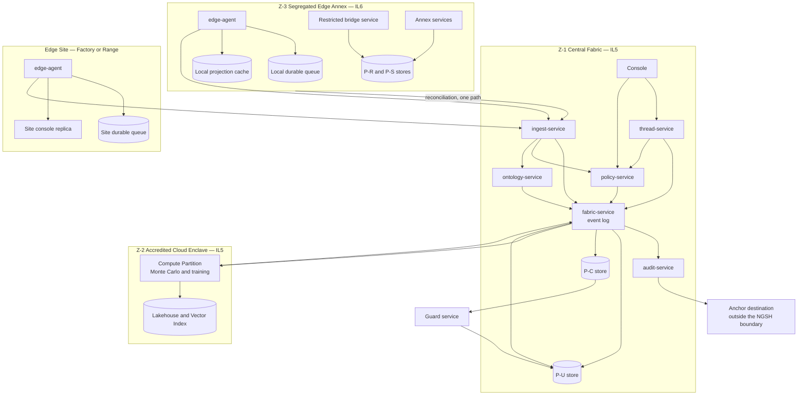
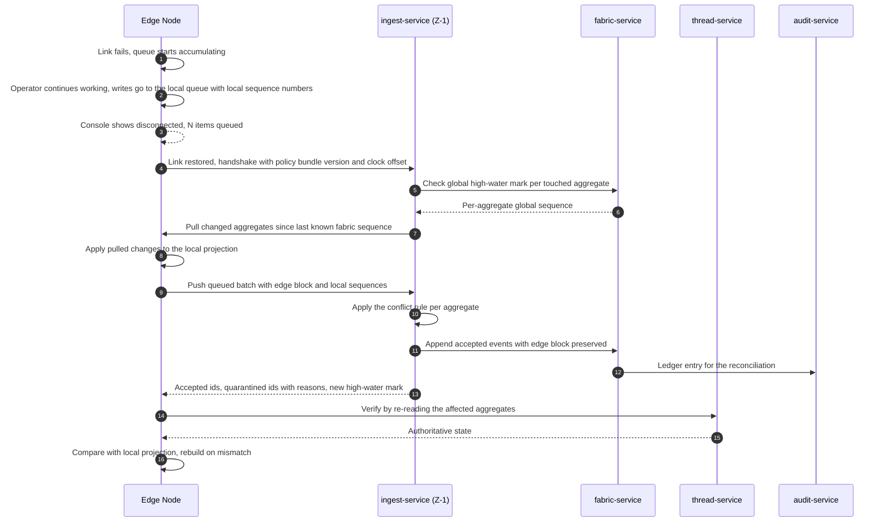

# NGSH Deployment Architecture

## Purpose

This document specifies how NGSH is deployed: the three zones, the four deployment profiles, the reconciliation path between a disconnected edge node and the central fabric, and the degraded-mode behaviour table. It is the operational companion to [ADR-0003](../adr/ADR-0003-platform-agnostic-hybrid-deployment.md), which states the decision; this document states the topology, the configuration surface and the observable behaviour.

## Contents

1. [Zones](#1-zones)
2. [Deployment profiles](#2-deployment-profiles)
3. [Zone topology](#3-zone-topology)
4. [Capability declarations](#4-capability-declarations)
5. [Reconciliation path](#5-reconciliation-path)
6. [Degraded-mode behaviour](#6-degraded-mode-behaviour)
7. [Configuration and promotion](#7-configuration-and-promotion)
8. [Data placement rules](#8-data-placement-rules)
9. [Observability and operations](#9-observability-and-operations)
10. [Scaling and cost model](#10-scaling-and-cost-model)
11. [References](#11-references)

## 1. Zones

| Zone | Name | Accreditation | Role | Primary contents |
|---|---|---|---|---|
| **Z-0** | Developer local | None. Synthetic data only | Developer workstation or CI runner. DP-L profile | All six services against local emulators, the edge agent, the console |
| **Z-1** | Central fabric | IL5 (FedRAMP Moderate equivalent), CMMC 2.0 L2+ | The system of record and the shared platform | Fabric (event log), ontology, policy, audit, thread, ingest services; console; P-U and P-C partitions |
| **Z-2** | Accredited cloud enclave | IL5, with a defined path to higher assurance where required | Elastic compute for burst and heavy workloads | Monte Carlo partition, ML training, model serving, lakehouse, vector index |
| **Z-3** | Segregated edge annex | IL6 / physical security. Physically segregated from Z-1 and Z-2 | Field and factory execution. Disconnected-capable | Edge agent, local durable queue, local projection cache, local ingest buffer, local console replica, P-R and P-S partitions at the IL6 annex |

**Why three zones and not two.** The IL6 annex and the edge site are different things with different accreditation, different physical security and different operational constraints. The IL6 annex is a controlled facility with classified content and a standing operations staff. The edge site is a factory floor or a range, possibly with no fixed power reliability guarantee, no privileged access and a part-time operator. Modelling them as one zone with two configurations would push the annex's security requirements onto an industrial host and the edge's operational constraints onto a classified facility. Three zones keeps each one honest.

**The compatibility matrix.**

| | Z-0 | Z-1 | Z-2 | Z-3 |
|---|---|---|---|---|
| **Z-0** local | — | No path | No path | No path |
| **Z-1** central fabric | No path | — | Bidirectional | One-way outbound to Z-3 for reconciliation; no transitive Z-1→Z-3→Z-1 path through a shared trust |
| **Z-2** cloud enclave | No path | Bidirectional | — | No path |
| **Z-3** edge annex / IL6 | No path | Via the reconciliation protocol | No path | — |

The absence of a Z-3 → Z-2 path is deliberate. The cloud enclave has no credentials for the restricted partitions, and the edge annex has no route to it.

## 2. Deployment profiles

Four profiles. One build. The difference is configuration and accreditation, never source.

| Profile | Where | Compute | Acceleration | Data partitions | Identity | Posture | Typical use |
|---|---|---|---|---|---|---|---|
| **DP-L** Local | Developer workstation, CI runner | Local process or container | None | P-U only, synthetic data | Mock identity, mock clearance attributes | No classified content; no real threat data | Contract tests, replay tests, the degraded-mode harness, UI work |
| **DP-5** IL5 enclave | Z-1 and Z-2 | Managed Kubernetes or equivalent | Autoscaling on the compute partition; managed object and graph services | P-U, P-C | PIV/ICAM, production | CUI; CMMC L2+; multi-tenant | The production posture for all CUI data |
| **DP-6** IL6 annex | Z-3 | Bare metal or a small on-premise cluster | Local only. No external control plane | P-U, P-C, P-R, P-S | Local authority, synchronised from ICAM | SECRET-classified content; physical security | The segregated annex; the only zone that may hold threat and fire-control data |
| **DP-E** Edge | Z-3 at a factory, range or lab | Single-node appliance or container on an industrial host | None. No control plane | P-L, site-local, scoped to the site's accreditation | Local cached clearance attributes; site identity authority | CUI, scoped to the site; degraded mode is a normal state | Store-and-forward capture at the point of work |

**The promotion rule.** The same image digest is promoted across profiles. Only the configuration and the capability declaration change. A separate build per zone is not permitted, because it is the mechanism by which a profile-specific divergence becomes an untracked fork.

| Artefact | Promoted | Not promoted |
|---|---|---|
| Service images | By digest | — |
| Edge agent binary | By digest | — |
| Console bundle | By digest | — |
| Contract layer and generated codecs | By digest, bound into the image | — |
| Deployment manifests | Rebuilt per profile from a common template | — |
| Capability declaration | **Per profile** | — |
| Configuration, secrets, certificates | **Per profile, per zone** | — |
| Policy bundle | Deployed per zone; the *content* is common unless a zone-specific rule exists | — |

## 3. Zone topology



**Reading the diagram.** Z-1 owns the log. Z-2 borrows compute from the log's partition and returns results; it owns no authoritative state. Z-3 holds the restricted partitions and reaches Z-1 only through the reconciliation protocol, so a disconnected annex is a normal state rather than a fault. Each edge site runs its own agent and queue.

## 4. Capability declarations

A deployment profile is expressed as a capability declaration. Services read capabilities, not environment variables.

```yaml
# DP-E — edge site
profile: DP-E
zone: Z-3
nodeId: EDGE-RANGE-07
partitions: [P-L]
capabilities:
  storeAndForward: true
  reconcileBidirectional: true
  localProjectionCache: true
  localConsoleReplica: true
  policyBundleOffline: true
  clockDiscipline: ptp
  bulkIngest: false
  monteCarloDispatch: false
  modelTraining: false
  surrogateInference: false
  sanitizeExtract: false
  crossPartitionBridge: false
```

| Capability | DP-L | DP-5 | DP-6 | DP-E | Effect when absent |
|---|---|---|---|---|---|
| `storeAndForward` | false | false | true | true | The agent refuses to start; there is no safe way to accept a write it cannot persist |
| `reconcileBidirectional` | false | false | true | true | The agent runs read-only against the local projection |
| `localProjectionCache` | true | true | true | true | Reads are served from the fabric directly. Slower, and unavailable when disconnected |
| `localConsoleReplica` | true | false | true | true | The site operator uses the central console, which requires connectivity |
| `policyBundleOffline` | false | true | true | true | Offline enforcement is impossible; the site requires connectivity for every access decision |
| `clockDiscipline` | `none` | `ntp` | `ntp` | `ptp` | Skew is measured but unbounded; batches may be quarantined under rule CS-7 of [ADR-0006](../adr/ADR-0006-edge-degraded-mode-and-reconciliation.md) |
| `bulkIngest` | false | true | false | false | Bulk uploads are queued for the fabric or refused with a scheduled job instead |
| `monteCarloDispatch` | false | true | false | false | The kill-chain simulator's entry point returns `CapabilityUnavailable` and points to the Z-2 submission path |
| `modelTraining` | false | true | false | false | Training is submitted to Z-2. Training on site is refused where the evidence classification would place it above the site's accreditation |
| `surrogateInference` | false | true | true | false | Surrogate models run in the enclave or the annex; the edge uses the full model or nothing |
| `sanitizeExtract` | false | true | true | false | The site cannot produce an extract; extracts are produced centrally |
| `crossPartitionBridge` | false | false | true | false | The restricted bridge service is not deployed. Cross-partition traces are unavailable at this site |

**Rule.** A service that calls a port whose capability is absent returns a typed `CapabilityUnavailable` with a user-facing action. It never falls back to a default, and it never partially applies an operation.

## 5. Reconciliation path

The reconciliation procedure is specified in full in [ADR-0006](../adr/ADR-0006-edge-degraded-mode-and-reconciliation.md). This section describes the operational path.

### 5.1 Timeline of a disconnection and recovery



### 5.2 Reconciliation outcomes

| Outcome | When | Handling |
|---|---|---|
| **Fast-forward** | The edge was the only writer since the branch point | The whole contiguous run is applied in order. The common case, and the quiet one |
| **Append** | The fabric received other writers' events for other aggregates | The edge's run is appended after them. No conflict |
| **Conflict — mutable** | Both sides modified the same mutable aggregate | The deterministic composite key selects a winner. The loser is retained in the ledger and annotated on the aggregate. A review task is raised if the difference is material |
| **Conflict — immutable** | Both sides recorded a result for the same article and campaign | **Never auto-resolved.** Quarantined as `immutable-conflict` and escalated to the programme quality authority. This is the one case where the platform refuses to decide, because it cannot adjudicate physics |
| **Sequence gap** | A queue entry was lost or an overflow drop occurred | The contiguous prefix is applied; the remainder is quarantined as `gap`. A data-completeness task is raised |
| **Divergent sequence** | Two events share a local sequence | Both are quarantined. An edge-node incident is raised |
| **Classification violation** | A merge would produce a downgrade, or a relation would cross a boundary illegally | Both candidates are rejected. A security task is raised |
| **Clock skew** | Measured skew > 60 s | The batch is quarantined as `clock-skew`; the edge's clock is corrected and the batch retried |
| **Clock untrusted** | The site has no trustworthy clock | The batch is processed with `effectiveAt` ordering disabled; ordering is by `recordedAt` only |

### 5.3 Operational requirements

| Requirement | Detail |
|---|---|
| Queue durability | The local queue is durable against process failure and, where the site requires it, replicated to a second local appliance. Media loss protection is a site configuration option |
| Queue capacity and overflow | The queue is bounded. The overflow policy drops by a declared priority order and records every drop. The priority order is agreed with the programme, not chosen by the platform team |
| Edge clock | PTP where the site supports it, otherwise NTP with a site-local reference. The skew is measured at every reconciliation and recorded on every event |
| Edge policy bundle | Signed and versioned. The edge verifies the signature and applies the most restrictive local ruleset if the bundle is stale beyond its bound |
| Operator visibility | The site console shows connection state, queue depth, pending conflicts, last successful sync time and the edge's effective capability declaration |
| Escalation SLA | A quarantined conflict older than the review SLA is reported as an open item in the programme's status, not left in a queue |

## 6. Degraded-mode behaviour

The authoritative table. Each row states what the platform does, not what the operator should hope for.

| Capability | Connected | Disconnected | Notes |
|---|---|---|---|
| **Write a domain fact** | Appended to the fabric; `sequence` assigned; `recordedAt` stamped by the fabric | Appended to the local durable queue with a local sequence and an `edge` block | Both paths are validated against the same contract and the same registry before acceptance |
| **Read a domain fact** | Served from the local projection (or the fabric, where the projection lags) | Served from the local projection | **Read behaviour is identical connected and disconnected.** This is a hard requirement |
| **Read-your-writes** | Guaranteed within the projection lag (≤ 5 s target) | Guaranteed against the local queue and local projection | The local sequence is the anchor |
| **See changes made elsewhere** | Within the projection lag | **Not available.** The last synchronised state is the only state | The console shows the last-sync timestamp prominently |
| **Classify an incoming payload** | Ingest PEP decides, using the live clearance attribute cache | The edge applies its local policy bundle and classifies against the ceiling it is accredited for | An unclassifiable payload defaults to the most restrictive partition, never the least |
| **Enforce authorization** | PDP decision | Local evaluation against the signed bundle; if the bundle is stale beyond its bound, the most restrictive local ruleset applies | Denial is always available |
| **Upload bulk data** | Direct to the ingest service | Queued locally; uploaded on reconnection | The queue's overflow policy applies |
| **Run a Monte Carlo batch** | Dispatched to the Z-2 compute partition | `CapabilityUnavailable`. The UI offers "submit when connected" | The job is queued in the UI, not in the agent |
| **Run a model inference** | Model service enforces the envelope and approval | Only models within the site's accreditation and capability set | `surrogateInference` is absent at DP-E |
| **Train a model** | Dispatched to Z-2 | `CapabilityUnavailable` | Training on site is refused where the evidence classification exceeds the site's accreditation |
| **Produce a sanitized extract** | Guard service runs in the classified zone | Not possible at the edge | Extracts are produced centrally |
| **Verify an audit chain** | Audit service verifies and anchors | The edge retains its local audit entries and uploads them on reconnection | Anchoring resumes on reconnection |
| **Change configuration** | Central configuration plane, audited | No configuration change | An operator cannot reconfigure a disconnected node; the change is applied at the next sync |
| **Upgrade software** | Rolling update by digest | No upgrade while disconnected | The edge upgrades when it reconnects; the digest is the same one used everywhere |

### 6.1 Degraded-mode observable signals

| Signal | Where | Alert threshold |
|---|---|---|
| Edge link state | Edge health endpoint, central fleet view | Immediate on loss for sites marked critical |
| Queue depth | Edge telemetry | > 50% capacity for 15 minutes |
| Queue overflow drops | Edge audit log | Any drop |
| Quarantined conflicts | Central fabric quarantine store | Any `immutable-conflict` or `classification-violation`; > 5 of any other class |
| Reconciliation latency | Time from link restore to full sync | > 30 minutes |
| Clock skew | `edge.clockSkewMs` distribution | > 5 s sustained, > 60 s immediate |
| Anchor lag | Audit service metrics | > 30 minutes |
| Projection lag | Thread service metrics | > 60 s sustained |

## 7. Configuration and promotion

### 7.1 Configuration hierarchy

| Layer | Content | Owner | Change mechanism |
|---|---|---|---|
| **Image** | The built artefact, by digest | Platform pod | CI; a new digest. Never rebuilt for a zone |
| **Capability declaration** | What the profile can do | Platform pod, per profile | Profile template. A profile change is a configuration change request |
| **Deployment manifest** | Replicas, resources, storage classes, network policy | Platform pod | GitOps. The same digest, different manifest |
| **Zone configuration** | Endpoints, partition bindings, key references, policy bundle version | Platform pod with the security office | GitOps, with a review gate |
| **Policy bundle** | The authorization rules | Policy owner, approved by the security office | Versioned document; `policyVersion` on every decision |
| **Runtime state** | The event log, the ledger, projections | The platform | Not configuration. Never edited by hand |

### 7.2 Promotion path

| Step | Action | Gate |
|---|---|---|
| 1 | Build and test in DP-L | All conformance suites pass |
| 2 | Publish the artefact by digest with its SBOM, provenance attestation and signature | CI gates pass, including the negative isolation suite and the seeded-tamper suite |
| 3 | Promote to DP-5 | Z-1 and Z-2 soak. Projection lag and error rate within SLO |
| 4 | Promote to DP-6 | Annex readiness review: physical security, key ceremony, connectivity test |
| 5 | Promote to DP-E | Site accreditation letter; clock discipline verified; policy bundle installed and signed |
| 6 | Roll back | The previous digest is promoted. **Rollback is a promotion**, and it goes through the same gates. There is no separate rollback path that bypasses review |

## 8. Data placement rules

| Data | Placement | Rule |
|---|---|---|
| Raw test, telemetry and imagery bytes | Object store, in the partition matching the batch's classification | The digest is in the log; the log holds the pointer, never the payload |
| High-rate sensor channels | Time-series store, in the same partition | Referenced from `process.run.completed.sensorChannels[]` |
| Domain entities | Graph projection, in the partition matching the entity's classification | A partition credential cannot write to another partition |
| Documents, ICDs, curricula, playbooks | Document store, in the matching partition | — |
| Curated ML corpora | Lakehouse, in the matching partition | Training runs in a partition the evidence allows |
| Embeddings | Vector index, in the matching partition | An accelerator, never a source of truth |
| Curated extracts for academic partners | P-U only | Produced by the guard. One-way |
| Model artefacts and cards | The partition matching the model's evidence set | A model trained on RESTRICTED evidence is RESTRICTED |
| The audit ledger | Partitioned by the classification of the audited resource | The chain spans partitions as contiguous segments |
| The event log | Partitioned by the classification of the event | A record's partition is immutable for its life |

## 9. Observability and operations

| Concern | Approach |
|---|---|
| Tracing | OpenTelemetry. The envelope's `correlationId` ties a client request to the decision, the append, the audit entry and the projection update |
| Metrics | Prometheus-style, per service, per zone. The SLO set is: append latency, projection lag, decision latency, ingestion throughput, queue depth, anchor lag, reconciliation latency |
| Logs | Structured, classified to match the data they describe. A log line carrying classified content goes to the classified log store, not the aggregate one |
| Health | `/healthz` for liveness, `/readyz` for readiness including registry load, policy bundle freshness, clearance cache freshness and ledger write reachability |
| Diagnostics | The edge exports its effective capability declaration, adapter versions, policy bundle version and clock offset with every diagnostic bundle, so a field failure can be reproduced in DP-L |
| Synthetic monitoring | A synthetic write-read round trip per zone, including a P-S round trip in the IL6 annex, on a short interval |
| Incident runbook | Each alert has a runbook. The runbook for an anchor failure, a partition breach attempt and a reconciliation conflict storm are specified in advance |

## 10. Scaling and cost model

| Dimension | Scaling approach | Constraint |
|---|---|---|
| Append throughput | Horizontal, by partition count. Partitions key on aggregate identity | Per-aggregate ordering requires one partition per aggregate |
| Projection read | Horizontal, by partition and aggregate hash | Depth and fan-out caps per query |
| Ingestion | Horizontal, by source and partition | Per-partition ceiling is lower than the aggregate |
| Monte Carlo | Elastic, in Z-2 | The ≥ 10,000-run batch in < 4 h target (PSDD §8) is a Z-2 workload. The annex and the edge cannot host it |
| ML training | Elastic, in Z-2 | Evidence classification may prevent dispatch to Z-2 entirely; the training then runs in the annex at lower scale |
| Edge sites | Linear, by site | Each site is independently accredited; growth is an accreditation and logistics problem more than a technical one |
| Storage | Per partition | Storage cost scales with the number of partitions times the zones, which is the largest single cost driver of the platform ([ADR-0007](../adr/ADR-0007-classification-partitioning.md) N-1) |
| Policy decisions | Horizontal, with a bounded decision cache | The cache TTL bounds the exposure of a stale clearance; it is a security parameter, not only a performance one |

**The cost observation that matters.** Partitioning multiplies infrastructure cost by the number of partitions. The design accepts this deliberately, and the compensating decision is that the elastic, expensive work — Monte Carlo and training — is concentrated in Z-2 where it can be scaled and shut down, while the steady-state fabric runs on predictable capacity. If the partition count grows, the guidance is to add partitions only where a real confidentiality boundary exists, not where a caveat would suffice.

## 11. References

**PSDD:** §4.1 (concept and zone sketch), §4.2 principle 3 (deployable at the edge), §5.7 (G-1 virtual test range, G-2 campaign digital twin), §6.2 (data stores), §6.3 (data governance), §7 (IF-4 range instrumentation), §8 (Availability, Performance, Scalability, Modularity), §10 (deployment pattern, cross-domain guards), §13 (risks — classification friction, threat-model data access chokepoint).

**Contracts:**
- `contracts/events/event-envelope.schema.json` — the `edge` block (`nodeId`, `capturedAt`, `reconciledAt`, `clockSkewMs`) and the `occurredAt` / `recordedAt` split that makes the reconciliation path auditable.
- `contracts/events/ingest.batch.accepted.schema.json` — the batch-level reconciliation record with `sha256`, `objectUri` and the `edge` block.
- `contracts/events/test.result.recorded.schema.json` — `supersedesRef`, the mechanism that keeps a correction from becoming a conflict.
- `contracts/ontology/registry.json` — `classificationFloor` per type, which determines which partitions must exist for a type to be writable.

**ADRs:** [ADR-0003](../adr/ADR-0003-platform-agnostic-hybrid-deployment.md) (the decision this document specifies), [ADR-0006](../adr/ADR-0006-edge-degraded-mode-and-reconciliation.md) (the reconciliation rules), [ADR-0007](../adr/ADR-0007-classification-partitioning.md) (partition model and placement rules), [ADR-0001](../adr/ADR-0001-event-sourced-foundation.md) (the log that every zone shares), [ADR-0004](../adr/ADR-0004-abac-with-pdp-pep-separation.md) (the PDP that runs in every zone).

**Sibling documents:** [`01-system-context.md`](01-system-context.md), [`03-foundation-services.md`](03-foundation-services.md), [`04-security-architecture.md`](04-security-architecture.md), [`../roadmap/increments.md`](../roadmap/increments.md), [`../risk-register.md`](../risk-register.md).
