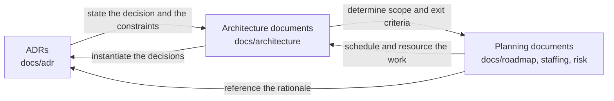

# NGSH Architecture Documentation

## Purpose

This directory holds the architecture documentation for the NGSH platform. Where the ADRs in [`../adr/`](../adr/README.md) record *why* a decision was taken, these documents record *what* the resulting architecture is: the platform context, the shared ontology, the foundation services, the security architecture and the deployment topology. Each document is written to be read on its own and referenced from the others.

## Contents

| Document | Subject | Primary audience |
|---|---|---|
| [`01-system-context.md`](01-system-context.md) | What NGSH is, the two mission sides, the shared-ontology argument, external actors and IF-1 to IF-7, scope boundaries and the ten architectural invariants | Everyone. Read this first |
| [`02-ontology-model.md`](02-ontology-model.md) | The 23 entity types and 10 relation types, constraints C-001 to C-008, the change-control path for a new type, and three worked trace paths | Engineers extending the model; partners integrating against it; assessors reviewing lineage and classification constraints |
| [`03-foundation-services.md`](03-foundation-services.md) | The six foundation services — ontology, fabric, policy, audit, thread, ingest — their APIs, stores, scaling, failure modes and events; the end-to-end "record a test result" sequence | Platform engineers; pillar engineers building on the foundation; the foundation exit criteria |
| [`04-security-architecture.md`](04-security-architecture.md) | Zero-trust posture, the attribute model, PDP/PEP topology, physical partitioning, identity and clearance verification, the audit trail, key management, the trust-boundary diagram, accreditation boundaries, SBOM and CMMC L2+ obligations | Security engineers; the security office; assessors; anyone adding a service or a data path |
| [`05-deployment-architecture.md`](05-deployment-architecture.md) | The three zones, the four deployment profiles, capability declarations, the reconciliation path, the degraded-mode behaviour table, configuration and promotion | Platform and SRE engineers; field and range operators; programme management |

## Reading order

| If you are | Read |
|---|---|
| New to the programme | `01-system-context.md`, then [`../roadmap/increments.md`](../roadmap/increments.md) |
| Building a pillar service | `03-foundation-services.md`, then `02-ontology-model.md`, then the relevant ADR |
| Extending the ontology | `02-ontology-model.md` §7, then [ADR-0002](../adr/ADR-0002-json-schema-contracts-over-shared-libraries.md) |
| Adding an API or a data path | `04-security-architecture.md` §4 and §12, then [ADR-0004](../adr/ADR-0004-abac-with-pdp-pep-separation.md) |
| Deploying or operating the platform | `05-deployment-architecture.md`, then [ADR-0003](../adr/ADR-0003-platform-agnostic-hybrid-deployment.md) |
| Working at a factory or range | `05-deployment-architecture.md` §6, then [ADR-0006](../adr/ADR-0006-edge-degraded-mode-and-reconciliation.md) |
| Preparing for an assessment | `04-security-architecture.md` §10 and §11, then [ADR-0005](../adr/ADR-0005-tamper-evident-audit-ledger.md) and [ADR-0007](../adr/ADR-0007-classification-partitioning.md) |
| Planning the programme | [`../roadmap/increments.md`](../roadmap/increments.md), [`../roadmap/work-packages.md`](../roadmap/work-packages.md), [`../staffing.md`](../staffing.md), [`../risk-register.md`](../risk-register.md) |

## Relationship between the documents and the ADRs

The ADRs are normative where they speak. The architecture documents are normative about structure and interfaces. Where the two differ, the ADR governs the decision and the architecture document is corrected.

## Conventions used in these documents

| Convention | Meaning |
|---|---|
| `PSDD §6.1` | A section of the Preliminary Software Design Document |
| `Pillar G-3` | A pillar capability id as used in PSDD §5 |
| `C-004` | A constraint id from `contracts/ontology/registry.json` |
| `WP-0.1` | A work package from [`../roadmap/work-packages.md`](../roadmap/work-packages.md) |
| `R-11` | A risk id from [`../risk-register.md`](../risk-register.md) |
| `ADR-0007` | An architecture decision record |
| `P-U`, `P-C`, `P-R`, `P-S` | Classification storage partitions, per [ADR-0007](../adr/ADR-0007-classification-partitioning.md) |
| `Z-0`..`Z-3` | Deployment zones, per [ADR-0003](../adr/ADR-0003-platform-agnostic-hybrid-deployment.md) |
| `DP-L`, `DP-5`, `DP-6`, `DP-E` | Deployment profiles, per [`05-deployment-architecture.md`](05-deployment-architecture.md) |
| `FOUNDATION` | The foundation services, distinct from the PSDD "foundation layer" which comprises Pillars A to D |

### Local identifier prefixes

A single-letter identifier of the form `X-n` is **always** a PSDD pillar capability id. Every document-local rule, table row or option therefore uses a two-letter prefix, so that the two can never be confused:

| Prefix | Meaning | Used in |
|---|---|---|
| `ALT-n` | A rejected alternative in an ADR's *Alternatives Considered* | All ADRs |
| `DR-n` | A decision rule | [ADR-0001](../adr/ADR-0001-event-sourced-foundation.md) (as `DR-1.n`), [ADR-0008](../adr/ADR-0008-model-card-and-fidelity-registry.md) (approval rules), [`02-ontology-model.md`](02-ontology-model.md) (design rules) |
| `DS-n` | A decision-semantics rule | [ADR-0004](../adr/ADR-0004-abac-with-pdp-pep-separation.md), [ADR-0007](../adr/ADR-0007-classification-partitioning.md) |
| `GEN-n` | A guarantee the code generator must provide | [ADR-0002](../adr/ADR-0002-json-schema-contracts-over-shared-libraries.md) |
| `EN-n` | An applicability-envelope rule | [ADR-0008](../adr/ADR-0008-model-card-and-fidelity-registry.md) |
| `FD-n` | A property of the fidelity-update path | [ADR-0008](../adr/ADR-0008-model-card-and-fidelity-registry.md) |
| `CC-n` | A conflict class in edge reconciliation | [ADR-0006](../adr/ADR-0006-edge-degraded-mode-and-reconciliation.md) |
| `CS-n` | A clock-skew rule | [ADR-0006](../adr/ADR-0006-edge-degraded-mode-and-reconciliation.md) |
| `FE-n` | A foundation exit criterion | [`03-foundation-services.md`](03-foundation-services.md) §12 |
| `TB-n` | A trust boundary | [`04-security-architecture.md`](04-security-architecture.md) §9 |
| `CR-n` | A composition rule for pods | [`../staffing.md`](../staffing.md) §3 |
| `RP-n` | A ramp-up phase | [`../staffing.md`](../staffing.md) §8 |
| `X-n` | An enumerated exception to a rule | [ADR-0001](../adr/ADR-0001-event-sourced-foundation.md), [ADR-0007](../adr/ADR-0007-classification-partitioning.md) |
| `P-n`, `N-n`, `S-n`, `Z-n`, `O-n`, `T-n`, `I-n`, `R-n` (two digits) | Positive consequence, negative consequence, sequence rule, zone, objective, traversal rule, invariant, risk | Throughout. `R-nn` is a risk id from [`../risk-register.md`](../risk-register.md) |
| `C-001`..`C-009` | An ontology constraint id from `contracts/ontology/registry.json` | Throughout. `C-009` is a *proposed* extension that does not yet exist in the registry |
| `SG-n` | A known security gap | [`04-security-architecture.md`](04-security-architecture.md) §13 |
| `AB-n` | An accreditation boundary | [`04-security-architecture.md`](04-security-architecture.md) §10 |
| `WP-x.y` | A work package | [`../roadmap/work-packages.md`](../roadmap/work-packages.md) |

**A note on that last convention.** PSDD §4.1 uses "FOUNDATION LAYER" to mean Pillars A, B, C and D — the pillars that sit below the mission layer. The contracts use `owner: FOUNDATION` on the six events produced by the foundation *services*. These are different things and the naming collides. Throughout this documentation "foundation services" means the six services and "PSDD foundation layer" means Pillars A–D. The collision is flagged for reconciliation in the programme's documentation review.

## Related documents

| Document | Relationship |
|---|---|
| [`../adr/README.md`](../adr/README.md) | The decision index and the ADR process |
| [`../roadmap/increments.md`](../roadmap/increments.md) | Increment 0 (foundation) through Increment 5 |
| [`../roadmap/work-packages.md`](../roadmap/work-packages.md) | The work breakdown, with acceptance criteria, dependencies and pod assignments |
| [`../staffing.md`](../staffing.md) | The pod model and the three reference organisations |
| [`../risk-register.md`](../risk-register.md) | The programme and delivery risk register |

## Source of truth

| Concern | Source of truth | The documents in this directory |
|---|---|---|
| Architectural decisions | The ADRs | Describe and apply them |
| Entity, relation and constraint definitions | `contracts/ontology/registry.json` and the JSON Schema files | Summarise and explain them |
| Event types and routing | `contracts/events/catalog.json` | Describe how each is used |
| Pillar capabilities | PSDD §5 | Reference the ids; do not restate the descriptions as definitions |
| Deployment topology | [ADR-0003](../adr/ADR-0003-platform-agnostic-hybrid-deployment.md) plus the deployment manifests | Describe the profiles and the behaviour |
| Requirements | PSDD §8 | Map to mechanisms; do not restate as requirements |

**Where a document in this directory contradicts a contract file, the contract file wins and the document is a defect.** The contracts are generated into every language and enforced at runtime; the documents are prose.
