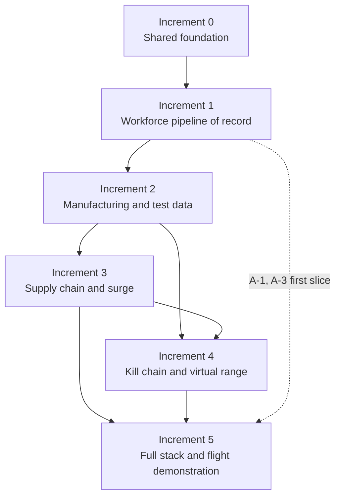

# NGSH Increment Plan

## Purpose

This document sequences the NGSH programme into six increments. Increment 0 builds the shared foundation; Increments 1 to 5 deliver the pillar capabilities and align to the phases in PSDD §11. For each increment it states the objective, the capabilities delivered by reference to the PSDD pillar capability ids, exit criteria that are testable and measurable, dependencies on other increments and external parties, and the programme risk that the increment retires.

## Contents

1. [Sequencing model](#1-sequencing-model)
2. [Increment summary](#2-increment-summary)
3. [Increment 0 — Shared foundation](#3-increment-0--shared-foundation)
4. [Increment 1 — Workforce pipeline of record](#4-increment-1--workforce-pipeline-of-record)
5. [Increment 2 — Manufacturing and test data](#5-increment-2--manufacturing-and-test-data)
6. [Increment 3 — Supply chain and surge](#6-increment-3--supply-chain-and-surge)
7. [Increment 4 — Kill chain and virtual range](#7-increment-4--kill-chain-and-virtual-range)
8. [Increment 5 — Full stack and flight demonstration](#8-increment-5--full-stack-and-flight-demonstration)
9. [Increment dependency map](#9-increment-dependency-map)
10. [The 2027 validation event](#10-the-2027-validation-event)
11. [Standalone-product test](#11-standalone-product-test)
12. [References](#12-references)

## 1. Sequencing model

### 1.1 Increment 0 precedes Phase 1

PSDD §11 phases the programme into seven phases, beginning with Phase 1 (Pillar E MVP under a WISH-type OTA). **Increment 0 is not a phase.** It precedes Phase 1 and is a prerequisite for it.

| Aspect | Increment 0 | PSDD Phase 1 |
|---|---|---|
| Duration | 9–12 months | 12–18 months (PSDD §11) |
| Content | Ontology, contracts, event log, policy, audit, graph projection, ingestion, edge sync, partitioning | Pillar E minimum viable product at 2–3 institutions and 1 Navy lab |
| Pillar capabilities delivered | None | E-1, E-2, E-3, E-4, E-5 |
| Why it cannot be skipped | Pillar E's curriculum (E-1, E-2) is drawn from the digital thread and delivered through sanitized extracts. Without the ontology, the partitioning and the guard, there is nothing to draw from, nothing safe to deliver, and no way to show the academic partner what was extracted or why |

This is the programme's principal deviation from PSDD §11, and it is deliberate. PSDD §11 is a *business* phasing — it sequences funding vehicles and revenue events. It is not a *technical* sequencing. Building Pillar E before the shared fabric would produce a curriculum product with no traceable provenance, which is the opposite of the platform's thesis.

### 1.2 Increment structure

Every increment has the same five-part structure, and each increment ends with a standalone product that can be demonstrated to a sponsor.

| Part | Question answered |
|---|---|
| Objective | What is true at the end of this increment that was not true at the start |
| Capabilities | Which PSDD pillar capability ids are delivered, and to what depth |
| Exit criteria | What must be measured, and to what threshold |
| Dependencies | What must already exist, and what must exist outside the programme |
| Risk retired | Which risk from [`../risk-register.md`](../risk-register.md) the increment closes, and which it only reduces |

### 1.3 Delivery model

| Aspect | Model |
|---|---|
| Sizing | Work packages, not time-boxed features. See [`work-packages.md`](work-packages.md) |
| Staffing | Pods of 6–9 engineers, scaled by adding pods. See [`../staffing.md`](../staffing.md) |
| Increment duration | 9–18 months, dependent on the pod count committed |
| Increment boundary | An increment is a *capability boundary*, not a calendar boundary. A pod can start Increment 2 work before Increment 1 exits, provided it does not depend on unexited criteria |
| Independent deployment | Every pillar is independently deployable and licenseable (PSDD §8). Each increment ends with at least one pillar that can be licensed on its own |

## 2. Increment summary

| Increment | Aligns to | Primary pillars | Capabilities | Duration | Exit gate |
|---|---|---|---|---|---|
| **0** Shared foundation | Precedes PSDD Phase 1 | None (foundation services) | None | 9–12 months | FE-1..FE-10 in [`../architecture/03-foundation-services.md`](../architecture/03-foundation-services.md) §12 |
| **1** Workforce pipeline of record | PSDD Phase 1 | E (plus the Pillar A first slice) | E-1, E-2, E-3, E-4, E-5, A-1, A-3 | 12–15 months | E-1..E-3 demonstrable at 2–3 institutions and 1 Navy lab |
| **2** Manufacturing and test data | PSDD Phase 2 | B, C | B-1, B-2, B-3, B-4, C-1, C-2, C-3, C-4 | 15–18 months | A CMC lot traced from prepreg to a flight-representative test result |
| **3** Supply chain and surge | PSDD Phase 3 | D, H | D-1, D-2, D-3, H-1, H-2, H-3 | 15–18 months | Verified surge rate and a reconstitution playbook for a named critical node |
| **4** Kill chain and virtual range | PSDD Phase 4 | F, G | F-1, F-2, F-3, F-4, F-5, F-6, G-1, G-2, G-3, G-4 | 15–18 months | A 10,000-run engagement batch inside the performance budget |
| **5** Full stack and flight demonstration | PSDD Phase 5 | A (complete) | A-2, A-4, A-5 | 18–24 months | A full requirement-to-flight trace on a real configuration baseline |

**Total capability coverage.** All 34 PSDD capability ids — A-1..A-5, B-1..B-4, C-1..C-4, D-1..D-3, E-1..E-5, F-1..F-6, G-1..G-4, H-1..H-3 — are delivered across Increments 1 through 5.

## 3. Increment 0 — Shared foundation

### Objective

At the end of Increment 0, a single event log carries the shared ontology, every access decision is authorized by one policy service and independently attested by a tamper-evident audit ledger, storage is physically partitioned by classification, and the same build runs in the central fabric, the cloud enclave, the IL6 annex and a disconnected edge site.

Increment 0 delivers no pillar capability. It delivers the substrate on which every pillar capability depends, and it delivers it first because retrofitting an ontology, a contract layer or a partitioning scheme into eight pillars is not possible.

### Capabilities delivered

None from the PSDD pillar list. The capabilities that Increment 0 delivers are foundational and are named in the architecture documents:

| Foundational capability | Where specified |
|---|---|
| The 23 entity types and 10 relation types, registered and validated | [`../architecture/02-ontology-model.md`](../architecture/02-ontology-model.md) |
| Constraints C-001 to C-008, each with an enforcement point and a negative test | [`../architecture/02-ontology-model.md`](../architecture/02-ontology-model.md) §4 |
| The event log as system of record, with replay determinism | [ADR-0001](../adr/ADR-0001-event-sourced-foundation.md) |
| The JSON Schema contract layer with generated codecs for Go, Python and TypeScript | [ADR-0002](../adr/ADR-0002-json-schema-contracts-over-shared-libraries.md) |
| Four deployment profiles from one build | [ADR-0003](../adr/ADR-0003-platform-agnostic-hybrid-deployment.md) |
| PDP/PEP topology with obligations | [ADR-0004](../adr/ADR-0004-abac-with-pdp-pep-separation.md) |
| The tamper-evident audit ledger with external anchoring | [ADR-0005](../adr/ADR-0005-tamper-evident-audit-ledger.md) |
| Edge degraded mode with deterministic reconciliation | [ADR-0006](../adr/ADR-0006-edge-degraded-mode-and-reconciliation.md) |
| Physical classification partitioning and the guard | [ADR-0007](../adr/ADR-0007-classification-partitioning.md) |
| Model card and fidelity registry | [ADR-0008](../adr/ADR-0008-model-card-and-fidelity-registry.md) |

### Exit criteria

| # | Criterion | Measurement |
|---|---|---|
| I0-1 | The contract layer is complete and enforced | All 23 entity types, 10 relation types and 10 event types have generated codecs in Go, Python and TypeScript. The codegen staleness check passes. 100% of the contract conformance fixtures pass in every language |
| I0-2 | The registry is enforced | All 8 constraints have an implemented enforcement point and a seeded-violation test. The violation is rejected at the specified scope (write, use, post or read) |
| I0-3 | The event log is deterministic under replay | A synthetic log containing all 10 event types is replayed 100 times; every projection is byte-identical across runs. A full rebuild of a 10^9-event synthetic log completes in ≤ 2 hours at ≥ 500,000 events/s |
| I0-4 | Every access is decided and recorded | 100% of test requests produce both an `access.decision.recorded` event and a ledger entry. The ledger-to-event cross-check reports zero unexplained mismatches over a 30-day soak |
| I0-5 | Classification partitioning is physical | Cross-partition reads and writes are attempted across every service and every API endpoint; 100% fail. The negative isolation suite is a release gate |
| I0-6 | Degrade is safe | No code path proceeds silently when a declared capability is absent. The degraded-mode conformance suite asserts this across every capability in the declaration |
| I0-7 | The edge operates disconnected | The edge agent runs 72 hours disconnected, accepts writes, and reconciles. The final state is identical across 100 randomised event orderings. No fact is lost or duplicated |
| I0-8 | The audit ledger verifies and detects | Verification passes on an untampered ledger and reports the correct finding class on each of the four seeded tamper classes: altered entry, removed entry, rewritten history, broken anchor |
| I0-9 | One build, four profiles | The same image digest runs DP-L, DP-5, DP-6 and DP-E, and the conformance suite passes against each. The CI dependency-boundary check proves no cloud SDK in any domain package |
| I0-10 | The programme can be accredited | The SBOM, the provenance attestation, the signed verification report and the partition isolation evidence form a complete CMMC L2 evidence package for the foundation scope |

### Dependencies

| Type | Dependency | Needed by |
|---|---|---|
| Internal | None. Increment 0 is the first increment | — |
| External | A PIV/ICAM integration profile (OIDC or equivalent) selected and an attribute source available for clearance and citizenship | I0-4, I0-10 |
| External | HSM availability in Z-1 and Z-3 for the P-S and P-R key classes | I0-5, I0-10 |
| External | An anchor destination under separate administrative control, outside the NGSH boundary | I0-8, I0-10 |
| External | A P-C and P-R partition accreditation path agreed with the security office | I0-5 |
| External | Two edge sites identified, one factory and one range, willing to host an appliance | I0-7 |

### Risk retired

| Risk | Effect of the increment |
|---|---|
| **R-07 Integration debt across pillars** | The contract layer and the event catalogue are the coupling mechanism from day one. Pillar integration is subscription to an event group, not a bespoke interface |
| **R-08 Contract drift** | Codegen plus the staleness check plus the conformance fixtures make drift a build failure rather than a production surprise |
| **R-20 Event log / projection divergence** | Replay determinism and the rebuild procedure are proven in Increment 0, before any pillar depends on them |
| **R-16 Multi-tenant isolation failure** | The negative isolation suite is a release gate from the first build |
| **R-14 Key-personnel concentration** (partially) | The contract layer, the registry and the ADRs are written artefacts, so the design does not live in one person's head |

## 4. Increment 1 — Workforce pipeline of record

### Objective

At the end of Increment 1, a cleared workforce can be trained against the actual digital thread, credentialed against real process qualifications, and deployed to work sites — and a curriculum package can be delivered to an academic partner through a one-way sanitized extract that the platform can prove.

### Capabilities delivered

| Capability | Description | Depth |
|---|---|---|
| **E-1** Digital-twin training | AR/VR and screen simulators built on the actual digital thread — real CMC cells, test stands, assembly lines | MVP at 2–3 institutions and 1 Navy lab, per PSDD §11 Phase 1 |
| **E-2** Replicable curriculum engine | Deployable courseware packages for any university or manufacturing hub | MVP. Package format, deployment to a partner environment, and a partner-hosted deployment of at least one package |
| **E-3** Skills credentialing | Badging tied to real process qualifications; feeds B-1 work authorisation | MVP. Issue, expiry, suspension and revocation, with C-005 and C-006 enforced at issue and at reference |
| **E-4** Workforce demand model | Gap analysis of cleared-skills supply against classified production demand, by region and trade | MVP. A monthly gap report by region and trade, produced from `Person`, `Credential`, `Skill`, `Facility.constrainedBySkillIds` and `ProcessPlan.operations[].requiredSkillIds` |
| **E-5** Industry–academia sandbox | Shared, sanitized environments for real manufacturing scenarios | MVP. The one-way extract pipeline operating end to end with an anchored manifest |
| **A-1** Digital twin backbone | Single source of truth for configuration, interfaces and requirements across payload, booster, GNC, airframe, TPS | **First slice.** The configuration baseline, the interface registry and the requirement graph. Not yet the full SysML environment |
| **A-3** Requirements-to-test traceability | End-to-end trace with automated coverage and verification status reporting | **First slice.** The trace mechanism and the coverage rollup, exercised with a small requirement set. The full Pillar A scope completes in Increment 5 |

**Why A-1 and A-3 are in Increment 1.** E-1 and E-2 draw their content from the digital thread, and E-3 issues credentials against process qualifications that live on `ProcessPlan` and `Facility`. Delivering Pillar E without a configuration baseline and a trace mechanism would mean the curriculum is built on illustrative rather than real configurations, which defeats the purpose. This is a deliberate augmentation of PSDD §11 Phase 1 and it is flagged as such.

### Exit criteria

| # | Criterion | Measurement |
|---|---|---|
| I1-1 | Training uses the real thread | ≥ 90% of the training scenarios in the pilot institutions reference at least one live `System`, `Variant`, `Part`, `ProcessPlan` or `Facility` entity. Zero scenarios built on placeholder data |
| I1-2 | The curriculum is genuinely replicable | A courseware package is deployed and run by an academic partner without NGSH staff on site, in ≤ 10 working days from handoff. The partner does not need the NGSH console |
| I1-3 | Credentials are real | ≥ 100 credential records issued, each referencing a `Skill` and a `Person`, with C-005 and C-006 enforced. A test suite proves that an expired clearance, a foreign citizenship on an export-controlled activity, and a lapsed credential are each rejected |
| I1-4 | The workforce gap is quantified | A gap report is produced monthly for ≥ 3 consecutive months, by region and trade, showing cleared-skills supply against classified production demand. The report is reproducible from the ontology |
| I1-5 | The sandbox is safe | Every extract released to a partner carries a manifest with source ids, transformation rules, guard version and reviewer. Every manifest is anchored in the audit ledger. A seeded attempt to extract a RESTRICTED record is blocked by the guard and recorded |
| I1-6 | The trace works | A requirement trace from a `Requirement` to a `TestResult` and back is executed for ≥ 50 requirements. Coverage status is computed automatically and agrees with a manual assessment on 100% of sampled traces |
| I1-7 | The platform is usable by a real operator | ≥ 10 programme office users complete ≥ 20 tasks per week in the console for 4 consecutive weeks, with no support intervention required for the common paths |
| I1-8 | E-1 is standalone-licensable | Pillar E can be deployed and licensed without any other pillar running, against the published contracts only |
| I1-9 | Audit completeness | 100% of access decisions across the pilot period have both an event and a ledger entry, with zero unexplained mismatches in the daily cross-check |

### Dependencies

| Type | Dependency | Needed by |
|---|---|---|
| Increment | Increment 0 exit criteria I0-1..I0-10 | Everything |
| External | WISH-type OTA vehicle and the 2–3 partner institutions | I1-1, I1-2 |
| External | A Navy laboratory host for the pilot | I1-1 |
| External | Academic partner acceptance of the sanitized-extract terms | I1-5 |
| External | Programme office access to the classified production demand data for the gap analysis | I1-4 |
| External | AR/VR hardware or screen-simulator provision at the pilot sites | I1-1 |

### Risk retired

| Risk | Effect of the increment |
|---|---|
| **R-02 Prime data-sharing resistance** | Pillar E is the entry wedge (PSDD §13) and it uses the least sensitive data. A successful Increment 1 makes the data-sharing conversation about *adding* trust to an existing relationship rather than starting one |
| **R-12 Data rights and intellectual property** | The one-way extract pipeline with a manifest and an anchored reviewer record establishes the mechanism for sharing without transferring ownership |
| **R-18 Cleared-workforce pipeline shortfall** (reduced) | E-4 quantifies the gap for the first time, which is the precondition for acting on PSDD §2.1 P7 |
| **R-01 Classification friction** (reduced) | The first academic delivery proves the extract pipeline works under real conditions, before the classified content arrives |
| **R-06 Budget cyclicality** (reduced) | A workforce and industrial-base framing with a delivered product is durable across budget cycles (PSDD §13) |

### Delivery status

The software slice of this increment is being built in dependency order. The
table records what exists in the repository today, not what the increment
commits to.

| Work package | Capability | Status | Evidence |
|---|---|---|---|
| WP-1.1 Configuration baseline | A-1 (first slice) | **Delivered** | `services/architecture-service`, [`../architecture/06-pillar-a-first-slice.md`](../architecture/06-pillar-a-first-slice.md) §2 |
| WP-1.2 Requirements and traceability | A-3 (first slice) | **Delivered** | Same service, same document §4; the evidence rule is shared with the thread projection |
| WP-1.3 Digital-twin training environment | E-1 | Not started | Depends on pilot institutions and AR/VR hardware |
| WP-1.4 Curriculum packaging | E-2 | Not started | Depends on WP-1.3 and WP-1.7 |
| WP-1.5 Skills credentialing | E-3 | Not started | Next software work package |
| WP-1.6 Workforce demand model | E-4 | Not started | Depends on WP-1.5 and access to classified demand data |
| WP-1.7 Sandbox and sanitized extract | E-5 | Not started | Depends on the security review workflow and a partner environment |

## 5. Increment 2 — Manufacturing and test data

### Objective

At the end of Increment 2, a CMC lot is traceable from powder to a flight-representative test result through a digital thread, and a manufacturing process drift is detected before the part is scrapped.

### Capabilities delivered

| Capability | Description | Depth |
|---|---|---|
| **B-1** Defence MES | Work instructions, traveller management, nonconformance, genealogy tuned to low-rate/high-complexity production | MVP. A traveller from `ProcessPlan.operations` to `ProcessRun`, `PartProvenance` chain of custody, and nonconformance with disposition |
| **B-2** CMC process characterisation | Process parameters → microstructure → test results; ML quality prediction; drift detection before scrap | MVP. A characterisation model with a fidelity score and an applicability envelope, and a drift detector that fires on a seeded drifted run before the disposition |
| **B-3** Test capability management | Schedule, execute and archive manufacturing test campaigns; auto-curation into reusable datasets | MVP. A campaign with a `RangeSlot`, a `TestArticle` and a curated dataset |
| **B-4** Rate and cost simulation | Discrete-event production simulation; what-if for rate increases, workforce shifts and supply disruption | MVP. A surge simulation driven by `Facility.surgeCapacity`, `Supplier` lead times and `Skill` availability, producing a rate curve and a cost-per-unit curve |
| **C-1** Unified test data lake | Ground, tunnel, sled and flight data with full configuration context | MVP. A `TestResult` with a populated `configurationSnapshot` for each of the four test types |
| **C-2** Automated reduction and anomaly detection | ML pipelines; near-real-time thermal/structural/aero anomaly surfacing | MVP. A reduction pipeline with a versioned provenance record, and anomaly surfacing within 15 minutes of result ingestion |
| **C-3** Twin validation loop | Flight-vs-simulation comparison; automated model updates feeding Pillars A, B and F | MVP. A `model.validated` event produced automatically from a `test.result.recorded`, with the fidelity change recorded |
| **C-4** Campaign management | Test planning, instrumentation manifests and range coordination data exchange | MVP. A `test.campaign.planned` event with a capacity model and an optimisation objective, exchanged through IF-4 |

### Exit criteria

| # | Criterion | Measurement |
|---|---|---|
| I2-1 | The thread is continuous | A real CMC lot is traced from the `Material` lot record through `ProcessPlan`, `ProcessRun` and `Part` to a `TestResult`, with every hop a graph edge and every node carrying provenance. The trace is produced by one query and is reproducible |
| I2-2 | Configuration context is complete | 100% of `TestResult` records in the pilot corpus carry a non-empty `configurationSnapshot` naming the variant, lot numbers, software build and instrument calibration state. A `TestResult` without a configuration snapshot is rejected at write |
| I2-3 | Drift is detected before scrap | On a seeded 30-run campaign with 6 drifted runs, the detector flags ≥ 5 of the 6 before the disposition, and the false-positive rate on the 24 clean runs is ≤ 5%. The flagged runs are quarantined for review rather than auto-dispositioned |
| I2-4 | The characterisation model is honest | The model carries a `modelCard`, a `FidelityScore` with an `applicabilityEnvelope`, and `approvedForUse: true` by a named human who is not the model author. Out-of-envelope use is refused, with the exceeded dimension named. A seeded out-of-envelope request is rejected |
| I2-5 | The twin loop closes | A `test.result.recorded` produces a `model.validated` within 30 minutes, with `evidenceTestResultIds` populated and `priorFidelity` present. The `causationId` chain from result to validation to fidelity update is one traversal |
| I2-6 | Ingestion meets the performance target | The ingest path sustains ≥ 10 GB/s burst into the object store and time-series store, with the fabric appending the resulting events at the required rate, and no classification misplacement across the burst |
| I2-7 | The MES is usable | ≥ 5 operators complete ≥ 10 travellers per week for 4 consecutive weeks with no support intervention. A traveller is produced from a `ProcessPlan` revision, not typed from scratch |
| I2-8 | Range coordination works | A campaign plan is exchanged with a range through IF-4 and the range's slot and instrumentation manifest are reflected in the campaign record. Slot conflicts are detected before booking |
| I2-9 | The surge simulation is calibrated | The simulated surge rate for ≥ 3 facilities is within 15% of the facilities' historical observed peaks, and the model states its confidence interval |
| I2-10 | B and C are standalone-licensable | Either pillar can be deployed and licensed without the other running, and against the published contracts only |

### Dependencies

| Type | Dependency | Needed by |
|---|---|---|
| Increment | Increment 1 exit criteria. Specifically the configuration baseline and the trace mechanism from A-1 and A-3 | I2-1, I2-6 |
| External | A prime PLM/MES integration (IF-1) with a willing prime — the main data-sharing dependency (PSDD §13) | I2-1, I2-7 |
| External | HAMTC-performer or equivalent access to a manufacturing test capability | I2-2, I2-8 |
| External | DASH-MOT-ecosystem CMC process data for characterisation | I2-3, I2-4 |
| External | Range instrumentation access for a tunnel, sled or ground campaign | I2-6, I2-8 |
| External | Access to ≥ 3 facilities' production history for simulation calibration | I2-9 |

### Risk retired

| Risk | Effect of the increment |
|---|---|
| **R-02 Prime data-sharing resistance** (reduced) | A live IF-1 integration with a willing prime converts the posture from principle to reference. The first prime's success is the artefact that unlocks the second |
| **R-11 M&S fidelity shortfall** (reduced) | The twin validation loop makes fidelity a live, measured property with a named owner, rather than an aspiration in a roadmap |
| **R-15 Test-environment scarcity** (reduced) | B-3 and C-4 make test capacity visible and bookable, which is the first step to using a scarce slot more effectively |
| **R-05 MDA/SDA integration politics** (reduced) | Demonstrating credible test data management ahead of any MDA engagement changes the starting position in the conversation |
| **R-12 Data rights and intellectual property** (reduced) | Process characterisation over prime-supplied data establishes the data-rights posture early, before the shield-side work raises the stakes |

## 6. Increment 3 — Supply chain and surge

### Objective

At the end of Increment 3, the programme can state a verified surge production rate with a confidence interval, name its single-source critical nodes, and produce a reconstitution playbook for any one of them with a measured time-to-reconstitute.

### Capabilities delivered

| Capability | Description | Depth |
|---|---|---|
| **D-1** Multi-tier visibility | Supplier risk scoring, capacity monitoring, part provenance and chain of custody | MVP. Tier-2 visibility for ≥ 1 critical sub-tier, risk scoring, and `PartProvenance` chain of custody populated from the B-1 traveller |
| **D-2** Foreign dependency mapping | Critical single-source nodes (CMC precursors, high-temp electronics) with reconstitution playbooks | MVP. ≥ 20 critical nodes mapped with reconstitution candidates and lead times |
| **D-3** Surge readiness twin | Continuous verified model of peacetime to conflict production scaling | MVP. The twin runs against live facility and supplier data and refreshes weekly |
| **H-1** Surge readiness command | Continuous verified surge model, answering the SHY question continuously rather than per RNI | MVP. A weekly verified surge rate with a stated confidence interval and a named owner |
| **H-2** Reconstitution planning | Automated playbooks for critical node loss; time-to-reconstitute metrics | MVP. ≥ 10 playbooks with measured time-to-reconstitute |
| **H-3** Affordability engineering | Cost traced to every design decision; unit-cost prediction against rate curves; feeds the affordable missile family and reusable aircraft programmes | MVP. Cost traced from `Requirement.costDrivers` to `System.costEstimate` and `Part.unitCost`, with a unit-cost prediction against the rate curve |

### Exit criteria

| # | Criterion | Measurement |
|---|---|---|
| I3-1 | Single-source exposure is known | 100% of `Part` records with `criticality: CRITICAL` have either a `reconstitutes` edge or an explicit programme risk flag, and C-007 reports zero unhandled violations in a post-commit sweep |
| I3-2 | The surge rate is verified | A surge rate for ≥ 3 facilities is computed weekly from live data, with a stated confidence interval. The interval narrows monotonically over 8 consecutive weekly runs. An independent manual reconciliation agrees with the model within the stated interval |
| I3-3 | Reconstitution is measurable | ≥ 10 reconstitution playbooks exist, each with a measured time-to-reconstitute obtained from a tabletop exercise, not an estimate |
| I3-4 | Affordability is traced | A cost trace exists from ≥ 50 requirements through allocated design elements to unit cost. Every cost estimate carries a `basis` and a `confidence`; no `PARAMETRIC` estimate is presented as an `ACTUAL` |
| I3-5 | Supply chain risk is scored | ≥ 50 suppliers scored, with the score derived from observed data (lead time variance, single-source flags, tier depth, domestic content) and reproducible from the ontology |
| I3-6 | The twin stays current | The surge readiness twin refreshes weekly against live data with no manual step, and its output is archived so week-over-week comparison is possible |
| I3-7 | D and H are standalone-licensable | Either pillar can be deployed and licensed without the other running |
| I3-8 | The programme can answer the SHY question | A programme-office question on surge readiness is answered in ≤ 1 working day from the platform, with the evidence trail attached. Measured over ≥ 3 such requests |

### Dependencies

| Type | Dependency | Needed by |
|---|---|---|
| Increment | Increment 2. Specifically the MES travellers and `PartProvenance` chain of custody from B-1, and the rate simulation from B-4 | I3-1, I3-2 |
| External | Supplier data from ≥ 50 suppliers, including tier-2 for at least one critical sub-tier | I3-5 |
| External | Domestic-content and lead-time data from the industrial base | I3-5, I3-6 |
| External | Access to production-rate history for calibration | I3-2 |
| External | Taboo exercise participation for the reconstitution playbooks | I3-3 |
| External | Programme office agreement on the format and audience of the weekly surge report | I3-8 |

### Risk retired

| Risk | Effect of the increment |
|---|---|
| **R-03 Defence-side budget thinness** (reduced) | H-1 and H-3 serve the *offensive* industrial-base and affordability questions, which is where the larger budget is. The programme's value is demonstrated on the side with budget |
| **R-15 Test-environment scarcity** (reduced) | The surge twin and the reconstitution playbooks use production capability, not test capacity |
| **R-01 Classification friction** (reduced) | Supplier and facility data is largely CUI, so Increment 3 exercises the CUI partition heavily without touching the IL6 boundary |
| **R-06 Budget cyclicality** (reduced) | A continuous verified surge answer is more durable across budget cycles than a point-in-time RNI response (PSDD §13) |

## 7. Increment 4 — Kill chain and virtual range

### Objective

At the end of Increment 4, a kill-chain architecture can be simulated end to end at production scale, its assumptions traced to evidence of stated confidence, and a virtual test range can replace a substantial fraction of physical flight tests.

### Capabilities delivered

| Capability | Description | Depth |
|---|---|---|
| **F-1** Threat digital twins | Configurable HGV, HCM and boost-glide models reconstructed from intel, telemetry and range observation; versioned and confidence-scored | MVP. ≥ 5 threat systems reconstructed with versioned models, each carrying a `FidelityScore`, an applicability envelope and a confidence score |
| **F-2** Kill-chain simulator | Detect → track → custody → engage end-to-end modelling for candidate architectures; Monte Carlo engagement statistics | MVP. The full chain modelled for ≥ 2 architectures, including HBTSS with WFoV/MFoV cueing into Aegis and GPI |
| **F-3** Fire-control data quality scoring | Continuous measurement of custody handover quality, track purity and fire-control solution error against thresholds | MVP. Three metrics implemented against IF-3 data, with thresholds and a reporting cadence |
| **F-4** Interim architecture workbench | Project Maverick-style composition of existing sensors and offboard cueing into candidate interim solutions, with virtual validation before flight test | MVP. ≥ 5 candidate interim architectures composed and virtually evaluated |
| **F-5** Golden Dome readiness | Reference-architecture plug-in framework for the homeland missile-defense shield | **First slice.** The plug-in framework and one reference plug-in. Full integration is beyond Increment 4 |
| **F-6** Red/blue co-simulation | Strike performance against defence performance using identical threat models | MVP. One co-simulation run using the *same* `ThreatSystem` node in both the offensive and defensive traces |
| **G-1** Virtual test range | Cloud-federated ground, tunnel, sled and flight data with physics M&S; iterate designs digitally before consuming scarce range slots | MVP. A range spanning ≥ 2 federated sites, with a virtual campaign producing a physical test plan |
| **G-2** Campaign digital twin | Range capacity, telemetry coverage, target and instrumentation availability modelling; cross-DoD scheduling optimisation | MVP. Capacity and coverage modelling across ≥ 2 ranges, with an optimisation objective recorded on the campaign plan |
| **G-3** Automated model validation | Every test result scores model fidelity and regenerates aero, thermal and plasma models | MVP. The loop running across ≥ 3 physics model types |
| **G-4** Fidelity registry | All models carry provenance, validation history and applicability envelope | MVP. The registry populated with every model in the platform, and the model card complete for every one |

### Exit criteria

| # | Criterion | Measurement |
|---|---|---|
| I4-1 | The simulator meets the performance target | A 10,000-run Monte Carlo engagement batch completes in < 4 hours on a dedicated partition, with the run count, seed and confidence level recorded on the `EngagementScenario` |
| I4-2 | The numbers are defensible | Every `EngagementScenario.resultsSummary` value traces to ≥ 1 `TestResult` and ≥ 1 `Model` with `approvedForUse: true` and a non-null fidelity score. A trace from a reported Pk value to its evidence is a single query |
| I4-3 | The virtual range substitutes for physical tests | ≥ 10 physical range slots are allocated to a virtual campaign, and the virtual campaign's design converged on the physical test plan in ≥ 7 of 10 cases. The ratio of virtual engagements per physical flight test consumed is measured and reported (PSDD §12 target ≥ 10×) |
| I4-4 | Threat reconstructions carry their confidence | Every `ThreatSystem` has a `confidence`, an observation lineage through `derivedFrom`, and a versioned `Model` set with applicability envelopes. A threat model with no envelope is rejected at write |
| I4-5 | Fidelity is live | ≥ 3 physics model types receive automatic `model.validated` events from `test.result.recorded`, with `priorFidelity` and `evidenceTestResultIds` populated. An envelope narrowing is applied automatically; an envelope widening requires a named human approval and is refused without one |
| I4-6 | The red/blue result is honest | A single co-simulation uses the identical `ThreatSystem` node in both traces, and the platform demonstrates that both traces resolve to the same node id. No duplicate or parallel threat model exists |
| I4-7 | Out-of-envelope use is refused | A seeded request to use a model outside its envelope is refused with the exceeded dimension named, and the refusal is in the audit ledger |
| I4-8 | IF-3 data quality is measured | Custody handover quality, track purity and fire-control solution error are measured continuously from IF-3 feeds, with thresholds defined and breaches alerting |
| I4-9 | The threat-data access chokepoint is opened | Classified threat data is ingested into P-R under the established process, with the SCI annex architecture operational and the cross-partition bridge audited on every query |
| I4-10 | F and G are standalone-licensable | Either pillar can be deployed and licensed without the other running |

### Dependencies

| Type | Dependency | Needed by |
|---|---|---|
| Increment | Increment 2 (test data, models) and Increment 3 (facility and range capacity data) | I4-3, I4-5 |
| External | MDA engagement and access to the threat-model data path (PSDD §13 identifies this as a chokepoint) | I4-4, I4-9 |
| External | SDA PWSA / HBTSS data feed availability under IF-3 | I4-8 |
| External | The IL6 annex accreditation in force, with P-R provisioned | I4-9 |
| External | Cooperative access to at least 2 national ranges for federated campaigns | I4-3 |
| External | A named security authority for the modelled threat system definitions | I4-4 |

### Risk retired

| Risk | Effect of the increment |
|---|---|
| **R-04 Threat-model data access is a chokepoint** | The SCI annex architecture exists and is used in production, converting the chokepoint from an access problem into a solved engineering problem |
| **R-05 MDA/SDA integration politics** (reduced) | IF-2 scenario definitions flow out and engagement results flow in, demonstrating the complement-not-replace posture (PSDD §3.2, §7) in operation |
| **R-11 M&S fidelity shortfall** (reduced) | The fidelity registry with live scoring and refusal semantics is the mechanism by which an unreliable model cannot enter an engagement analysis |
| **R-15 Test-environment scarcity** (reduced) | G-1 and G-2 measurably substitute virtual campaigns for physical range slots |
| **R-03 Defence-side budget thinness** (reduced) | Pillar F wins on leverage — multiplying existing sensor and effector value — rather than on competing with hardware primes (PSDD §13) |

## 8. Increment 5 — Full stack and flight demonstration

### Objective

At the end of Increment 5, a complete family-of-systems configuration can be generated, a technology can be inserted against a production slot, the full SysML-based engineering environment is usable, and a real flight article's requirement-to-flight trace is complete on a real configuration baseline.

### Capabilities delivered

| Capability | Description | Depth |
|---|---|---|
| **A-2** Modularity engine | Library-based architecture enforcement; auto-generated family-of-system variants from a common core | Full. Variant generation from a common core, with library compliance enforced |
| **A-4** Technology insertion planner | TRL/SRL mapping against production slots; rapid technology integration | Full |
| **A-5** Digital engineering SaaS | SysML v2 environment, requirement management, ICD generation, pre-integrated DoN reference architectures | Full, aligned to OpenMBEE and SysML v2 (PSDD §8) |
| **A-1** Digital twin backbone (completion) | Single source of truth for configuration, interfaces and requirements across all five domains | Complete |
| **A-3** Requirements-to-test traceability (completion) | End-to-end trace with automated coverage and verification status reporting | Complete, at production scale |

### Exit criteria

| # | Criterion | Measurement |
|---|---|---|
| I5-1 | Variants generate automatically | ≥ 20 variants are generated from a common core, each with a `Variant` entity, a `familyId`, and a complete bill of materials. A configuration error in the core is detected in all 20 |
| I5-2 | Technology insertion is planned against reality | ≥ 5 technologies are inserted against real production slots, with the TRL/SRL mapping recorded and the slot conflict analysis accurate against the facility and supplier data |
| I5-3 | SysML v2 interoperability | The environment exchanges models with ≥ 2 external tools via OpenMBEE-aligned exchange, with round-trip fidelity verified on a representative model |
| I5-4 | The trace is complete on a real configuration | For one real flight article, 100% of baselined requirements have a verification status derived from a `TestResult`, a `TestCampaign` or an approved `Model` analysis, with the full trace reproducible |
| I5-5 | ICDs are generated | ≥ 10 interfaces have generated ICDs that match the `Interface` entities' `characteristics`, verified against the referenced systems |
| I5-6 | The full stack is operational | A single programme-office query spans at least four pillars — for example, a requirement trace that reaches a manufacturing run, a test result and a cost estimate — and returns in ≤ 30 seconds |
| I5-7 | Flight demonstration readiness | The platform is demonstrably ready to support a flight demonstration: the configuration baseline, the test evidence, the verification status and the cost trace are all present and consistent for the demonstration article |
| I5-8 | Every pillar stands alone | All eight pillars can be deployed and licensed independently, each against the published contracts only, with no cross-pillar store access |

### Dependencies

| Type | Dependency | Needed by |
|---|---|---|
| Increment | Increments 1 through 4 in full | Everything |
| External | A prime or government engineering environment providing SysML v2 exchange | I5-3 |
| External | A flight demonstration article and its configuration baseline | I5-4, I5-7 |
| External | Production slot data at sufficient fidelity | I5-2 |
| External | 26-07-type or equivalent RFS vehicle for the increment's funding | The increment |

### Risk retired

| Risk | Effect of the increment |
|---|---|
| **R-13 Schedule risk of the 2027 validation event** (reduced) | By Increment 5 the full stack is demonstrable; the residual is the integration risk, not the platform risk |
| **R-07 Integration debt across pillars** (closed) | The cross-pillar query in I5-6 is the proof that the contract-and-event coupling works across all eight pillars |
| **R-09 Single-vendor lock-in** (reduced) | Eight independently licensable pillars against published contracts, with an open API surface, is the structural answer |
| **R-11 M&S fidelity shortfall** (reduced) | The fidelity registry is populated and live across every model type in the platform |

## 9. Increment dependency map

**Critical path.** I0 → I1 → I2 → I3 → I4 → I5. The increments are largely sequential, with one genuine parallel branch: I3 and I4 can run concurrently once I2 exits, because they depend on different data domains (industrial base versus threat and range). If the programme must compress, that is the compression available.

**What each increment unblocks.**

| Increment | Unblocks |
|---|---|
| 0 | Everything |
| 1 | The academic sandbox and the workforce story, and the first prime integration conversations |
| 2 | The strike-side thread, the B/C pillars, and the data foundation F depends on |
| 3 | The surge answer and the cost story, and the facility data G-2 depends on |
| 4 | The shield side, the virtual range, and the MDA engagement |
| 5 | The full stack, the family-of-systems story, and the flight demonstration |

## 10. The 2027 validation event

PSDD §11 Phase 4 records a validation event: the 2027 Maverick flight test. This is a hard constraint on Increment 4 and the single largest schedule risk in the programme (R-13).

| Aspect | Position |
|---|---|
| The tension | The 2027 event falls inside the window in which Increment 4 is expected to deliver F and G. The programme therefore has a fixed date at which some capability must be demonstrated, against a foundation that does not complete until Increment 0 ends |
| What is actually at stake | Not the platform's participation in the flight test — the platform can be a witness to it. What is at stake is whether a *virtual* engagement analysis backed by the platform can be shown alongside the physical result. That is a claim about F-2, F-3 and G-1 |
| The honest position | Increment 0 ends at month 9–12. A credible virtual-analysis capability is Increment 4 work at month 36–48. **The 2027 event cannot be supported by the full platform.** Attempting to compress Increment 4 into Increment 0 is how an ontology gets compromised |
| The viable strategy | Use the 2027 event as a *design and data* event rather than a *platform* event. The threat-model ingestion path, the engagement scenario structure and the `EngagementScenario` schema can be exercised against the 2027 data in a reduced, unclassified or CUI configuration, on the Increment 0 foundation, without the full platform. The scenario definitions for BMC3 test are an IF-2 output, which the foundation can produce in Increment 0 once the scenario structure exists |
| What must be decided early | Whether the 2027 event requires the full platform or accepts a reduced configuration. This is a programme decision with a deadline of roughly the end of Increment 0, because building a separate reduced product after the fact costs more than designing for it |
| What must not happen | A separate "Maverick edition" of the platform with its own ontology and its own stores. That is the A-5 failure mode from [ADR-0003](../adr/ADR-0003-platform-agnostic-hybrid-deployment.md) at programme scale, and it would create a second digital thread that the enterprise then has to reconcile |
| Tracking | R-13 in [`../risk-register.md`](../risk-register.md), with the contingency being the reduced-configuration path above |

## 11. Standalone-product test

PSDD §11 states: "Each phase yields a standalone, revenue-capable product (risk management for OTA work)." That is the risk-management mechanism for OTA vehicles, and it is a testable property of each increment.

| Increment | The standalone product | The test |
|---|---|---|
| 0 | The foundation is not independently licensable. It is the substrate | Correctly, it is not a revenue product. This is stated here so that the omission is deliberate rather than an oversight |
| 1 | Digital-twin training and credentialing, delivered to institutions | E-1 through E-3 deploy and run without any other pillar (I1-8) |
| 2 | CMC process intelligence, or the test data platform, delivered alone | B and C deploy and run independently of each other (I2-10) |
| 3 | Supply chain visibility, or the surge readiness command, delivered alone | D and H deploy and run independently of each other (I3-7) |
| 4 | The kill-chain simulator, or the virtual test range, delivered alone | F and G deploy and run independently of each other (I4-10) |
| 5 | The full stack, delivered as a platform of record | All eight pillars deploy and run independently (I5-8) |

**The licence boundary.** A pillar licensed standalone receives the contract layer, the foundation services it depends on, and its own projections. It does not receive the graph projection of a pillar it does not license, and it reaches upstream data through the event feed. This is what makes the independence claim real rather than a packaging exercise.

## 12. Implementation status in this repository

The repository contains a working reference implementation of the platform and
of all eight pillars. That is not the same thing as an increment exit. The table
separates what is runnable today from what still requires an institution, a
range or a production dataset.

| Increment | Runnable now | Exit still depends on |
|---|---|---|
| 0 Foundation | Six foundation services, contract layer, audit chain, edge annex, projection rebuild | PostgreSQL runtime exercise, accredited identity provider |
| 1 Workforce and Pillar A slice | A-1/A-3 baseline and traceability; E-3/E-4 credentialing and demand gap | Partner institutions, curriculum delivery, live training records |
| 2 Manufacturing and test data | B traveller/genealogy/drift/rate; C campaign, admission, anomaly, twin loop | Prime PLM/MES access, AR/VR test cell, range instrumentation |
| 3 Supply chain and surge | D single-source exposure (C-007), surge and reconstitution | Supplier portal integration, contract and pricing data |
| 4 Kill chain and virtual range | F deterministic batches and kill chain; G range slots | PSDD IF-3 outbound to SDA/PWSA, high-fidelity threat models |
| 5 Full stack and flight demonstration | All pillar services share one log and one traversal (`tests/e2e/test_programme_traversal.py`, `make demo-programme`) | Classified production demand, the 2027 validation event, full capability verification |

Details and per-pillar "not delivered" tables are in
[`../architecture/07-pillar-coverage.md`](../architecture/07-pillar-coverage.md).

## 13. References

**PSDD:** §5.1–§5.8 (the pillar capability ids referenced throughout), §7 (IF-1..IF-7), §8 (non-functional requirements and the Modularity requirement), §9 (AI/ML), §11 (phasing, the 2027 Maverick validation event, and the standalone-product rule), §12 (KPIs), §13 (risks), §14 (teaming strategy).

**Contracts:** `contracts/events/catalog.json` (the event types and subscription groups that define the integration surface between increments), `contracts/ontology/registry.json` (the entity and relation types each increment exercises).

**Architecture:** [`../architecture/03-foundation-services.md`](../architecture/03-foundation-services.md) §12 (foundation exit criteria), [`../architecture/02-ontology-model.md`](../architecture/02-ontology-model.md) (the types each increment relies on).

**ADRs:** all eight in [`../adr/`](../adr/README.md).

**Planning:** [`work-packages.md`](work-packages.md), [`../staffing.md`](../staffing.md), [`../risk-register.md`](../risk-register.md).
